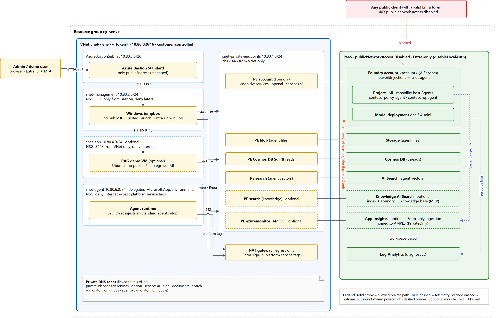
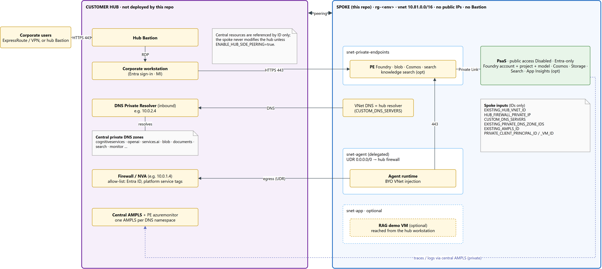
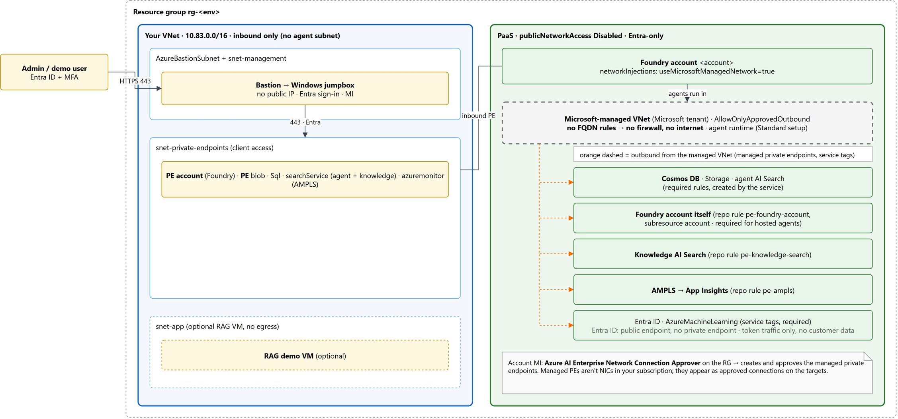

# Private networking for Microsoft Foundry — reference deployment

Security-first reference deployment of **Microsoft Foundry** with private connectivity, deployed with the
**Azure Developer CLI (`azd`)** and Bicep: private endpoints and private DNS for every data plane, Entra ID
only, agents with BYO VNet injection and Standard agent setup, and four network options from a quick public
demo to an enterprise hub-spoke spoke.

> [!IMPORTANT]
> **Sample / reference implementation — not an official Microsoft product.** It is provided "as is" under the
> [MIT License](LICENSE), without warranty and without any Microsoft support commitment or SLA. Review,
> test and adapt it to your own security, compliance and operational requirements before any production use.
> Features marked **preview** are subject to the
> [Supplemental Terms of Use for Microsoft Azure Previews](https://azure.microsoft.com/support/legal/preview-supplemental-terms/).
> All options were **validated live in Sweden Central (`swedencentral`) between 17 and 24 November 2026**;
> Foundry networking changes often — re-validate in your region before you rely on a capability.

## What you get

- Current Foundry resource model (`Microsoft.CognitiveServices/accounts` kind `AIServices` + projects) —
  **no legacy Foundry hub** (`MachineLearningServices` hub workspace). In this repository "hub" otherwise
  always means the **network** hub of a hub-spoke topology.
- **Public network access disabled** on every data plane; private endpoints + private DNS (all profiles
  except the explicitly labelled `public` quick-demo profile).
- **Entra ID only** — key/local auth disabled everywhere; no secrets in code or outputs.
- **BYO VNet agent isolation** with **Standard agent setup** (Cosmos DB, Storage, AI Search in your tenant,
  behind private endpoints); Microsoft-managed agent network as a **preview** alternative.
- Optional modules: private AI Search, RAG web app, prompt agent with the Azure AI Search tool, agent traces
  over Azure Monitor Private Link Scope, Foundry IQ, and a hosted agent (Agent Framework) deployed from an
  in-network runner.
- Preflight checks that fail **before** deployment on unsupported combinations, offline tests in CI, and a
  live validation script that proves isolation with *valid* tokens from public networks.

## Architecture

All private options share the same core (Foundry account + project, private endpoints, private DNS,
Entra-only, Standard agent setup). They differ in **where admin access, DNS, egress and the agent network
live**. This repository always deploys the **workload** network; it never deploys a production hub.

**A. Standalone (default)** — one self-contained VNet with Bastion, a jumpbox, private endpoints, the
injected agent subnet and a NAT gateway for controlled egress; private DNS zones created and linked locally.
For demos, proofs of concept and isolated workloads.



**B. Hub-spoke** — the workload spoke behind your hub (firewall, central DNS, central AMPLS). The spoke holds
only private endpoints, the agent subnet and the optional app subnet; no Bastion, jumpbox or public IP.
Admin access, DNS (Private Resolver + central `privatelink.*` zones), egress (UDR `0/0` → hub firewall) and
the Azure Monitor Private Link Scope belong to the hub. For enterprise landing zones.



**F. Managed VNet for agents (preview)** — inbound identical to A/B (private endpoints in your VNet); the
agent runtime runs in a Microsoft-managed VNet (`AllowOnlyApprovedOutbound`) and reaches Cosmos DB, Storage,
AI Search and AMPLS through managed private endpoints. No agent subnet or egress firewall to operate, but no
egress logs; preview and irreversible per account.



Also available: **C. spoke-ready** (the hub-spoke spoke deployed in isolation and connected later,
[handover runbook](docs/spoke-ready-handover.md)) and **G. public quick demo** — **not private** by design
(IP allow-list + Entra-only, synthetic data only, [details](docs/public-quick-demo.md)).

Editable diagrams: [architecture.drawio](docs/img/architecture/architecture.drawio) (three pages) and Mermaid
in [docs/architecture/architecture.md](docs/architecture/architecture.md).

**Read first:** [Deployment options — public to fully private, incl. hosted agents](docs/foundry-deployment-options.md)
([PDF](docs/foundry-deployment-options.pdf)) · [Whitepaper: networking and identity architecture](docs/whitepaper/foundry-private-networking-whitepaper.md)
([PDF](docs/whitepaper/foundry-private-networking-whitepaper.pdf))

## Security characteristics

| | |
|---|---|
| Inbound | Private endpoints only (Foundry `account`, `blob`, `Sql`, `searchService`; optional knowledge `searchService` and `azuremonitor` via AMPLS); `publicNetworkAccess: Disabled`; ACL deny |
| DNS | 6 private DNS zones for the core, plus the Azure Monitor zones for advanced monitoring (or your central zones in hub-spoke) |
| Auth | Entra ID; `disableLocalAuth` on Foundry, Cosmos DB, Search, Log Analytics; Storage shared key off |
| Outbound | Subnets private by default; explicit NAT (standalone) or hub firewall (hub-spoke); agent subnet NSG denies Internet except platform service tags |
| Admin access | Standalone: Bastion Standard + Entra ID sign-in to a jumpbox with no public IP. Hub-spoke: your hub path; an existing hub VM can be the private client (`PRIVATE_CLIENT_VM_ID`) |
| RBAC | Least privilege; never Owner/Contributor/User Access Administrator to workloads — see [identity and RBAC](docs/identity-rbac.md) |

Control matrix and documented exceptions: [security design](docs/security/security-design.md) ·
[threat model](docs/security/threat-model.md)

## Prerequisites

- Azure subscription; deployer with **Owner** or **Contributor + Role Based Access Control Administrator**
- Azure CLI ≥ 2.70, Bicep ≥ 0.49, `azd` ≥ 1.37, PowerShell 7.4 (`pwsh`)
- Region with Foundry Agent Service + BYO VNet support and model quota (validated: **swedencentral**)
- Resource providers `Microsoft.CognitiveServices`, `Microsoft.App`, `Microsoft.ContainerService`,
  `Microsoft.Network`, `Microsoft.Compute`, `Microsoft.Storage`, `Microsoft.DocumentDB`, `Microsoft.Search`,
  `Microsoft.OperationalInsights`, `Microsoft.Insights`, `Microsoft.DevTestLab` (preflight checks them)

## Quick start

```powershell
azd auth login; az login
azd env new contoso-standalone --location swedencentral
azd provision                                  # runs preflight, then deploys (~15 min)
pwsh ./scripts/validation/Test-Deployment.ps1  # network, identity, public-negative and in-VNet tests
```

Connect: Azure portal → `vm-jump-*` → **Connect** → **Bastion** → Microsoft Entra ID; then open
`https://ai.azure.com` on the jumpbox. Step by step: [walkthrough](docs/walkthrough.md).

## Deployment options (profiles)

Every option is an **azd environment** (one resource group `rg-<env>` with its own VNet, Foundry account and
project), configured from a sample profile in `examples/`. Pick names per the
[naming conventions](docs/naming-conventions.md) and don't reuse a just-deleted environment name.

| # | Option | Profile | Create the environment | Validated live |
|---|---|---|---|---|
| A | **Standalone** (default): own VNet, Bastion, Windows jumpbox, NAT egress, BYO VNet agents | [standalone-bastion.env](examples/standalone/standalone-bastion.env) | `azd env new contoso-standalone --location swedencentral` | ✔ |
| B | **Hub-spoke**: spoke peered to your hub, central DNS, UDR to your firewall, no public IPs | [hub-spoke.env](examples/hub-spoke/hub-spoke.env) | `azd env new contoso-spoke --location swedencentral` | ✔ |
| C | **Spoke-ready**: private spoke for a later handover, models only, no access path yet | [spoke-ready.env](examples/hub-spoke/spoke-ready.env) | `azd env new contoso-spokeready --location swedencentral` | ✔ |
| D | **Standalone + AI Search** (module 1) | [ai-search.env](examples/private-rag/ai-search.env) | `azd env new contoso-standalone --location swedencentral` | ✔ |
| E | **Full demo**: standalone + optional modules 1–6 | [full-demo.env](examples/private-rag/full-demo.env) | `azd env new contoso-standalone --location swedencentral` | ✔ |
| E | Full demo with Foundry IQ **query planning** over a shared private link | [full-demo-query-planning.env](examples/private-rag/full-demo-query-planning.env) | `azd env new contoso-standalone --location swedencentral` | ✔ |
| E+ | **Full demo + hosted agent** (module 7) | [full-demo-hosted.env](examples/private-rag/full-demo-hosted.env) | `azd env new contoso-standalone --location swedencentral` | ✔ |
| F | **Managed VNet (preview)**: like E, agents in a Microsoft-managed network | [managed-vnet.env](examples/managed-vnet/managed-vnet.env) | `azd env new contoso-mvnet --location swedencentral` | ✔ (preview) |
| G | **Public quick demo — NOT private**: IP allow-list, Entra-only, Basic agents, no VNet/VMs, ~4 min | [public-quick-demo.env](examples/public/public-quick-demo.env) | `azd env new contoso-public --location swedencentral` | ✔ |

Load a profile into the selected environment, then provision (PowerShell):

```powershell
Get-Content examples/standalone/standalone-bastion.env | ? { $_ -match '^([^#=]+)=(.*)$' } | % { azd env set $Matches[1] $Matches[2] }
azd provision
```

Option-specific inputs:

- **B. Hub-spoke** — from the network team: hub VNet ID, firewall private IP, DNS resolver inbound IP, the
  central private DNS zone IDs and (optional) the central AMPLS ID:

  ```powershell
  azd env set EXISTING_HUB_VNET_ID "/subscriptions/<sub>/resourceGroups/<rg>/providers/Microsoft.Network/virtualNetworks/<hub-vnet>"
  azd env set HUB_FIREWALL_PRIVATE_IP 10.0.1.4
  azd env set CUSTOM_DNS_SERVERS 10.0.2.4
  azd env set EXISTING_PRIVATE_DNS_ZONE_IDS "<zone-id-1>,<zone-id-2>,..."   # 6 zones, comma-separated
  azd env set VNET_ADDRESS_PREFIX 10.81.0.0/16                              # + PE_/AGENT_SUBNET_PREFIX, no overlap with the hub
  # optional: an existing VM in the hub runs the post-provision steps and tests
  azd env set PRIVATE_CLIENT_VM_ID "/subscriptions/<sub>/resourceGroups/<rg>/providers/Microsoft.Compute/virtualMachines/<vm>"
  azd env set PRIVATE_CLIENT_PRINCIPAL_ID <object ID of that VM's managed identity>
  ```

  The hub → spoke peering is created by the network team, or by this repository only with
  `ENABLE_HUB_SIDE_PEERING=true` (needs Network Contributor on the hub VNet). Firewall allow-list and DNS
  forwarding: [deployment options, option B](docs/foundry-deployment-options.md#6-option-b--hub-spoke).
- **C. Spoke-ready** — nobody can reach it after deployment, by design. After peering,
  `pwsh ./scripts/handover/Switch-ToCentralDns.ps1` moves the private endpoint DNS records into the central
  zones ([runbook](docs/spoke-ready-handover.md)). Set `OUTBOUND_NETWORK_MODE=byoVnet` **before** the first
  provision if the spoke will need agents.
- **F. Managed VNet (preview)** — preflight requires `MANAGED_VNET_PREVIEW_ACK=true` and a supported region;
  preview API, irreversible for the account, no customer firewall or egress logs for agents
  ([trade-offs](docs/modules/managed-vnet.md)).
- **G. Public quick demo** — `azd env set PUBLIC_ALLOWED_IPS (Invoke-RestMethod https://api.ipify.org)`;
  preflight requires `PUBLIC_NETWORK_ACCESS_ACK=true`. Synthetic data only ([guardrails](docs/public-quick-demo.md)).

Operator reference for every mode: [deployment guide](docs/deployment-guide.md).

## Optional modules

Modules can be added to a new **or an already running** environment: set the switch, run `azd provision`
again. They work in standalone and hub-spoke (hub-spoke needs `PRIVATE_CLIENT_VM_ID` for the post-provision
steps).

| Module | Enable | Requires | What you get | Doc |
|---|---|---|---|---|
| 1 AI Search | `ENABLE_AI_SEARCH=true` | — | Private knowledge search (Basic, Entra-only) with a seeded sample index | [ai-search.md](docs/modules/ai-search.md) |
| 3 RAG demo app | `ENABLE_RAG_DEMO=true` | module 1 | Private web app on an Ubuntu VM (no public IP, no internet egress) | [rag-demo.md](docs/modules/rag-demo.md) |
| 4 Demo agent | `ENABLE_AGENT_DEMO=true` | module 1, `byoVnet` | Prompt agent with the Azure AI Search tool and citations | [agent-demo.md](docs/modules/agent-demo.md) |
| 5 Advanced monitoring | `ENABLE_ADVANCED_MONITORING=true` (hub-spoke: `EXISTING_AMPLS_ID`) | — | Agent traces in Entra-only App Insights, AMPLS (private query), alerts, saved queries | [monitoring.md](docs/modules/monitoring.md) |
| 6 Foundry IQ | `ENABLE_FOUNDRY_IQ=true` (+ optional `FOUNDRY_IQ_REASONING=low` for query planning) | module 1, `byoVnet` | Knowledge base over the private index + MCP agent; query planning over an approved shared private link | [foundry-iq.md](docs/modules/foundry-iq.md) |
| 7 Hosted agent demo | `ENABLE_HOSTED_AGENT_DEMO=true` | module 6, a private client, `byoVnet`/`managedVnet` | Toolbox + hosted agent (Agent Framework) deployed by azd from the private client; guardrails (agent level: **preview**) | [hosted-agent-demo.md](docs/modules/hosted-agent-demo.md) |

Example: `azd env set ENABLE_AI_SEARCH true; azd env set ENABLE_AGENT_DEMO true; azd provision`.

**Decided at account creation (can't change later):** `OUTBOUND_NETWORK_MODE` (`byoVnet` = agents with
Standard setup, `managedVnet` = preview, `none` = models only), the agent subnet and the VNet address plan.
All settings: [infra/main.parameters.json](infra/main.parameters.json) and the [deployment guide](docs/deployment-guide.md).

## Validation

| Layer | Command | Azure needed |
|---|---|---|
| Bicep build + lint | `az bicep build -f infra/main.bicep; az bicep lint -f infra/main.bicep` | no |
| Address plan, parameters, static security for every profile | `Invoke-Pester tests` | no |
| What-if | `azd provision --preview` | yes |
| Live: network, identity, public negatives (with a valid token), in-VNet functional tests | `pwsh scripts/validation/Test-Deployment.ps1` | yes |

Negative tests call the public endpoints **with a valid token** and only pass on a *network* rejection
(403 + public-access/firewall error); a 401 is reported as inconclusive.

| Profile | Latest live result | Date |
|---|---|---|
| Standalone, all optional modules + Foundry IQ query planning, all trusted-service exceptions off | 101/101 | 2026-11-19 |
| Standalone full demo + hosted agent module (`full-demo-hosted.env`) | 103/103 | 2026-11-24 |
| Hub-spoke (lab hub with Azure Firewall, DNS Private Resolver, central DNS zones and AMPLS), all optional modules, trusted-service exceptions off | 91/91 + hosted agent | 2026-11-23 |
| Managed VNet (preview), standalone + all optional modules, trusted-service exceptions off | 105/105 + hosted agent | 2026-11-23 |
| Public quick demo, allow-listed IP + outsider rejected | 14/14 | 2026-11-19 |
| Spoke-ready: isolation, then handover with `Switch-ToCentralDns.ps1` | 20/20 isolation, 30/30 after handover | 2026-11-18 |

All live results: region Sweden Central.

## Cleanup

```powershell
azd down --purge --force          # or: pwsh ./scripts/cleanup/Remove-Environment.ps1
```

A `predown` hook ([scripts/cleanup/predown.ps1](scripts/cleanup/predown.ps1)) runs the required order before
azd deletes the resource group: it unlinks AMPLS scoped resources, deletes and purges the Foundry account
(needed to release the agent subnet; ~20 min), and refuses to run if the az CLI is on a different
subscription than the environment. Don't reuse an account name right after a purge
([troubleshooting](docs/troubleshooting.md)). Details and cost: [cost estimation](docs/cost-estimation.md#teardown).

## Known limitations

- Agent outbound mode is fixed at account creation; changing it requires redeploying Foundry.
- Managed VNet is **preview**: preview-only API, irreversible, no egress logging ([module doc](docs/modules/managed-vnet.md)).
- Bastion requires a Standard public IP (managed ingress only); the NAT gateway public IP is egress-only.
- Public-endpoint agent tools (Bing, web search, SharePoint) are excluded from the private profiles.
- The Foundry portal is a public web app; its data-plane calls work only from a network that resolves the
  private endpoints (jumpbox / hub-connected workstation).
- Full list: [private-networking limitations](docs/private-networking-limitations.md) ·
  [compatibility](docs/compatibility.md) · [troubleshooting](docs/troubleshooting.md).

## Documentation

| Topic | Documents |
|---|---|
| Choosing an option | [Deployment options](docs/foundry-deployment-options.md) ([PDF](docs/foundry-deployment-options.pdf)) · [Whitepaper](docs/whitepaper/foundry-private-networking-whitepaper.md) ([PDF](docs/whitepaper/foundry-private-networking-whitepaper.pdf)) · [Cost estimation](docs/cost-estimation.md) |
| Deploying | [Deployment guide](docs/deployment-guide.md) · [Walkthrough](docs/walkthrough.md) · [Naming conventions](docs/naming-conventions.md) · [Spoke-ready handover](docs/spoke-ready-handover.md) · [Public quick demo](docs/public-quick-demo.md) |
| Architecture | [Architecture](docs/architecture/architecture.md) · [ADR 0001: Foundry resource architecture](docs/adr/0001-foundry-resource-architecture.md) · [Compatibility](docs/compatibility.md) |
| Networking | [Private DNS](docs/private-dns.md) · [Private Link explained](docs/private-link-explained.md) · [Network directions](docs/network-directions.md) · [Private-networking limitations](docs/private-networking-limitations.md) |
| Security | [Security design](docs/security/security-design.md) · [Threat model](docs/security/threat-model.md) · [Identity and RBAC](docs/identity-rbac.md) |
| Modules | [AI Search](docs/modules/ai-search.md) · [RAG demo](docs/modules/rag-demo.md) · [Agent demo](docs/modules/agent-demo.md) · [Monitoring](docs/modules/monitoring.md) · [Foundry IQ](docs/modules/foundry-iq.md) · [Hosted agent](docs/modules/hosted-agent-demo.md) · [Managed VNet](docs/modules/managed-vnet.md) |
| Operations | [Troubleshooting](docs/troubleshooting.md) |

## Contributing, security and license

- Contributions: [CONTRIBUTING.md](CONTRIBUTING.md) · [Code of conduct](CODE_OF_CONDUCT.md)
- Security issues: report privately, see [SECURITY.md](SECURITY.md) — not through public issues.
- License: [MIT](LICENSE).

## Trademarks

This project may contain trademarks or logos for projects, products or services. Microsoft, Azure and related
marks are trademarks of the Microsoft group of companies. Use of Microsoft trademarks or logos must follow
[Microsoft's Trademark & Brand Guidelines](https://www.microsoft.com/legal/intellectualproperty/trademarks/usage/general)
and must not cause confusion or imply Microsoft sponsorship. Any use of third-party trademarks or logos is
subject to those third parties' policies.
