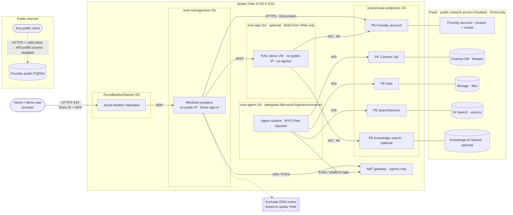
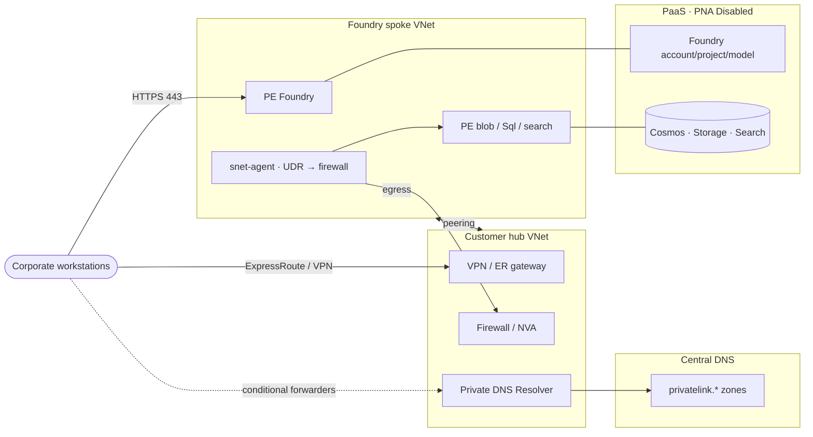

# Architecture

> Diagrams are maintained as code: [`architecture.mmd`](architecture.mmd) (standalone),
> [`architecture-hub-spoke.mmd`](architecture-hub-spoke.mmd) (hub-spoke) and the editable
> draw.io file [`architecture.drawio`](../img/architecture/architecture.drawio) (three pages: standalone, hub-spoke, managed VNet). Update all three when the topology changes. Decisions are recorded in [`../adr/`](../adr/).

## 1. Standalone private Foundry with Bastion (default)

## 2. Enterprise hub-spoke integration

## 3. Components and why they exist

| Component | Why |
|---|---|
| **Foundry account** (`Microsoft.CognitiveServices/accounts`, kind `AIServices`, API `2026-09-01`) | Current Foundry resource model. Hosts projects, model deployments, connections and capability hosts. No legacy hub / ML workspace. |
| **Foundry project** | Unit of isolation for agents, connections and data. System-assigned MI used by Agent Service to reach the BYO resources. |
| **Model deployment** | Parameterised (`MODEL_*`). Default `gpt-5.4-mini` / `DataZoneStandard` keeps processing in the EU data zone. |
| **Private endpoint (`account`)** | The only inbound path to the Foundry data plane. One PE serves three FQDN families: `*.cognitiveservices.azure.com`, `*.openai.azure.com`, `*.services.ai.azure.com`. |
| **Private DNS zones** | Without them clients resolve the public IP and are rejected (403). DNS is what makes the *same* URL work privately. |
| **Agent subnet + `networkInjections`** | BYO VNet outbound isolation: the agent runtime runs inside a customer subnet, so its traffic to Cosmos/Storage/Search uses their private endpoints and is subject to customer NSGs/UDRs/firewalls. Must be set at account creation. |
| **Cosmos DB / Storage / AI Search** (Standard agent setup) | Conversation history, files and vector stores live in the customer tenant, behind private endpoints, Entra-only. |
| **Capability host (project)** | Tells Agent Service which BYO connections to use. The account-level host is created automatically by the RP from `networkInjections`. |
| **Azure Bastion (Standard)** | Browser/native-client RDP without exposing RDP. Its Standard public IP is the Bastion service's managed HTTPS ingress; not a path to workloads. |
| **Jumpbox** | A client *inside* the network boundary, for demos and for the automated in-VNet tests (Run Command + managed identity). |
| **NAT gateway** (standalone only) | Explicit, outbound-only egress for Entra sign-in / portal UI (jumpbox) and Entra / platform endpoints (agent runtime). NSGs restrict it to HTTPS (+HTTP/KMS for the jumpbox). Subnets are private by default. |
| **Log Analytics** | Resource logs/metrics for Foundry, Bastion, Cosmos, Storage, Search. Local auth disabled. |

## 4. How Foundry reaches its dependencies

1. A user/app calls `https://<acct>.services.ai.azure.com/api/projects/
/…` → resolves to the
   account PE → Foundry (inbound).
2. For agent runs, Foundry schedules work on the **injected agent runtime in `snet-agent`**.
3. The runtime reaches Cosmos DB / Storage / AI Search via **their private endpoints** in
   `snet-private-endpoints`, authenticating with the **project managed identity**.
4. The runtime needs Entra ID (token acquisition) and Azure Container Apps platform endpoints: these
   go through NAT (standalone) or the hub firewall (hub-spoke) and are limited by NSG service tags.
5. Model inference is executed inside the Foundry service; no customer-side egress is involved.

## 5. Network isolation vs. RBAC

They are independent layers and both are required:

| Layer | Question it answers | Enforced by |
|---|---|---|
| Network isolation | *Can the packet reach the service?* | `publicNetworkAccess: Disabled`, ACL deny, PEs, NSGs, DNS |
| Authentication | *Who is calling?* | Entra ID only (`disableLocalAuth`, no keys) |
| Authorization | *What may they do?* | Azure RBAC (Foundry User, OpenAI User, data-plane roles) |

A request from the internet with a **valid** token is still rejected (network layer). A request
from the VNet **without** a role assignment is still rejected (authorization layer). The
validation suite tests both, and treats a public 401 as *inconclusive* rather than as proof of
isolation.

## 6. Bastion and jumpbox are optional in hub-spoke

Enterprises already have a private access path (ExpressRoute/VPN + hub DNS). Adding Bastion would
create a new public IP in the spoke, which most landing-zone policies forbid. In `hub-spoke`
mode the repo therefore creates **no public IPs**; access is through the customer's hub.

## 7. Integrating the spoke into a landing zone

See [option B in the deployment options](../foundry-deployment-options.md#6-option-b--hub-spoke): address plan, peering (spoke side by default,
hub side opt-in), UDR to the hub firewall, centralised DNS (`PRIVATE_DNS_ZONE_MODE=existing`),
firewall allow-list, DNS forwarding for on-premises clients, the central AMPLS (`EXISTING_AMPLS_ID`) and
an existing private client for hooks and tests (`PRIVATE_CLIENT_VM_ID` / `PRIVATE_CLIENT_PRINCIPAL_ID`).

## 8. Outbound network modes

| Mode | Status | Notes |
|---|---|---|
| `byoVnet` | **Default, implemented** | Standard agent setup + VNet injection (this document). |
| `managedVnet` | **Implemented, PREVIEW** (validated live 2026-11-19) | Microsoft-managed VNet with `AllowOnlyApprovedOutbound`, no FQDN rules, Standard setup; no `snet-agent`. Requires `MANAGED_VNET_PREVIEW_ACK=true`. See [modules/managed-vnet.md](../modules/managed-vnet.md) |
| `none` | Implemented | Models only; adding agents later requires redeploying the Foundry account. |
