# Microsoft Foundry & hosted agents — deployment options from public to fully private


**Audience:** customer architects and security teams who need to decide how Microsoft Foundry and its
agents should be deployed: from a public quick demo to a fully private enterprise landing zone.
The document is self-contained; every option is described with its topology, traffic paths, DNS,
identities, security controls, live evidence, trade-offs and cost drivers.

**Basis:** the reference implementation in this repository (`azd` + Bicep, region Sweden Central) and
its live test results. Statements marked **validated live** were exercised against real Azure resources by
`scripts/validation/Test-Deployment.ps1` and the hosted-agent tests
of the repository; the latest status is from **23 November 2026**. Statements from Microsoft Learn link
to their source. **Preview** features are marked as such.

**Related documents:** [networking walk-through](networking/networking-walkthrough.md) (packet-level
detail for network architects) · [ADR 0001 Foundry resource architecture](adr/0001-foundry-resource-architecture.md) ·
[ADR 0003 hosted agents](adr/0003-hosted-agents.md) ·
[security design](security/security-design.md).

## Contents

- [Executive summary](#executive-summary)
- [1. Why: enterprise requirements](#1-why-enterprise-requirements)
- [2. Foundry resource architecture today](#2-foundry-resource-architecture-today)
- [3. The spectrum of deployment options](#3-the-spectrum-of-deployment-options)
- [4. Option G — public quick demo (not private)](#4-option-g--public-quick-demo-not-private)
- [5. Option A — standalone private (default)](#5-option-a--standalone-private-default)
- [6. Option B — hub-spoke](#6-option-b--hub-spoke)
- [7. Option C — spoke-ready](#7-option-c--spoke-ready)
- [8. Options D and E — module variants](#8-options-d-and-e--module-variants)
- [9. Option F — managed VNet for agents (preview)](#9-option-f--managed-vnet-for-agents-preview)
- [10. Private Link mechanics and private DNS](#10-private-link-mechanics-and-private-dns)
- [11. Agents in private networks](#11-agents-in-private-networks)
- [12. Security controls summary](#12-security-controls-summary)
- [13. Comparison matrix and decision guide](#13-comparison-matrix-and-decision-guide)
- [14. Validation evidence](#14-validation-evidence)
- [15. Current limitations in private networks](#15-current-limitations-in-private-networks)
- [Appendix A — Glossary](#appendix-a--glossary)
- [Appendix B — References](#appendix-b--references)

## Executive summary

**What is being compared.** Seven deployment options of the same Foundry workload, from public to fully
private: **G** public quick demo, **A** standalone private (default), **B** hub-spoke, **C** spoke-ready,
**D/E** A with optional modules (AI Search, RAG app, Foundry IQ, monitoring, demo agents), and **F**
managed VNet for agents (preview). All private options share one core: Foundry resource, project, model,
Standard agent setup, private endpoints, private DNS and Entra-only authentication.

**Key messages**

1. **The data plane can be fully private today.** A caller from the Internet holding a *valid* Entra
   token is rejected with `403 Public access is disabled` — proven live in every private option; the
   main profiles also passed with the trusted-service exception switched off (`None`).
2. **Inbound and outbound are separate decisions.** Inbound privacy comes from private endpoints, private
   DNS and `publicNetworkAccess: Disabled`. Outbound (agent egress) is either a **delegated subnet in your
   VNet** (BYO VNet, GA, egress through your NSG/NAT or firewall, logged) or a **Microsoft-managed VNet**
   (preview, `AllowOnlyApprovedOutbound`, no egress logs).
3. **Hosted agents work privately in all three private network modes** (A standalone, B hub-spoke,
   F managed VNet), validated live on 23 November 2026. They are deployed with `azd` from an
   **in-network runner**, use a project **toolbox** for tools, are guarded at two layers (agent policy
   and model deployment content filter), and need no firewall change in hub-spoke. In a managed VNet
   they require a managed private endpoint back to the Foundry account itself.
4. **DNS decides whether Private Link works.** Three Foundry FQDN families map to one private endpoint
   with three IP addresses. In hub-spoke, central `privatelink.*` zones, a DNS Private Resolver and
   conditional forwarders for the *public* zone names are required.
5. **Several choices are fixed at account creation:** the agent outbound mode (`byoVnet`,
   `managedVnet`, `none`), the agent subnet and the address plan. Decide them before the first deployment.

**Recommendation in one table**

| If the customer… | Choose | Agents |
|---|---|---|
| needs a laptop demo with synthetic data in minutes | **G** public quick demo | prompt (Basic setup) |
| needs an isolated PoC or a self-contained private workload | **A** standalone (+ modules: **D/E**) | prompt + hosted |
| runs an enterprise landing zone with a hub firewall and central DNS | **B** hub-spoke | prompt + hosted |
| must deploy before the network team can connect the spoke | **C** spoke-ready, then hand over to B | after handover |
| doesn't want to operate agent subnets and egress firewalls, accepts preview and no egress logs | **F** managed VNet (preview) | prompt + hosted |

**Evidence (current status, 23 November 2026):** standalone with all modules and all trusted-service
exceptions off **101/101**; hub-spoke **91/91** plus hosted agent; managed VNet **105/105** plus hosted
agent; standalone hosted agent with guardrails PASS; public quick demo **14/14**; spoke-ready **20/20**
isolation and **30/30** after handover.

## 1. Why: enterprise requirements

Customers who put generative AI on sensitive data typically ask for the same set of controls. The table
maps each requirement to how this design meets it.

| Requirement | How the design meets it | Where it is described |
|---|---|---|
| **No public data plane** | Private endpoints for every PaaS data plane; `publicNetworkAccess: Disabled`; network ACL `defaultAction: Deny`; trusted-service bypass optional (`None` validated) | §10, §12 |
| **Entra ID only** | `disableLocalAuth: true` on Foundry, Cosmos DB, AI Search, Log Analytics, App Insights; Storage shared key off; no keys created, listed or output | §12 |
| **Controlled egress** | Subnets without default outbound access; egress only through an explicit NAT gateway (A) or the customer hub firewall (B), restricted by NSG service tags; or managed outbound rules (F) | §5, §6, §9 |
| **Central DNS and hub integration** | Option B writes private endpoint records into the customer's central zones, uses the hub DNS Private Resolver, routes `0.0.0.0/0` to the hub firewall and joins a central Azure Monitor Private Link Scope (AMPLS) | §6, §10 |
| **Auditability** | Diagnostic settings to Log Analytics; agent traces in Entra-only App Insights behind AMPLS; firewall logs for agent egress in B; security-drift alerts | §8, §12 |
| **Least privilege** | Data-plane roles at the narrowest scope (project, database, ABAC-conditioned containers); never Owner, Contributor or User Access Administrator for workload identities | §12 |
| **Repeatable deployment** | Every option is an `azd` environment (one resource group) with a sample profile; preflight checks fail closed; offline Bicep/Pester tests and a live validation script | §14 |
| **Data residency** | Default model deployment `DataZoneStandard` (EU data zone); Standard agent setup keeps threads, files and vectors in the customer's Cosmos DB, Storage and AI Search | §2 |

**Design principles** ([security design](security/security-design.md)): no public data plane; identity
instead of keys; explicit egress; fail closed (preflight stops unsupported configurations before
deployment; the template never opens network access to make them work); least privilege.

## 2. Foundry resource architecture today

### 2.1 Foundry resource, not the hub-based model

Two Foundry resource models exist. This design uses the current one
([ADR 0001](adr/0001-foundry-resource-architecture.md)):

| | Current Foundry resource (used) | Older hub-based model (not used) |
|---|---|---|
| Resource type | `Microsoft.CognitiveServices/accounts`, kind `AIServices`, `allowProjectManagement: true`, child `accounts/projects` | `Microsoft.MachineLearningServices/workspaces` (kind `Hub` / `Project`) plus a separate AI Services account, Storage and Key Vault |
| Model deployments, connections, capability hosts | Children of the same account | Spread across workspace and account |
| Private endpoints for the platform | **One** (group `account`) serves the account, its projects and the OpenAI-compatible endpoint | One per resource |
| Outbound isolation | Agent network injection: BYO VNet or Microsoft-managed VNet | AML managed VNet |

In this document "hub" therefore always means the **network** hub of a hub-spoke topology, never a
Foundry hub. API version: `2026-09-01` (GA) for accounts, projects and deployments.

### 2.2 Control plane vs. data plane

| Plane | Endpoint | Exposure |
|---|---|---|
| Control plane (ARM) | `management.azure.com` | Public, protected by Entra ID and Azure RBAC. `azd provision` works from anywhere with the right roles |
| Data plane | `<account>.services.ai.azure.com` (project API, agents), `<account>.openai.azure.com`, `<account>.cognitiveservices.azure.com` | **Private** in options A–F (private endpoint only). Public with an IP allow-list in G |

Private Link for Azure Resource Manager exists but is uncommon and **not in scope of this template**: it
is a tenant-wide decision (root management group only), breaks Azure Bastion (`privatelink.azure.com`
overlaps `management.azure.com`), isn't supported for AKS or multi-tenant accounts, and needs Owner or
Contributor at the root management group
([Learn](https://learn.microsoft.com/azure/azure-resource-manager/management/create-private-link-access-portal)).

Consequence: everything that touches the data plane — seeding an index, creating agents, deploying a
hosted agent, running tests — must run **inside the network**. The repository uses VM Run Command (a
management-plane channel) or an in-network `azd` runner for that.

### 2.3 Agent types

| | Prompt agents | Hosted agents |
|---|---|---|
| What you provide | Instructions, model, tools (declarative definition) | Your own code (Microsoft Agent Framework, LangGraph or custom; Python or C#) |
| Who runs the agent loop | Foundry Agent Service | Your code, in a **per-session micro VM** run by Foundry |
| Where it runs (BYO VNet) | Agent runtime injected into the delegated agent subnet | Micro VM attached to the same delegated agent subnet |
| Endpoint | Project endpoint (Responses API) | `{project}/agents/{name}/endpoint/protocols/...` (Responses, Invocations, Activity, A2A) |
| Identity | Project managed identity | Dedicated, platform-created **agent identity** (Entra) plus the project managed identity for platform operations |
| Status | GA | Managed hosting **GA**; Python hosting package `agent-framework-foundry-hosting` **prerelease**; agent-level guardrails **preview** |

Sources: [What are hosted agents?](https://learn.microsoft.com/azure/foundry/agents/concepts/hosted-agents),
[ADR 0003](adr/0003-hosted-agents.md).

### 2.4 Standard agent setup

All private options use the **Standard agent setup**: conversation threads in the customer's **Cosmos
DB**, files in the customer's **Storage**, vector stores in the customer's **AI Search**, each behind a
private endpoint and Entra-only. A project **capability host** (`capabilityHostKind: Agents`) tells Agent
Service which connections to use; the account-level host is created by the resource provider from
`networkInjections`. The **Basic setup** (state in Microsoft-managed storage) is used only by the public
quick demo (G).

### 2.5 Decisions fixed at account creation

| Decision | Values | Changeable later? |
|---|---|---|
| Agent outbound mode (`OUTBOUND_NETWORK_MODE`) | `byoVnet` (default, GA) · `managedVnet` (**preview**) · `none` (models only) | **No.** Requires a new Foundry account (new environment). A managed network can't be disabled; there is no BYO → managed upgrade path |
| Agent subnet | Dedicated subnet delegated to `Microsoft.App/environments`, one account per subnet | **No** |
| VNet address plan | Must avoid the Agent Service reserved ranges (see §15) | **No** for a deployed environment |
| Network mode (`NETWORK_MODE`) | `standalone` · `hub-spoke` · `spoke-ready` · `public` | Spoke-ready → hub-spoke by a documented handover; otherwise redeploy |

Recommendation: choose `byoVnet` even for a models-only start unless the customer has decided against
agents. Adding agents to a `none` account means redeploying Foundry.

## 3. The spectrum of deployment options

Every option is an **`azd` environment**: one resource group with its own VNet (except G), Foundry account
and project. Settings are environment variables loaded from a sample profile in `examples/`.

| # | Option | Private? | Inbound to the data plane | Agent egress | DNS | Admin / client access | Typical deploy time |
|---|---|---|---|---|---|---|---|
| **G** | Public quick demo | **No** | Public endpoint, IP allow-list, Entra-only | None in the customer network (Basic setup) | Public | Allowed laptop IPs | ~4 min |
| **A** | Standalone (default) | Yes | Private endpoints in the workload VNet | Delegated subnet → NSG service tags → NAT gateway | Local private zones | Bastion → jumpbox (no public IP) | ~15 min (core) |
| **B** | Hub-spoke | Yes | Private endpoints in the spoke, reached over peering | Delegated subnet → UDR `0/0` → hub firewall | Central zones + DNS Private Resolver | Customer hub (VPN/ExpressRoute, hub Bastion, hub workstation) | ~29 min (all modules) |
| **C** | Spoke-ready | Yes | Private endpoints, unreachable until handover | None until handover (sample: models only) | Local zones → central after handover | None in phase 1 (by design) | ~3.5 min (models only) |
| **D / E** | A + AI Search / A + all modules | Yes | As A, plus knowledge search and AMPLS endpoints | As A | As A | As A, plus private RAG app | ~25–30 min (E) |
| **F** | Managed VNet for agents (**preview**) | Yes | As A (private endpoints in your VNet) | Microsoft-managed VNet, `AllowOnlyApprovedOutbound`, managed private endpoints | As A | As A | as E |

| # | Prompt agents | Hosted agents | Latest live validation |
|---|---|---|---|
| G | ✔ Basic setup | not validated in this profile | 14/14 (2026-11-19) |
| A | ✔ | ✔ validated | 101/101 (2026-11-19); hosted agent + guardrails PASS (2026-11-23) |
| B | ✔ | ✔ validated | 91/91 + hosted agent PASS (2026-11-23) |
| C | after handover (sample is models only) | after handover | 20/20 isolation, 30/30 after handover (2026-11-18) |
| D / E | ✔ (demo agents included) | ✔ (E is the base of the hosted-agent tests) | E: see A |
| F | ✔ | ✔ validated | 105/105 + hosted agent PASS (2026-11-23) |

The following chapters describe each option with the same structure: purpose, topology, traffic paths
and DNS, identity and controls, live evidence, and trade-offs, limitations and cost.

## 4. Option G — public quick demo (not private)

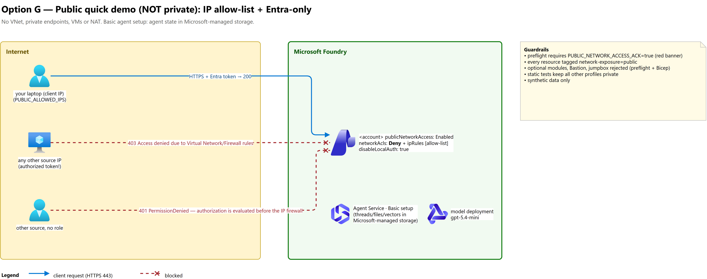

*Figure 1 — Option G: no VNet. The Foundry account is public but restricted to an IP allow-list and
Entra ID. Agents use the Basic setup (Microsoft-managed state). Use it only for synthetic demo data.*

### 4.1 Purpose and when to choose

A fast "what does Foundry do" demo from a laptop: about **4 minutes** to deploy, no VMs, no VNet, no
Bastion, minimal cost. **It is not a private deployment.** Use it only with synthetic data, never with
customer data ([public quick demo](public-quick-demo.md)).

### 4.2 Traffic paths and DNS

| Aspect | Option G |
|---|---|
| Inbound | Laptop → public Foundry endpoint. `publicNetworkAccess: Enabled`, `networkAcls.defaultAction: Deny`, `ipRules = PUBLIC_ALLOWED_IPS` (IPv4/CIDR; IPv6 clients not supported) |
| Prompt agent egress | Basic setup: no network isolation, agent state in Microsoft-managed storage |
| Hosted agent egress | Not part of this profile. ADR 0003 rates G as the simplest fit (quickstart path, public egress) but it was not validated here |
| DNS | Public DNS only; no private zones |

### 4.3 Identity, RBAC and security controls

- Entra-only: `disableLocalAuth: true`; a fake API key is rejected with 401.
- **Guardrails against accidental exposure:** `NETWORK_MODE=public` requires `PUBLIC_NETWORK_ACCESS_ACK=true`
  (red banner in preflight); `PUBLIC_ALLOWED_IPS` is validated and an empty list produces a warning;
  `OUTBOUND_NETWORK_MODE` must be `none`; every optional module, Bastion and jumpbox are rejected by
  preflight and by the Bicep; every resource is tagged `network-exposure=public`; static tests assert that
  every other profile keeps `publicNetworkAccess: Disabled`.
- **Authorization is evaluated before the IP firewall** (observed): an unauthorized caller from a
  non-allowed IP gets 401, an authorized caller from a non-allowed IP gets
  `403 Access denied due to Virtual Network/Firewall rules`. The test therefore grants the outsider a
  temporary role so that a 403 proves the network rule.

### 4.4 Validated live

**14/14 PASS (2026-11-19)**, deployed in 3 min 53 s: firewall default deny + allow-list, Entra-only, model
inference, project API, Basic agent create + run from the allowed IP; a VM with a different egress IP and
an authorized token was rejected with 403.

### 4.5 Trade-offs, limitations and cost

- **Not private**: the endpoint is on the Internet; protection relies on the IP allow-list and Entra ID.
- No private data sources, AI Search, RAG, monitoring module or Foundry IQ. The allow-list must be updated
  when the presenter's IP changes (VPN, hotel Wi-Fi).
- **Cost drivers:** model tokens and Log Analytics only; no fixed infrastructure cost.

## 5. Option A — standalone private (default)

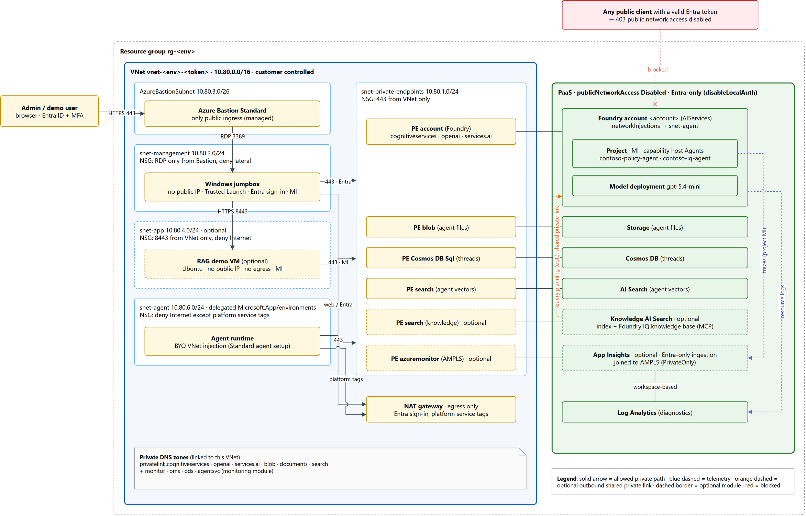

*Figure 2 — Option A, logical architecture: Bastion and jumpbox for access, private endpoints for every
PaaS data plane, the agent runtime injected into `snet-agent`, a NAT gateway for egress only, and
private DNS zones linked to this VNet. Dashed boxes are optional modules (options D/E).*

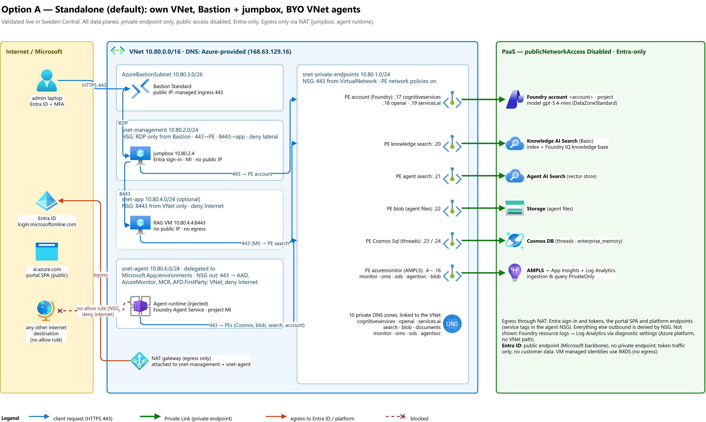

*Figure 3 — Option A, network view with the address plan: private endpoint subnet `10.80.1.0/24`,
management `10.80.2.0/24`, Bastion `10.80.3.0/26`, app `10.80.4.0/24` (optional module 3), agent
`10.80.6.0/24`. Red: the agent NSG denies Internet destinations outside the allowed
service tags.*

### 5.1 Purpose and when to choose

One self-contained VNet with everything needed to operate and test a private Foundry: private endpoints,
private DNS zones, Azure Bastion, a Windows jumpbox without public IP, a NAT gateway for controlled egress
and the delegated agent subnet. Choose it for proofs of concept, demos and isolated workloads that don't
(yet) belong to an enterprise hub.

### 5.2 Traffic paths and DNS

| Aspect | Option A |
|---|---|
| Inbound | Admin browser → Bastion Standard (managed HTTPS ingress, Entra ID + MFA) → RDP to the jumpbox (`10.80.2.4`, no public IP) → Foundry account private endpoint (`.17`/`.18`/`.19`). Not part of the baseline: optional module 3 "private app tier" (RAG VM on `10.80.4.4:8443`, full-demo profile E), reachable from the VNet only |
| Prompt agent egress | Agent runtime in `snet-agent` → Cosmos DB, Storage, agent AI Search and knowledge search through their private endpoints (project managed identity). Entra and platform endpoints: NSG service tags `AzureActiveDirectory`, `AzureMonitor`, `MicrosoftContainerRegistry`, `AzureFrontDoor.FirstParty` → NAT gateway. Internet denied |
| Hosted agent egress | Micro VM in `snet-agent` → project endpoint via the account private endpoint (model, toolbox, conversations). Tool calls run through the project **data proxy** in the agent subnet → knowledge search private endpoint. Platform egress as for prompt agents |
| DNS | `PRIVATE_DNS_ZONE_MODE=create`: six core `privatelink.*` zones (+ five Azure Monitor zones with module 5) in the workload resource group, linked to this VNet; Azure-provided DNS (`168.63.129.16`) |
| Egress | NAT gateway on `snet-agent` and `snet-management` only; private endpoint and app subnets have no egress at all |

**Why NAT and not a firewall?** A standalone deployment has no customer hub. The NAT gateway gives
deterministic, outbound-only egress for the jumpbox (portal, Entra sign-in, updates) and the agent
runtime's platform dependencies, and the agent NSG restricts the runtime to service tags. If FQDN
filtering and egress logs are required, use option B or add a firewall to the standalone VNet.

**Subnets and NSGs** (all subnets `defaultOutboundAccess: false`):

| Subnet | NSG highlights | Egress |
|---|---|---|
| `snet-private-endpoints` | In: 443 from `VirtualNetwork`, deny all. Out: deny Internet. Private endpoint network policies enabled | — |
| `snet-management` (jumpbox) | In: 3389 from the Bastion subnet only. Out: 443 → PE subnet, app port → `snet-app`, 443/80 + KMS 1688 → Internet, deny other VNet traffic (lateral movement) | NAT |
| `AzureBastionSubnet` | Platform-mandated Bastion rule set | Bastion public IP |
| `snet-app` (RAG VM, optional module 3 only) | In: 8443 from `VirtualNetwork` only. Out: deny Internet | **None** |
| `snet-agent` (delegated `Microsoft.App/environments`) | Out: 443 → the four service tags above; all → `VirtualNetwork`; deny Internet | NAT |

### 5.3 Identity, RBAC and security controls

- Jumpbox: Windows Server 2025, Trusted Launch, Entra ID sign-in (`AADLoginForWindows`) with
  *Virtual Machine User Login* (non-admin) plus *Reader* on the VM, its NIC and Bastion (required to connect
  through Bastion), random local administrator password that is never output,
  daily auto-shutdown.
- Bastion Standard: Entra ID + MFA/Conditional Access; no shareable links, IP connect or file copy.
- Demo user: *Foundry User* on the **project** (not the account), *Cognitive Services OpenAI User* on the
  account. Project managed identity: data-plane roles on the Standard setup resources (see §12.3).
- Documented exceptions: the Bastion Standard public IP (managed HTTPS ingress only) and the NAT gateway
  public IP (egress only, cannot accept inbound).

### 5.4 Validated live

- **101/101** full run (2026-11-19) with all optional modules, Foundry IQ query planning and **both
  trusted-service exceptions set to `None`**; earlier 97/97 with the default bypass.
- **Hosted agent** (2026-11-23): `azd deploy` from the jumpbox in 2 min 37 s; private invoke with
  citation; toolbox calls from the data proxy; jailbreak blocked at the agent layer and at the model layer;
  Internet `403`.
- End-to-end user test through Bastion and the jumpbox (with module 3, profile E): the private RAG app
  answered all questions with citations; the same URL from outside the VNet was unreachable, as designed.

### 5.5 Trade-offs, limitations and cost

| Pro | Con |
|---|---|
| Self-contained, fastest private option, no dependency on a network team | Own Bastion and NAT public IPs (documented exceptions; landing-zone policies may forbid them) |
| Full control of NSGs; agent egress restricted to service tags | No FQDN filtering and no egress logs without an added firewall; service tags such as `AzureFrontDoor.FirstParty` are broad |
| Same core as B, so a later move to a hub is a redeployment with the same profile logic | Jumpbox can browse the Internet on 443/80 (portal and updates); restrict with a proxy or firewall if required |

**Cost drivers:** Bastion Standard is the largest fixed item, followed by the jumpbox (reduced by
auto-shutdown), the agent AI Search (Basic), the NAT gateway plus data, one charge per private endpoint
and Cosmos DB throughput. Model tokens are variable and small for demos. Deleting Bastion between demos
is the biggest saving.

## 6. Option B — hub-spoke

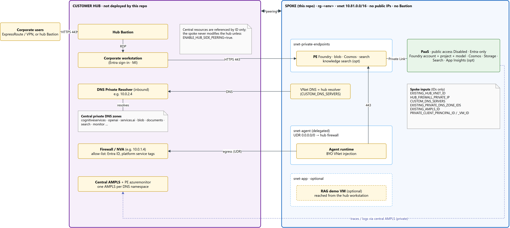

*Figure 4 — Option B, logical architecture: the spoke is peered to the customer hub; DNS, egress, admin
access and AMPLS are hub services.*

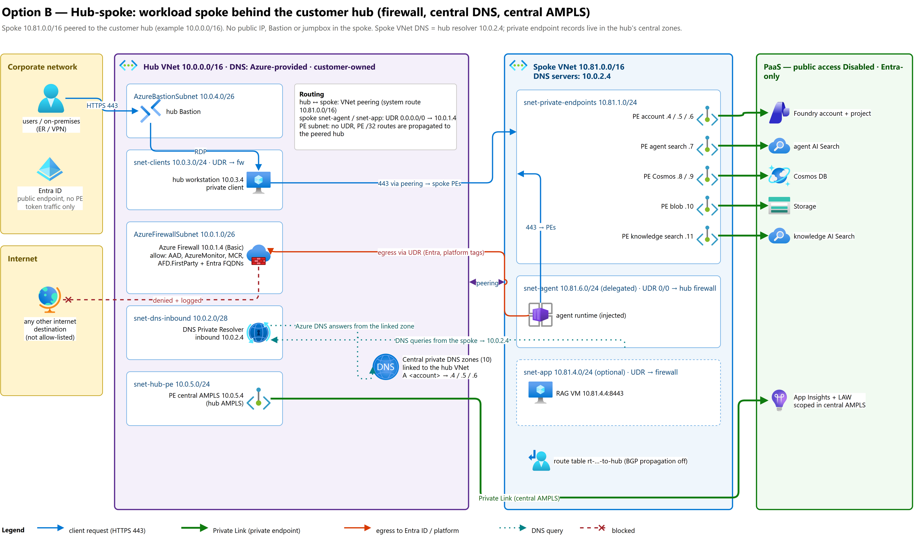

*Figure 5 — Option B, network view: hub `10.0.0.0/16` (firewall `10.0.1.4`, resolver inbound
`10.0.2.4`, workstation `10.0.3.4`, central AMPLS endpoint `10.0.5.4`) and spoke `10.81.0.0/16`. Red: the
firewall denies and logs every destination that isn't on its allow-list.*

### 6.1 Purpose and when to choose

The workload is a **spoke** behind the customer's existing hub. The spoke contains only private
endpoints, the agent subnet and the optional app subnet: **no Bastion, no jumpbox, no public IP**. Admin
access, DNS, egress and Azure Monitor Private Link Scope belong to the hub. Choose it for enterprise
landing zones. The repository never deploys a production hub; it was validated against a **reference hub** (Azure Firewall Basic, DNS Private Resolver, central private DNS zones, central AMPLS, a hub
workstation behind a hub Bastion).

### 6.2 Traffic paths and DNS

| Aspect | Option B |
|---|---|
| Inbound | Corporate client (ExpressRoute/VPN) or hub workstation → peering → spoke private endpoints. Each private endpoint IP is a `/32` route in its VNet and peered VNets; together with the peering route it takes priority over the hub's `0/0` UDR, so **this traffic doesn't cross the firewall**. Inspection would need UDRs at least as specific as the spoke address space, private endpoint network policies for route tables on the endpoint subnet, and SNAT on the firewall (not part of the template, §10.3) |
| Prompt agent egress | Agent runtime → spoke private endpoints (in-VNet routes, never via the firewall). Entra and platform: UDR `0.0.0.0/0` → hub firewall (BGP propagation off), allow-list below |
| Hosted agent egress | Micro VM → spoke account private endpoint (model, toolbox), → central AMPLS endpoint over the peering (telemetry): **not in the firewall log**. Tool calls via the data proxy. Only platform egress reaches the firewall (§11.6) |
| DNS | `PRIVATE_DNS_ZONE_MODE=existing`: private endpoint zone groups write A records into the **central** zones (`EXISTING_PRIVATE_DNS_ZONE_IDS`); no zones in the spoke. Spoke DNS servers = resolver inbound IP. On-premises: conditional forwarders for the **public** zone names to the resolver |
| Monitoring | App Insights and Log Analytics join the **central AMPLS** (`EXISTING_AMPLS_ID`); the spoke creates no AMPLS endpoint (one AMPLS per DNS scope) |

**Minimum firewall allow-list for the agent subnet** ([hub integration](hub-integration.md), from Learn):

| Purpose | FQDN / service tag | Port |
|---|---|---|
| Entra ID tokens | `login.microsoftonline.com`, `*.login.microsoftonline.com`, `*.login.microsoft.com`, or tag `AzureActiveDirectory` | 443 |
| Managed identity (Container Apps) | `*.identity.azure.net`, `control-{region}.identity.azure.net` | 443 |
| Container platform | tags `MicrosoftContainerRegistry`, `AzureFrontDoor.FirstParty` | 443 |
| Monitoring | tag `AzureMonitor` | 443 |

Do **not** allow `Internet` broadly. Public-endpoint tools (Bing, web search, SharePoint grounding) are
intentionally excluded from the private profiles.

**Entra ID:** Entra ID has no private endpoint. Token traffic goes to the public Entra endpoints
(`AzureActiveDirectory` service tag / login FQDNs above) over the Microsoft backbone and carries no
customer data. VM managed identities use IMDS (host-local, no egress); platform identities get their
tokens inside the service.

**What the network team provides:** hub VNet ID, firewall private IP, resolver inbound IP, the central
zone IDs (three Foundry zones + blob, documents, search), optionally the central AMPLS ID and an existing
VM as private client (`PRIVATE_CLIENT_VM_ID`) that runs the post-provision steps and tests via Run
Command. The hub → spoke peering is created by the network team, or by the template only with
`ENABLE_HUB_SIDE_PEERING=true` (needs *Network Contributor* on the hub VNet).

### 6.3 Identity, RBAC and security controls

- As A for the workload identities. The private client VM's managed identity receives the scoped
  validation roles; remove them after acceptance (`GRANT_JUMPBOX_VALIDATION_ROLES=false`).
- Deployer additionally needs *Private DNS Zone Contributor* (or record write + join) on the central zones,
  and write access on the central AMPLS when module 5 is used.
- Landing-zone policies supported: deny public IPs, deny public network access on PaaS, require private
  DNS zone groups (DINE policies produce identical records), deny local auth, require NSGs on subnets.

### 6.4 Validated live

- **91/91** full run with all optional modules and both trusted-service exceptions `None`, plus the
  **hosted agent** deployed with `azd` from the hub workstation (2026-11-23): private invoke across the
  peering with citations (cold start 6.8 s), public `403`, toolbox calls from the data proxy, agent-layer
  guardrail blocks a jailbreak.
- Hub firewall over 3 hours of spoke traffic: **no allow-list change needed** (details in §11.6).
- End-to-end user test (Parts 1–8, 2026-11-19): isolation checks from a notebook, Foundry portal over
  Private Link from the hub workstation, both agents with citations, agent traces, private RAG app.

### 6.5 Trade-offs, limitations and cost

| Pro | Con |
|---|---|
| Fits enterprise landing zones: no public IPs in the spoke, central DNS, central egress firewall with logs | Depends on the network team (peering, central zones, firewall rules, resolver) |
| Agent egress visible in the customer's firewall logs | Firewall sees only egress, not client → private endpoint traffic (unless explicitly routed) |
| One central AMPLS and DNS for all spokes | Never link a local and a central zone of the same name to one VNet; peering alone is not enough for DNS |

**Cost drivers:** no Bastion, jumpbox, NAT or public IPs and central DNS, so the spoke cost is driven by
AI Search, private endpoints, Cosmos DB and Log Analytics. Hub costs (firewall, resolver, gateways) belong
to the platform team.

## 7. Option C — spoke-ready

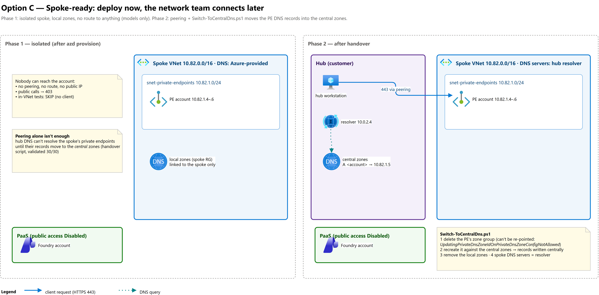

*Figure 6 — Option C: phase 1 is an isolated spoke with local private DNS zones; phase 2 peers it to the
hub and moves the private endpoint records into the central zones.*

### 7.1 Purpose and when to choose

For organisations where the workload team deploys first and the network team connects spokes later
(landing-zone vending, Azure Virtual Network Manager, change processes). Phase 1 deploys a fully private
workload that **nobody can reach yet**: no Bastion, jumpbox, peering, egress route or public IP. Phase 2
hands it over to the hub ([spoke-ready handover](spoke-ready-handover.md)).

### 7.2 Traffic paths and DNS

| Phase | State | What a client sees |
|---|---|---|
| 1 isolated | Local zones linked to the spoke only; no peering, route or client | Nobody reaches the data plane; public calls → 403. In-VNet tests are skipped by design |
| 2a peering only | Hub ↔ spoke peered | **Peering alone isn't enough:** hub DNS can't resolve the spoke's private endpoints (NXDOMAIN) until their records move to the central zones (handover script, validated 30/30) |
| 2b handover | `scripts/handover/Switch-ToCentralDns.ps1` deletes each private endpoint zone group and recreates it against the central zones, removes the local zones and sets the spoke DNS to the resolver | Private answers from the hub; identical to option B |

Zone groups can't be re-pointed in place (`UpdatingPrivateDnsZoneIdOnPrivateDnsZoneConfigNotAllowed`),
hence delete and recreate; names are unresolvable for a few minutes, nothing is opened publicly.
**Recommended:** if the central zones already exist, deploy with `PRIVATE_DNS_ZONE_MODE=existing` from day
one; the handover is then peering only.

Agents: the sample profile is models only (`OUTBOUND_NETWORK_MODE=none`). If the spoke will ever need
agents, set `byoVnet` **before the first provision**; this can't be changed later.

### 7.3 Identity, RBAC and security controls

Same as B after handover. During phase 1 no identity has a network path to the data plane.

### 7.4 Validated live

**20/20** isolation checks and **30/30** end-to-end from the hub workstation after the handover
(2026-11-18): central DNS, private inference, project API, public `403`.

### 7.5 Trade-offs, limitations and cost

- Decouples workload deployment from network change windows; no exposure at any point.
- No access path for operators or tests until phase 2; DNS handover needs the script (or central zones
  from day one).
- **Cost drivers:** the repository publishes no separate figure. The sample deploys models only (no
  Standard setup resources, no Bastion, jumpbox or NAT), so cost is dominated by private endpoints, DNS
  zones, Log Analytics and model tokens.

## 8. Options D and E — module variants

### 8.1 Purpose and when to choose

D and E are option A with optional modules. They don't change the network model; they add private
endpoints and traffic flows. **D** adds only the private knowledge search; **E** (full demo) adds all
modules. Modules can be enabled on a new or a running environment (set the switch, run `azd provision`)
and work in standalone and hub-spoke (hub-spoke needs a private client for the post-provision steps).

| Module | Switch | Network additions | What you get |
|---|---|---|---|
| 1 AI Search | `ENABLE_AI_SEARCH` | Knowledge search (Basic, Entra-only, `bypass: None`) + private endpoint | Private index `contoso-policies`, seeded from inside the VNet |
| 3 RAG demo ("private app tier") | `ENABLE_RAG_DEMO` | `snet-app`, Ubuntu VM at `10.x.4.4:8443`, **no egress at all** | Customer-app pattern: no Internet egress, managed identity only, NSG 8443 only, citation target for the agents; keyless RAG web app, code pushed over Run Command. For production use App Service or Container Apps |
| 4 Demo agent | `ENABLE_AGENT_DEMO` | Agent → knowledge search private endpoint | Prompt agent `contoso-policy-agent` with the Azure AI Search tool |
| 5 Advanced monitoring | `ENABLE_ADVANCED_MONITORING` | AMPLS (PrivateOnly / PrivateOnly) + private endpoint (13 IPs); App Insights and Log Analytics public ingestion and query disabled | Agent traces in Entra-only App Insights, alerts (security drift, server errors, RAI rejections), saved queries |
| 6 Foundry IQ | `ENABLE_FOUNDRY_IQ` | Knowledge base + `RemoteTool` (MCP) connection → knowledge search private endpoint. With `FOUNDRY_IQ_REASONING=low`: Search **shared private link** → Foundry | Knowledge base `contoso-policies-kb` and prompt agent `contoso-iq-agent` (MCP) |

Preflight fails (nothing deployed) on unsupported combinations, e.g. the agent demo or Foundry IQ without
AI Search, or with `OUTBOUND_NETWORK_MODE=none`.

### 8.2 Topology: Foundry IQ query planning

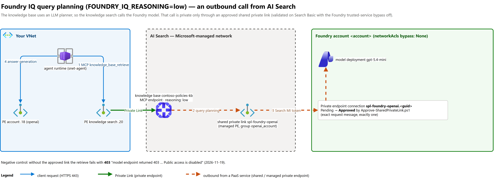

*Figure 7 — With `FOUNDRY_IQ_REASONING=low`, AI Search itself calls the model (an outbound call from a
PaaS service). It stays private only through an approved shared private link (`openai_account`).
Validated live on Search Basic with the Foundry bypass `None`: no link → 403; pending → 403; approved → 200.*

### 8.3 Traffic paths and DNS

- **Default Foundry IQ (`minimal`)**: the knowledge base makes **no** outbound call; retrieval stays inside
  the Search service. The agent reaches the MCP endpoint through the knowledge search private endpoint
  (project managed identity, audience `https://search.azure.com/`).
- **Query planning (`low`/`medium`)**: the shared private link is created by Bicep and approved by a
  narrow script that accepts exactly one pending connection with the exact request message (or leaves it
  to the account owner with `FOUNDRY_IQ_AUTO_APPROVE=false`). The knowledge search identity gets
  *Cognitive Services OpenAI User* on the account. It is the only automatically approved connection that
  originates outside the customer network, hence opt-in. Validated in A; B and F use `minimal`.
- **Monitoring ordering**: the Foundry account must be created **after** the AMPLS private endpoint and
  its DNS records. Otherwise the injected agent runtime resolves the public ingestion endpoint and its
  traces are rejected by the (correct) public-ingestion block. The Bicep enforces the order; a static
  test guards it. In hub-spoke the central AMPLS exists before the spoke.

### 8.4 Identity, RBAC and security controls

| Identity | Role | Why |
|---|---|---|
| Project MI | Search Index Data Contributor + Search Service Contributor on the knowledge search | Required by the Azure AI Search tool (Index Data Reader alone fails with 403 on `Indexes.Get`) |
| Project MI | Monitoring Metrics Publisher on App Insights | Server-side agent traces with Entra-only ingestion |
| RAG VM MI | Cognitive Services OpenAI User (account) + Search Index Data Reader (knowledge search) | Only these two, validated live |
| Knowledge search MI (query planning only) | Cognitive Services OpenAI User on the account | Model call for query planning |
| Demo user | Search Index Data Reader; Log Analytics Reader on App Insights + workspace | Query the index, view traces |

The RAG VM has no public IP and no Internet egress (validated: Microsoft, PyPI and Entra endpoints
unreachable); tokens come from IMDS, which is host-local. Server-side tracing also writes **message
content** to Log Analytics (`genAIContent`): treat the workspace as business data, restrict readers and
align retention.

### 8.5 Validated live

Each module was validated individually and in combination: E reached **97/97**, and **101/101** with
query planning and both trusted-service exceptions off (2026-11-19). In hub-spoke all modules passed as
part of the 91/91 run. Server-side agent traces are stored with App Insights public ingestion disabled.

### 8.6 Trade-offs, limitations and cost

**Cost drivers per module:** module 1 adds a second AI Search (Basic) and one private endpoint (the
largest add-on); module 3 adds a small Linux VM (auto-shutdown keeps it low); module 4 adds only tokens;
module 5 adds App Insights ingestion and one AMPLS private endpoint; module 6 (`minimal`) adds almost
nothing, query planning adds model tokens (~1.5k input tokens per question observed) and Private Link
usage.

Limitations: indexers pulling from private sources need `executionEnvironment: Private`; Foundry IQ
knowledge sources with auto-generated indexers don't support the private execution environment; private
ingestion with embeddings still relies on the Foundry trusted-service bypass (Learn); knowledge bases need
the semantic ranker. Fully private agentic ingestion (Foundry IQ option B) is deferred (needs Search S2+).

## 9. Option F — managed VNet for agents (preview)

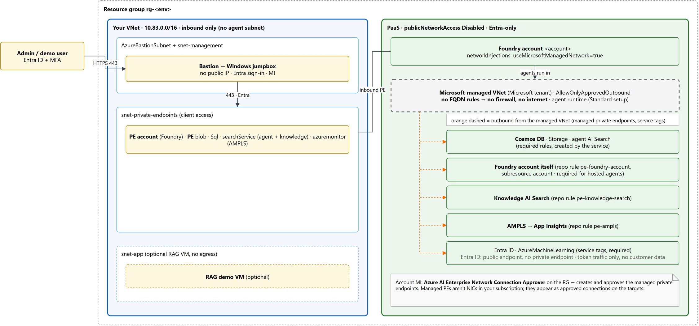

*Figure 8 — Option F, logical architecture: the customer VNet keeps the inbound private endpoints and
the jumpbox; the agent runtime lives in the Microsoft-managed VNet.*

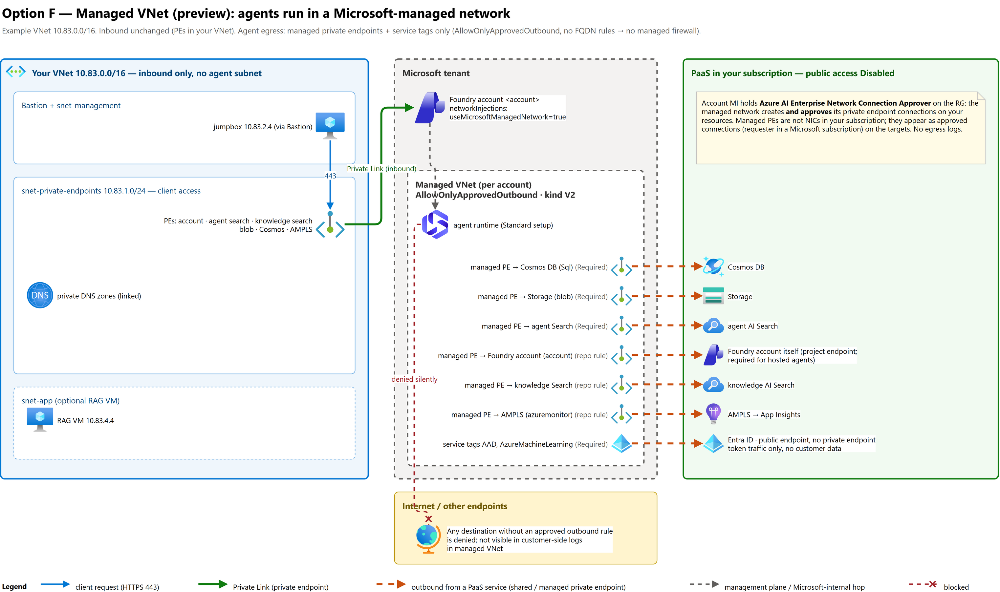

*Figure 9 — Option F, network view: every outbound hop of the agent runtime is an approved managed private
endpoint, including `pe-foundry-account` back to the Foundry account. Red: any destination without an
approved outbound rule is denied; it is not visible in customer-side logs in a managed VNet.*

### 9.1 Purpose and when to choose

Inbound isolation is identical to A/B (private endpoints in your VNet). The **agent runtime** — prompt
agents and hosted agents — runs in a **Microsoft-managed virtual network** owned by the Foundry account,
with `isolationMode: AllowOnlyApprovedOutbound`. It reaches your PaaS resources through **managed private
endpoints** that the service creates and approves. Choose it when the customer doesn't want to operate
agent subnets and egress firewalls and accepts preview status and the absence of egress logs
([managed VNet module](modules/managed-vnet.md),
[Learn](https://learn.microsoft.com/azure/foundry/how-to/managed-virtual-network)).

> **Preview and irreversible.** `accounts/managedNetworks` has only preview API versions (this repo uses
> `2026-09-15-preview`, the newest with Bicep types). Once enabled, the managed network can't be disabled
> and there is no switch to or from BYO VNet. Preflight requires `MANAGED_VNET_PREVIEW_ACK=true` and a
> supported region.

### 9.2 Traffic paths and DNS

| Aspect | Option F |
|---|---|
| Inbound | As A: client → private endpoint in your VNet |
| Agent egress (prompt and hosted) | Managed VNet → outbound rules only. **Required** (service-created): private endpoints to Cosmos DB (`Sql`), Storage (`blob`), agent AI Search; service tags `AzureActiveDirectory`, `AzureMachineLearning`. **Repo rules:** `pe-foundry-account` (subresource `account`, always), `pe-knowledge-search` (modules 1/4/6), `pe-ampls` (module 5). **No FQDN rules** → no managed Azure Firewall, no Internet egress |
| Hosted-agent specific | The micro VM calls its own project endpoint (model, toolbox, conversation storage). Without `pe-foundry-account` every invoke fails with **HTTP 500** because the agent has no private path back to its account (public access disabled). The rule is now part of every managed VNet deployment of the template |
| DNS | Your VNet as A. The managed network resolves the managed private endpoints itself |
| Your VNet | No `snet-agent`, no delegation, no agent NAT (NAT only for the jumpbox in standalone) |

### 9.3 Identity, RBAC and security controls

- The account managed identity holds **Azure AI Enterprise Network Connection Approver** on the resource
  group, so the managed network can create **and approve** its private endpoint connections on your
  resources (Learn requirement).
- Managed private endpoints aren't NICs in your subscription; they appear only as approved private
  endpoint connections on the target resources, with a requester in a Microsoft subscription.
- Deployment ordering matters: account → account private endpoint → managed network and rules → project →
  capability host (project connections created while the managed network is still provisioning fail).

### 9.4 Validated live

- **104/104** (2026-11-19): agent create/run with the AI Search tool, Foundry IQ via MCP, server-side
  traces through `pe-ampls`, RAG app, public negatives; idempotent full re-deploy.
- **105/105** plus **hosted agent** (2026-11-23): invoke with citation after adding `pe-foundry-account`,
  public `403`, jailbreak blocked at input stage; code-emitted traces arrive through `pe-ampls` once the
  agent identity has *Monitoring Metrics Publisher* on App Insights.

### 9.5 Trade-offs, limitations and cost

| | BYO VNet (A/B, default) | Managed VNet (F, preview) |
|---|---|---|
| Agent network | Your delegated `/24` subnet | Microsoft-managed, per account |
| Egress control | Your NSG + NAT (A) or your firewall via UDR (B) | Outbound rules on the account |
| Egress logging | Your firewall logs | **None** |
| Destinations without an approved rule | Denied by NSG or firewall; visible in the firewall logs (B) | Denied; not visible in customer-side logs |
| Address planning | `/24` + reserved-range checks | None |
| On-premises / non-PaaS targets | Peering, routing | Only through an Application Gateway private endpoint |
| Status | GA | Preview API; irreversible |

**Cost drivers:** the repository publishes no separate figure. The resource set equals option E without
the agent subnet; no managed Azure Firewall is created because no FQDN rules exist (adding FQDN rules
would create one, with its own cost). **Teardown:** the service-created account capability host survives
project deletion and must be deleted before the account; the cleanup script and `predown` hook do this.

## 10. Private Link mechanics and private DNS

### 10.1 Anatomy of a private endpoint

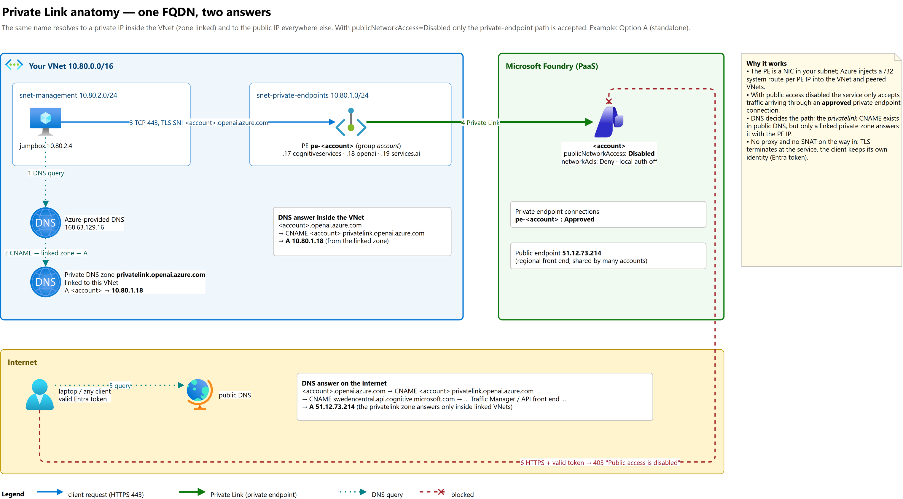

*Figure 10 — A private endpoint is a NIC with private IPs in your subnet, connected through Azure Private
Link to one sub-resource of a PaaS service. The private DNS zone maps the public name to those IPs; the
target has public access disabled. The connection must be approved on the target.*

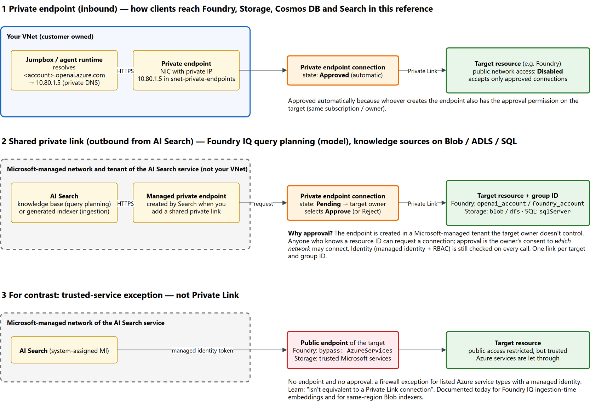

*Figure 11 — Three different mechanisms: a private endpoint (inbound, in your VNet), an AI Search shared
private link (outbound from Search, in a Microsoft-managed network, approved by the target owner) and the
trusted-service exception (not Private Link). Background: [Private Link explained](private-link-explained.md).*

### 10.2 One Foundry private endpoint, three FQDN families

A Foundry account exposes three public FQDN families. One private endpoint with group ID `account` gets
**three IP configurations on one NIC**, one per zone (example: option A):

| IP configuration | Public FQDN | Private DNS zone | Example IP |
|---|---|---|---|
| `default` | `<account>.cognitiveservices.azure.com` | `privatelink.cognitiveservices.azure.com` | 10.80.1.17 |
| `secondary` | `<account>.openai.azure.com` | `privatelink.openai.azure.com` | 10.80.1.18 |
| `third` | `<account>.services.ai.azure.com` (project API, agents, hosted agent endpoints) | `privatelink.services.ai.azure.com` | 10.80.1.19 |

All three records must exist. A missing one breaks only the SDKs that use that host name, which is hard to
diagnose. Resolution chain:

```text
<account>.openai.azure.com
  CNAME <account>.privatelink.openai.azure.com
     ├── inside the VNet (zone linked):  A 10.80.1.18            → private endpoint
     └── public DNS:  CNAME <region>.api.cognitive.microsoft.com → … → public IP → 403
```

Other private endpoints: Storage `blob`, Cosmos DB `Sql` (the regional endpoint gets a second IP), AI
Search `searchService` (agent vector store and knowledge search), AMPLS `azuremonitor` (13 IPs:
ingestion, live metrics, profiler, snapshot, query, agent-service blob). Plan private endpoint subnets
with that in mind (`/24` in this template).

### 10.3 Mechanics that matter

| Mechanism | Behaviour | Setting in this design |
|---|---|---|
| Routes | `/32` routes take priority: each private endpoint IP is added as a `/32` route in its VNet **and peered VNets**; as the most specific route it takes priority over a `0.0.0.0/0` UDR, so private endpoint traffic does not pass the firewall. To force it through a firewall, the private endpoint subnet needs network policies for route tables, the UDR needs a prefix at least as specific as the VNet address space (a `0/0` UDR never overrides), and the firewall should SNAT ([Learn](https://learn.microsoft.com/azure/private-link/disable-private-endpoint-network-policy)) | No UDR on the private endpoint subnet; no inspection UDRs |
| Network policies | With `privateEndpointNetworkPolicies: Enabled`, NSGs and UDRs apply to traffic **to** the endpoint | Enabled + NSG: 443 from `VirtualNetwork` only |
| Approval | Auto-approved when the requester holds `…/privateEndpointConnectionsApproval/action` on the target; otherwise *Pending* | All inbound endpoints auto-approve; shared private links need explicit approval |
| Zone groups | Write and remove A records automatically; can't be re-pointed to other zones in place | Spoke-ready handover deletes and recreates them |
| Public access | A private endpoint adds a private path; it does **not** remove the public one | `publicNetworkAccess: Disabled` everywhere (except G) |
| Trusted services | `networkAcls.bypass: AzureServices` lets `Microsoft.CognitiveServices`, `Microsoft.Search` and `Microsoft.MachineLearningServices` in with managed identity + RBAC | Default `AzureServices` on Foundry and agent Storage; **`None` validated** (101/101); Cosmos DB and Search always `None` |

**Trusted-service bypass.** Learn: an endpoint firewall or trusted-service exception "isn't equivalent to a
Private Link connection". The full validation passed with both exceptions set to `None`
(`FOUNDRY_NETWORK_ACLS_BYPASS`, `AGENT_STORAGE_NETWORK_BYPASS`), so no tested path depends on it. Not
covered by tests: file upload / file search / Code Interpreter files, evaluations, and Search skillsets or
integrated vectorization calling Foundry (Learn documents the bypass as required for ingestion-time
embeddings). Recommendation for maximum isolation: `None` unless a needed feature relies on it.

### 10.4 Public negatives: what a 403 proves

The validation calls every public endpoint **with a valid Entra token** and passes only on a *network*
rejection: Foundry `403 Public access is disabled`, Cosmos DB "blocked by your Cosmos DB account
firewall", Search `publicNetworkAccess: Disabled`, Storage `AuthorizationFailure` (firewall code, distinct
from the RBAC code). A 401 is reported as **inconclusive**, because it says nothing about the network.
Network isolation and RBAC are independent layers: a request from the Internet with a valid token is
rejected by the network; a request from inside the VNet without a role is rejected by authorization.

### 10.5 Private DNS

| Mode | Behaviour | Used by |
|---|---|---|
| `create` | Zones in the workload resource group, linked to the workload VNet | A, C (phase 1), D/E, F |
| `existing` | **No zones, no links.** Zone groups write records into central zones given as comma-separated resource IDs; the platform team links them to the hub/resolver VNet | B, C after handover |

Core zones: `privatelink.services.ai.azure.com`, `privatelink.openai.azure.com`,
`privatelink.cognitiveservices.azure.com`, `privatelink.blob.core.windows.net`,
`privatelink.documents.azure.com`, `privatelink.search.windows.net`; plus `privatelink.monitor.azure.com`,
`privatelink.oms.opinsights.azure.com`, `privatelink.ods.opinsights.azure.com` and
`privatelink.agentsvc.azure-automation.net` for AMPLS ([private DNS](private-dns.md)).

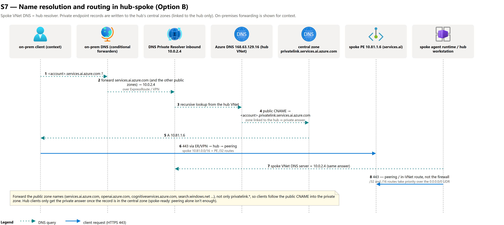

*Figure 12 — Name resolution in hub-spoke from on-premises (context) and from the spoke. Traffic then
follows the most specific route: the private endpoint `/32` takes priority over the `0/0` UDR.*

Hub-spoke rules:

- On-premises DNS forwards the **public** zones (`services.ai.azure.com`, `openai.azure.com`,
  `cognitiveservices.azure.com`, `search.windows.net`, `blob.core.windows.net`, `documents.azure.com`,
  Azure Monitor zones) to the resolver inbound IP. Forwarding only `privatelink.*` breaks resolution,
  because clients ask for the public name first.
- The resolver VNet must be linked to every `privatelink.*` zone; spokes that use the resolver need no
  links.
- **One AMPLS per DNS scope.** AMPLS registers *shared* Azure Monitor endpoints; a spoke-owned AMPLS would
  redirect every workload's monitoring traffic. Standalone creates its own; hub-spoke joins the central one.

### 10.6 Portal, model calls and automation over Private Link

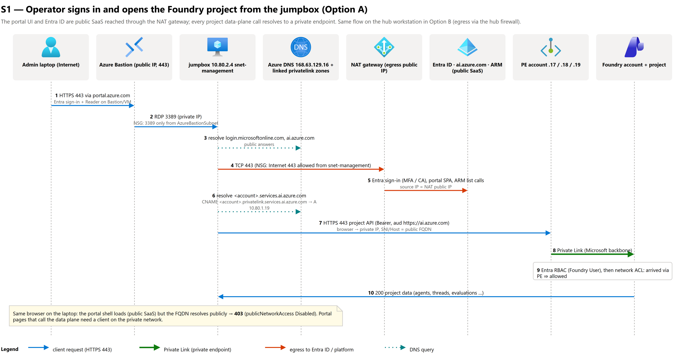

*Figure 13 — The Foundry portal (`ai.azure.com`) is a public single-page app; Entra ID and ARM are public
too. The browser then calls the project data plane, which resolves to the private endpoint. From outside
the network the portal shell loads but data-plane calls get 403 — the main visible proof that the data
plane is private.*

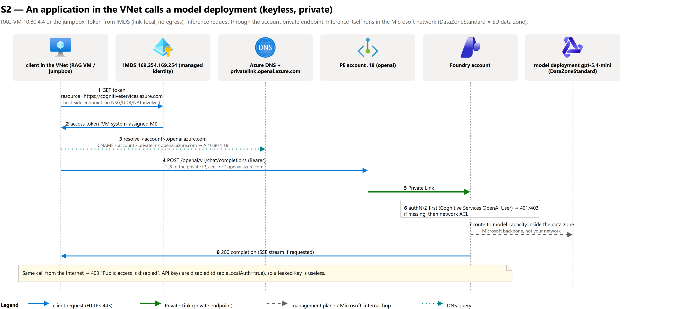

*Figure 14 — An in-VNet client calls a model deployment through the account private endpoint with a
managed-identity token (audience `https://cognitiveservices.azure.com`, role Cognitive Services OpenAI
User). IMDS is host-local, so a VM without any egress still gets tokens. With `DataZoneStandard` the hop
from the account to model capacity stays in the EU data zone and is Microsoft-internal.*

**Entra ID** has no private endpoint: token traffic goes to the public Entra endpoints
(`AzureActiveDirectory` service tag / login FQDNs) over the Microsoft backbone and carries no customer
data. VM managed identities use IMDS (no egress); platform identities get their tokens inside the
service.

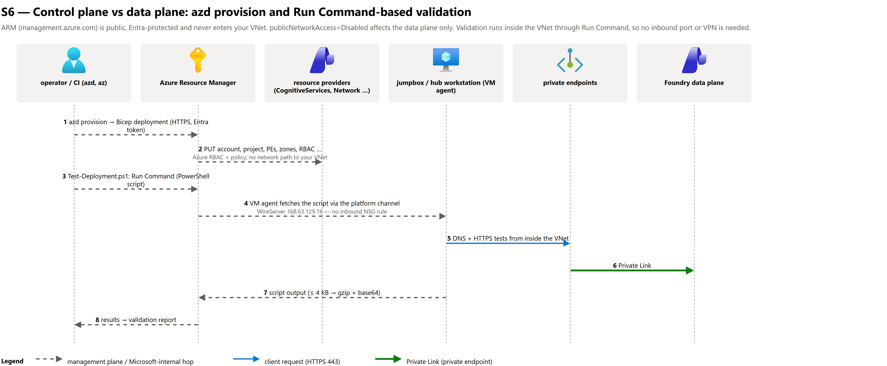

*Figure 15 — The control plane never enters the VNet. `azd provision` works with the data plane fully
private; data-plane steps run inside the VNet through VM Run Command (output limited to 4 KB, so the
scripts compress results) or through an in-network `azd` runner.*

## 11. Agents in private networks

### 11.1 Prompt agents and hosted agents compared

| Topic | Prompt agent | Hosted agent |
|---|---|---|
| Agent loop | Foundry Agent Service | **Your code** → set iteration and time limits before production |
| Compute (BYO VNet) | Agent runtime injected into the delegated subnet | Per-session micro VM in the delegated subnet |
| Compute (managed VNet) | Managed VNet | Managed VNet |
| Agent's own egress | Platform-managed runtime | Through the delegated subnet (your NSG, NAT / firewall, private DNS) or the managed outbound rules |
| Tool calls | Through the project **data proxy** | With a toolbox: through the data proxy as well (validated) |
| Identity | Project managed identity | Agent identity (runtime) + project managed identity (platform) |
| Deployment | REST/SDK from a private client (here: Run Command) | `azd deploy` from an in-network runner (source-code deploy, `remote_build`) |
| Guardrails | Model deployment content filter (`Microsoft.DefaultV2`) | Model deployment filter **and** optional agent-level RAI policy (preview) |
| Telemetry | Server-side traces with the project MI | Server-side traces + code-emitted traces with the agent identity |

### 11.2 Prompt agent run (Standard setup)

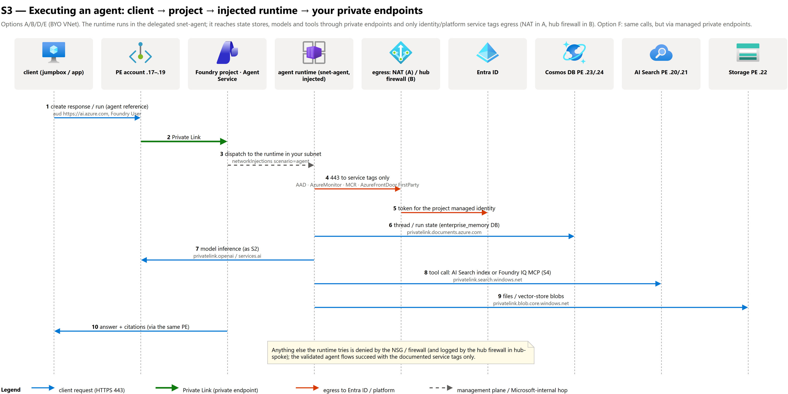

*Figure 16 — The client talks only to the project endpoint. Agent Service dispatches the run to the
runtime injected in `snet-agent`, which calls Cosmos DB, the model, AI Search and Storage through their
private endpoints.*

| Hop | From → to | Path | Control |
|---|---|---|---|
| 1–2 | Client → project API | Account private endpoint | Entra (`https://ai.azure.com`), Foundry User |
| 3 | Agent Service → runtime | Microsoft-internal (injection) | Delegation + capability host |
| 4–5 | Runtime → Entra / platform | NAT (A) or hub firewall (B) | NSG service tags, firewall allow-list |
| 6 | Runtime → Cosmos DB | Private endpoint | Project MI, Cosmos DB data role at database scope |
| 7 | Runtime → model | Account private endpoint | Project MI |
| 8 | Runtime → AI Search | Private endpoint | Project MI: Search Index Data Contributor + Search Service Contributor |
| 9 | Runtime → Storage | Private endpoint | Project MI: Storage Blob Data roles (Owner with ABAC condition) |

Option F: hops 4–9 leave the managed VNet through the outbound rules instead of your subnet.

### 11.3 Foundry IQ and telemetry

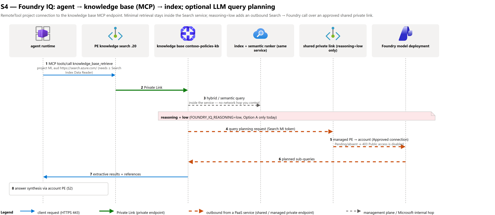

*Figure 17 — Foundry IQ via the knowledge base MCP endpoint (`knowledge_base_retrieve`). The project
connection is `RemoteTool` with `ProjectManagedIdentity`. Minimal retrieval stays inside AI Search; with
query planning Search calls the model over the shared private link (Figure 7).*

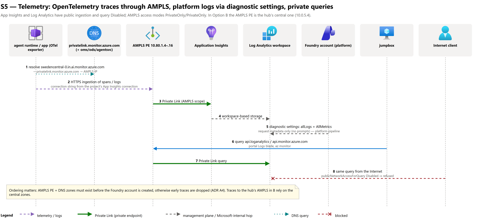

*Figure 18 — OpenTelemetry exports go to the regional ingestion endpoint, which resolves to the AMPLS
private endpoint (PrivateOnly ingestion and query). Platform resource logs go through diagnostic settings,
outside your network; they contain request metadata, not prompts. Queries run through the AMPLS query
endpoints, so traces are viewable only from inside the network.*

### 11.4 Hosted agents: deployment from an in-network runner

With public network access disabled, `azd deploy` from an Internet workstation fails (403). The validated
workflow runs **azd on a private client** — the jumpbox (A, F) or the hub workstation (B) — as an
**in-network runner** (`scripts/agents/Deploy-HostedAgentAzd.ps1`):

1. Install `azd` with the `azure.ai.agents` and `azure.ai.toolboxes` extensions on the runner;
   sign in with `azd auth login --managed-identity`.
2. Grant the runner identity **Foundry Project Manager** on the project.
3. `azd deploy` of the azd project `src/hosted-agents/azure.yaml`: a **toolbox** `contoso-policy-tools`
   (MCP tool on the existing `knowledge-base-mcp` connection, project managed identity) and the hosted
   agent `contoso-policy-hosted` (Agent Framework, Responses protocol, `FoundryToolbox`).
4. Grant the agent identity *Monitoring Metrics Publisher* on App Insights (script step `rbac`).

```yaml
contoso-policy-hosted:
  host: azure.ai.agent
  kind: hosted
  uses: [contoso-policy-tools]
  codeConfiguration:
    runtime: python_3_13
    entryPoint: main.py            # a string in azure.yaml (the API uses an array)
    dependencyResolution: remote_build
  container: { resources: { cpu: "1", memory: 2Gi } }
  protocols: [{ protocol: responses, version: 2.0.0 }]
  policies:
    - type: rai_policy
      raiPolicyName: __RAI_POLICY_ID__   # full ARM ID; azd doesn't expand ${VAR} here
```

**Source-code deployment** (zip, `remote_build`) needs **no container registry**: the build runs
platform-side. In the hub-spoke test the firewall saw **no** MCR, PyPI or GitHub traffic from the spoke.
Learn lists `mcr.microsoft.com` and `*.login.microsoft.com` as egress for source-code deployment
([deploy from source code](https://learn.microsoft.com/azure/foundry/agents/how-to/deploy-hosted-agent-code));
both are covered by the existing NSG tags and firewall rules. A private container registry (private
endpoint, public access disabled) is also supported for projects created after 25 June 2026. Use the
dependency set of a tested sample: hand-picked versions of the hosting package and `mcp` conflicted.

### 11.5 Hosted agents: network paths per mode

The invoke path is the same in every mode: client → account private endpoint → agent Responses endpoint
`{project}/agents/{name}/endpoint/protocols/openai/responses` → **agent guardrail** → micro VM. The agent
code then calls the project endpoint (model deployment, toolbox); the toolbox call is executed by the
Foundry tools service through the single-tenant **data proxy** to the knowledge search private endpoint.
What changes per mode is where the micro VM and the data proxy live and how they leave the network.

#### A — standalone

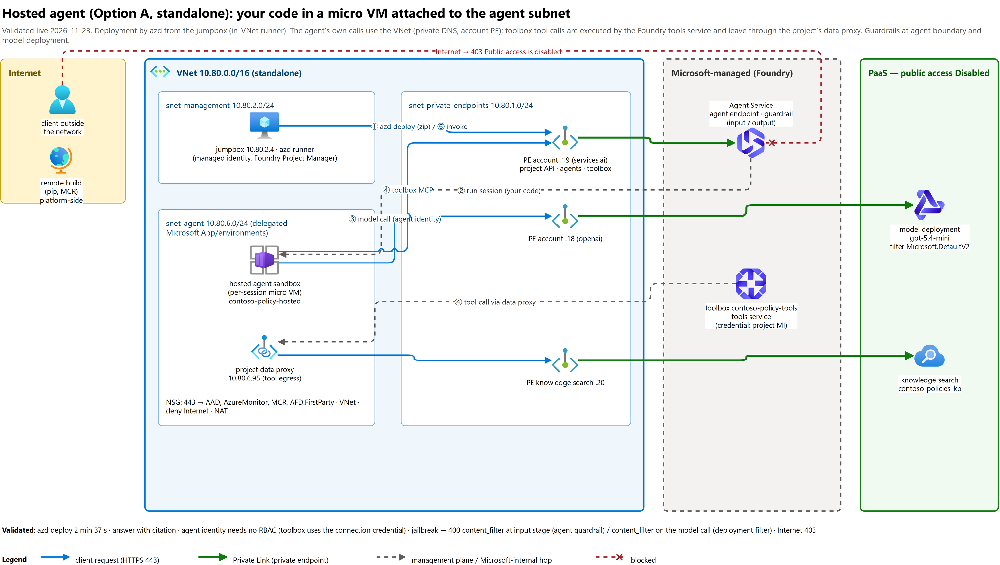

*Figure 19 — Option A: the micro VM and the data proxy are attached to the delegated agent subnet; the
jumpbox is the azd runner and the private client.*

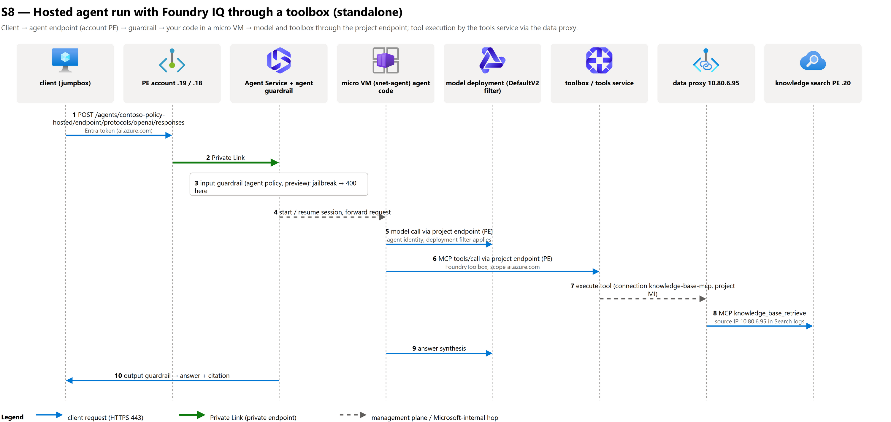

*Figure 20 — Hosted agent run with Foundry IQ through a project toolbox.*

| Path | Route | Evidence (2026-11-23) |
|---|---|---|
| Deploy | Jumpbox (azd, MI with Foundry Project Manager) → account private endpoint; remote build platform-side | `azd deploy` 2 min 37 s |
| Invoke | Client → account private endpoint → agent guardrail → micro VM | Answer with citation; jailbreak → `400 content_filter` at input stage |
| Agent's own calls | Micro VM → project endpoint via account private endpoint → model deployment (content filter `Microsoft.DefaultV2`) | Jailbreak without agent policy → `content_filter` on the model call |
| Tool calls | Micro VM → toolbox → tools service → **data proxy** (agent subnet) → knowledge search private endpoint | Search logs: `Agents.Mcp` calls from the data proxy address, not from the micro VM |
| Platform egress | Agent subnet → NSG service tags → NAT gateway | — |
| Internet | → `403 Public access is disabled` | live |

An earlier variant in which the agent code called the knowledge base MCP endpoint **directly** with its
own identity also worked: the Search logs then showed the **micro VM** addresses as callers, and the agent
identity needed *Search Index Data Reader*. The toolbox variant is the recommended one.

#### B — hub-spoke

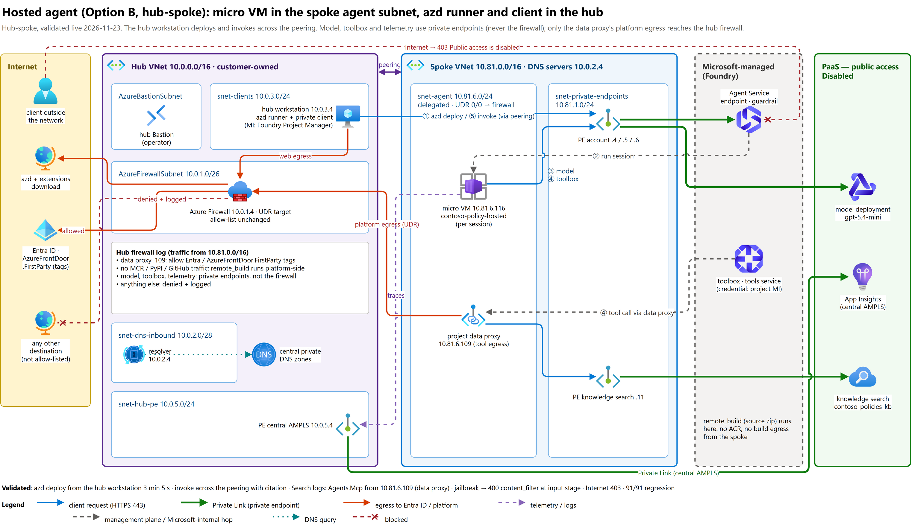

*Figure 21 — Option B: micro VM (`10.81.6.116`) and data proxy (`10.81.6.109`) in the spoke agent subnet;
the hub workstation is both azd runner and private client and reaches the spoke private endpoints over the
peering. Only platform egress reaches the hub firewall.*

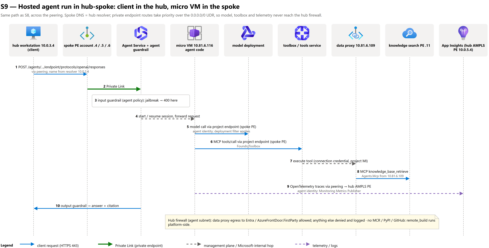

*Figure 22 — The same run across the peering. Private endpoint `/32` routes take priority over the
`0.0.0.0/0` UDR, so model, toolbox and telemetry traffic never crosses the firewall.*

| Path | Route | Evidence (2026-11-23) |
|---|---|---|
| Deploy | Hub workstation → peering → spoke account private endpoint; azd and extensions downloaded through the firewall's workstation web rule | `azd deploy` 3 min 5 s |
| Invoke | Hub workstation → peering → account private endpoint (name from the hub resolver) → agent guardrail → micro VM | Answer with citations; cold start 6.8 s; jailbreak → `400 content_filter` |
| Tool calls | Micro VM → toolbox → tools service → data proxy → knowledge search private endpoint | Search logs: `Agents.Mcp` from the data proxy |
| Telemetry | Micro VM → peering → central AMPLS private endpoint → App Insights | Not in the firewall log |
| Platform egress | UDR → hub firewall | See §11.6 |

#### F — managed VNet (preview)

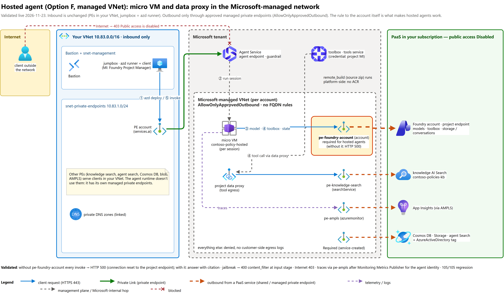

*Figure 23 — Option F: your VNet keeps the inbound private endpoints and the jumpbox (azd runner). The
micro VM and the data proxy run in the Microsoft-managed VNet and leave it only through managed private
endpoints. The rule `pe-foundry-account` (subresource `account`) is required for hosted agents.*

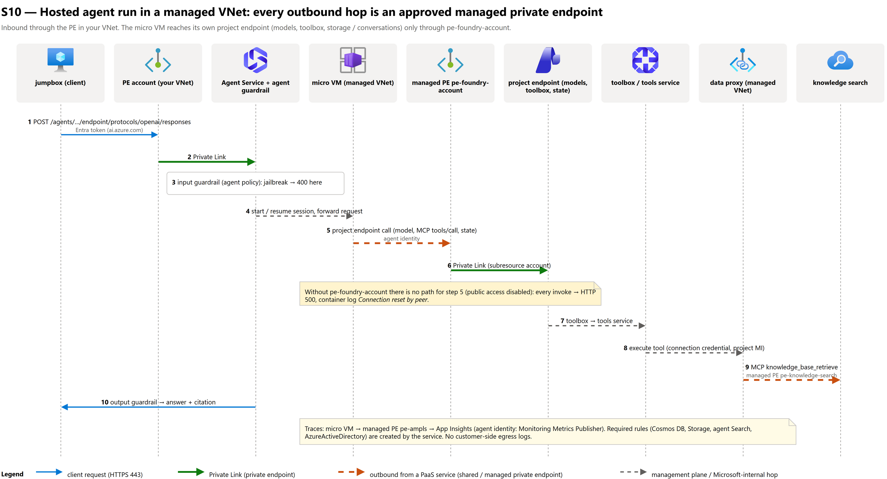

*Figure 24 — The same run in a managed VNet: every outbound hop of the agent runtime is an approved
managed private endpoint.*

| Path | Route | Evidence (2026-11-23) |
|---|---|---|
| Invoke | Client → account private endpoint (your VNet) → agent guardrail → micro VM (managed VNet) | Answer with citation; jailbreak blocked |
| Agent's own calls | Micro VM → managed private endpoint **`pe-foundry-account`** → project endpoint (models, toolbox, conversation storage) | Without the rule: every invoke HTTP 500; with it: PASS |
| Tool calls | Toolbox → tools service → data proxy (managed VNet) → `pe-knowledge-search` | Answer with citation |
| Telemetry | Micro VM → `pe-ampls` → App Insights | Traces arrive once the agent identity has Monitoring Metrics Publisher |
| Platform egress | Required rules only; everything else denied | No customer-side egress logs |

### 11.6 Hub firewall findings (option B)

All traffic from the spoke was analysed in the hub firewall logs over 3 hours of hosted-agent tests:

| Source | Destination | Verdict | Assessment |
|---|---|---|---|
| Data proxy | Entra ID / `AzureFrontDoor.FirstParty` service tags | Allowed | Covered by the documented allow-list |
| Spoke | Any destination not on the allow-list | Denied and logged | No functional impact on the validated scenarios |
| Spoke | MCR, PyPI, GitHub | **No traffic** | `remote_build` runs platform-side |

**Decision: the firewall allow-list stays unchanged for hosted agents.** Model, toolbox and telemetry stay
on private endpoints and never reach the firewall.

### 11.7 Guardrails at two layers

| Layer | Configuration | Behaviour (validated live) |
|---|---|---|
| **Model deployment** content filter | `Microsoft.DefaultV2` on the deployment; applies to every prompt/completion through the deployment, also when hosted-agent code calls the model | Jailbreak prompt → model call `400 content_filter` ("jailbreak detected"); the agent span shows `error.type=content_filter` and the agent returns a refusal |
| **Agent** guardrail (**preview**, optional) | `rai_config` / `policies: rai_policy` on the hosted agent definition (here `Microsoft.DefaultV2`); without it there is no agent-boundary guardrail | Jailbreak → `HTTP 400 content_filter … blocked at input stage` **before the agent code runs**; normal questions still answered with citations |

For the Responses protocol Foundry screens agent input and output automatically; the Invocations protocol
needs explicit moderation paths and Invocations WebSocket is not screened
([add guardrails to a hosted agent](https://learn.microsoft.com/azure/foundry/agents/how-to/add-hosted-agent-guardrails)).
Network egress controls in the same RAI policy are GA for hosted agents (Transform rules and Azure Policy
egress governance are preview, [guardrails overview](https://learn.microsoft.com/azure/foundry/guardrails/guardrails-overview)).

### 11.8 Agent identity and RBAC

| Identity | Needs | Doesn't need |
|---|---|---|
| **Agent identity** (platform-created, stable across versions) | **Monitoring Metrics Publisher** on App Insights for code-emitted traces with Entra-only ingestion ([Learn](https://learn.microsoft.com/azure/foundry/observability/how-to/trace-ingestion-entra-authentication#set-up-entra-authentication-for-hosted-agent-traces)); without it the exporter gets `Forbidden` | **No data-plane role for tools** when a toolbox is used: the knowledge base is called with the toolbox connection's credential (project MI). Direct MCP calls from code would need Search Index Data Reader |
| **Runner identity** (jumpbox / hub workstation MI) | Foundry Project Manager on the project | — |
| **Project MI** | Its existing Standard setup and knowledge search roles | — |

### 11.9 Operational recommendations

- **Iteration and time limits:** a hosted agent owns its loop; set maximum iterations, tool calls and
  wall-clock time in the agent code before production.
- **Subnet sizing:** delegated subnet `/27` minimum, `/24` recommended (≈ 60,000 planned sessions);
  exhaustion shows as `429 subnet_exhausted`. Keep private endpoint addresses out of `192.168.0.0/24`
  (internal sandbox network → `EHOSTUNREACH`).
- **Agent 365 data collection:** documented hosted-agent telemetry to `agent365.svc.cloud.microsoft` only
  when enabled; keep it disabled (`a365LoggingEnabled=false`) unless needed.
- **Status, quota and cost** (checked 2026-11-23):

| Topic | Finding |
|---|---|
| Status | Managed hosting of hosted agents and Foundry Agent Service: **GA**. Python hosting package: **prerelease**. Agent-level guardrails: **preview**. Some older Learn pages still say "hosted (preview) agents" |
| Session quota | Default **2,000 concurrent hosted sessions per subscription in Sweden Central** (1,000 in most other regions); idle/stopped sessions don't count; exceeded → `429 session_quota_exceeded` |
| Cost | Billed per vCPU-hour and GiB-hour while a session's compute runs, including idle time until suspension (default 15 min); models and tools billed separately. |

## 12. Security controls summary

### 12.1 Controls per option

| Control | G | A | B | C | D/E | F |
|---|---|---|---|---|---|---|
| Data-plane public access | **Enabled + IP allow-list** | Disabled | Disabled | Disabled | Disabled | Disabled |
| Local auth (keys) | off | off | off | off | off | off |
| Private endpoints + private DNS | ✘ | local zones | central zones | local → central | local zones | local zones |
| Trusted-service bypass | n/a | `AzureServices` default, `None` validated | same | same | same | same |
| Agent egress control | none (Basic setup) | NSG tags + NAT | NSG tags + customer firewall (logged) | n/a until handover | NSG tags + NAT | managed outbound rules (not logged) |
| Admin access | allowed IPs | Bastion → jumpbox | customer hub | customer hub | Bastion → jumpbox | Bastion → jumpbox |
| Public IPs | none | Bastion ingress, NAT egress | none | none | Bastion, NAT | Bastion, NAT |
| Telemetry | public (no monitoring module) | AMPLS private (module 5) | central AMPLS | — | AMPLS private | AMPLS via managed PE |

### 12.2 Control matrix (private profiles)

| Control | Value |
|---|---|
| Foundry | `publicNetworkAccess: Disabled`, ACL `defaultAction: Deny` without IP/VNet rules, `disableLocalAuth: true`, network injection at creation |
| Storage (agent files) | Public access disabled, shared key off, public blob off, TLS 1.2, HTTPS only, soft delete 7 days |
| Cosmos DB (threads) | Public access disabled, `disableLocalAuth`, `disableKeyBasedMetadataWriteAccess`, TLS 1.2 |
| AI Search (both) | Public access disabled, `disableLocalAuth`, `bypass: None` |
| Log Analytics / App Insights | Local auth off; with module 5 public ingestion and query disabled, AMPLS PrivateOnly |
| VMs | No public IP; Trusted Launch; Entra login; auto-shutdown; RAG VM without egress |
| NSGs | Deny-all inbound; only 443 from the VNet to endpoints, RDP only from the Bastion subnet; agent subnet denies Internet except platform tags; management subnet denies lateral movement |
| Diagnostics | All logs to Log Analytics for Foundry, Bastion, Cosmos DB, Storage, Search |
| Alerts (module 5) | Security drift (writes on Foundry, Search, Storage, Cosmos DB, private endpoints, NSG rules, AMPLS), server errors, RAI rejections |
| Secrets | None in outputs (linter rule as error + test); no Key Vault needed |

### 12.3 Least-privilege RBAC

| Identity | Scope | Role |
|---|---|---|
| Human user | Project / account | Foundry User / Cognitive Services OpenAI User; VM User Login on the jumpbox |
| Project MI | Storage | Storage Blob Data Contributor + Storage Blob Data Owner **with ABAC condition** (only its agent containers) |
| Project MI | Cosmos DB | Cosmos DB Operator (account) + Built-in Data Contributor at **database** scope |
| Project MI | Agent AI Search, knowledge search | Search Index Data Contributor + Search Service Contributor |
| Project MI / agent identity | App Insights | Monitoring Metrics Publisher (server-side / code-emitted traces) |
| Account MI (F only) | Resource group | Azure AI Enterprise Network Connection Approver |
| Runner identity (hosted agents) | Project | Foundry Project Manager |

Never assigned by the template: **Owner, Contributor, User Access Administrator, Role Based Access Control
Administrator** (enforced by static and live tests). Role names follow the current Foundry built-in roles:
*Foundry User* and *Foundry Project Manager* were formerly named *Azure AI User* and *Azure AI Project
Manager* (same role IDs, [Learn](https://learn.microsoft.com/azure/foundry/concepts/rbac-foundry)). For
runtime-only users, use *Foundry Agent Consumer* or *Foundry Project Runtime User* instead of Foundry User.
*Cosmos DB Operator* and *Search Service Contributor* are scoped management-role exceptions required by
the Standard setup and the Azure AI Search tool, each scoped to a single resource. CI uses
a federated (OIDC) identity; no client secrets ([identity and RBAC](identity-rbac.md)).

### 12.4 Threat model highlights

| Threat | Mitigation | Residual |
|---|---|---|
| Public endpoint exposure | Public access disabled, ACL deny, private endpoints only; live test with a *valid* token | Low |
| Unauthorized model invocation | Entra-only; OpenAI User only for named principals | Low |
| Prompt injection (direct / indirect) | `Microsoft.DefaultV2` (Prompt Shields) on the deployment, optional agent guardrail, no public-web tools | **Medium** (inherent to LLMs) |
| Data exfiltration | Agent subnet denies Internet except platform tags; firewall FQDN allow-list (B); managed VNet `AllowOnlyApprovedOutbound` (F) | **Medium** (broad service tags) |
| Compromised managed identity | System-assigned identities, scoped roles; remove validation roles after testing | Medium for the jumpbox MI |
| DNS misconfiguration | Zone groups on every endpoint; in-VNet tests resolve every FQDN | Low (public resolution yields 403, not a bypass) |
| Logging of sensitive content | Trace content only in private-only Log Analytics with RBAC | Low–Medium |
| Control-plane abuse | Public by design; protect with Entra Conditional Access, PIM and RBAC, not network rules | — |

Not met by default (decide per customer): customer-managed keys on Storage, Cosmos DB and Search; Defender
for AI/Storage/Cosmos DB plans (recommended for production); encryption at host for VMs
([security design](security/security-design.md), [threat model](security/threat-model.md)).

## 13. Comparison matrix and decision guide

### 13.1 Comparison matrix

| Criterion | G | A | B | C | D/E | F |
|---|---|---|---|---|---|---|
| Data plane private | ✘ | ✔ | ✔ | ✔ | ✔ | ✔ |
| Agent egress in customer network | ✘ | ✔ subnet + NAT | ✔ subnet + firewall | (after handover) | ✔ | ✘ managed |
| Agent egress logs | ✘ | ✘ (no firewall; add one if needed) | ✔ firewall logs | — | ✘ (as A) | ✘ |
| Depends on network team | ✘ | ✘ | ✔ | phase 2 | ✘ | ✘ |
| Public IPs in workload | none (public endpoint) | Bastion, NAT | none | none | Bastion, NAT | Bastion, NAT |
| Prompt agents | Basic setup | ✔ | ✔ | after handover | ✔ | ✔ |
| Hosted agents | not validated | ✔ | ✔ | after handover | ✔ | ✔ (needs `pe-foundry-account`) |
| Foundry IQ query planning | ✘ | ✔ | minimal only | — | ✔ | minimal only |
| GA vs preview | GA | GA | GA | GA | GA (agent guardrail preview) | **Preview** |
| Reversible | — | outbound mode fixed | fixed | fixed | fixed | **irreversible** |
| Main cost drivers | tokens + logs | Bastion, jumpbox, Search, NAT, private endpoints | spoke PaaS + hub | private endpoints, logs, tokens | as A + modules | as E without agent subnet |
| Live evidence | 14/14 | 101/101 + hosted | 91/91 + hosted | 20/20, 30/30 | 101/101 | 105/105 + hosted |

### 13.2 Decision guide

```text
Is the data synthetic and the goal a quick laptop demo?
 ├─ yes → G (public quick demo, IP allow-list, Entra-only)
 └─ no → the data plane must be private
     ├─ Is there an enterprise hub (firewall, central DNS, VPN/ExpressRoute)?
     │   ├─ yes, and the spoke can be connected now → B hub-spoke
     │   ├─ yes, but the connection comes later   → C spoke-ready (decide byoVnet + central DNS up front) → B
     │   └─ no → A standalone (+ modules = D/E)
     └─ Who should control agent egress?
         ├─ the customer (firewall, logs, FQDN policy) → BYO VNet (A / B), GA
         └─ Microsoft-managed, no subnet to operate, preview accepted, no egress logs → F managed VNet
```

**Prompt or hosted agent?**

| Choose | When |
|---|---|
| **Prompt agent** | Declarative agents with Foundry-managed tools; the platform owns the loop; simplest to govern; works in every private option |
| **Hosted agent** | Code-first agents (Agent Framework, LangGraph, custom), own orchestration or libraries, model calls from code. Requires an in-network runner, iteration/time limits in code, and Monitoring Metrics Publisher for the agent identity |

## 14. Validation evidence

### 14.1 How it is tested

| Layer | Command | Azure needed |
|---|---|---|
| Bicep build + lint (security warnings as errors) | `az bicep build -f infra/main.bicep` | no |
| Address plan and parameter unit tests | `Invoke-Pester tests/networking, tests/infrastructure` | no |
| Static security (PSRule-expanded, all sample profiles) | `Invoke-Pester tests/security` | no |
| What-if | `azd provision --preview` | yes |
| Live: network, identity, public negatives, in-VNet functional tests | `pwsh scripts/validation/Test-Deployment.ps1` | yes |

In-VNet checks run on a private client through VM Run Command: DNS answers inside the private endpoint
subnet, TCP 443, model inference with a managed identity, project API, agent create/run, tool calls with
citations, Foundry IQ, RAG, traces stored. Public negatives use a valid token and pass only on a network
rejection (§10.4).

### 14.2 Current status (23 November 2026)

| Profile | Latest live result |
|---|---|
| Standalone, all optional modules + Foundry IQ query planning + all trusted-service exceptions `None` | **101/101** full run |
| Standalone, all optional modules, bypasses `None`, **hosted agent** (azd from the jumpbox) | Hosted agent + guardrails **PASS** |
| Standalone full demo + **hosted-agent module** (`ENABLE_HOSTED_AGENT_DEMO`) | **103/103** full run incl. hosted-agent checks |
| Hub-spoke against a reference hub, all optional modules, bypasses `None`, **hosted agent** (azd from the hub workstation) | **91/91** full + hosted agent **PASS**; earlier user end-to-end test Parts 1–8 PASS |
| Standalone, all optional modules, bypasses `None`, **managed VNet (preview)** + **hosted agent** | **105/105** full + hosted agent **PASS**; earlier 104/104 without hosted agent |
| Public quick demo (not private) | **14/14** |
| Spoke-ready (models only, handover script) | **20/20** isolation, **30/30** after handover |
| Offline: Bicep build + lint, Pester | Green in CI on every push |

### 14.3 Hosted-agent evidence

| Check | A standalone | B hub-spoke | F managed VNet |
|---|---|---|---|
| `azd deploy` from the in-network runner | PASS (2 min 37 s) | PASS (3 min 5 s) | PASS |
| Private invoke with citation | PASS | PASS (cold start 6.8 s) | PASS (after `pe-foundry-account`) |
| Internet with valid token | 403 | 403 | 403 |
| Agent guardrail (jailbreak) | 400 at input stage | 400 at input stage | 400 at input stage |
| Model-layer filter without agent policy | `content_filter` on the model call | — | — |
| Toolbox path | Data proxy (agent subnet) | Data proxy (spoke agent subnet) | Data proxy (managed VNet) → managed PE |
| Code-emitted telemetry | Monitoring Metrics Publisher granted | Granted; via central AMPLS | Granted; via `pe-ampls` |
| Firewall change needed | — | **None** | — (no customer egress) |

### 14.4 Durable findings from live testing

| Finding | Consequence in the design |
|---|---|
| Agent traces need the AMPLS private endpoint and DNS **before** the Foundry account exists | Bicep orders the account after the AMPLS endpoint; static test |
| Azure AI Search tool needs Search Index Data Contributor + Search Service Contributor for the project MI | Granted by the template |
| Agent citations link to the source only if the index field `url` exists **and is searchable** | Index schema includes it; RAG app serves `/docs/<id>` as citation target |
| Hosted agents in a managed VNet need a managed private endpoint to their own account | `pe-foundry-account` in every managed VNet deployment |
| Code-emitted traces need Monitoring Metrics Publisher for the agent identity | Granted by the deployment script |
| Managed VNet: project connections fail while the managed network provisions | Project depends on the managed network |
| Peering alone isn't enough: hub DNS can't resolve the spoke's private endpoints until their records move to the central zones | Handover script (validated 30/30) / central zones from day one |
| Teardown with VNet injection: the agent subnet stays linked until the account is deleted **and purged** (~20 min) | `predown` hook deletes projects, purges the account and waits; managed VNet: deletes the account capability host first |

## 15. Current limitations in private networks

The validated scenarios pass **without** broadening network access. Destinations that aren't on the
documented allow-list stay denied; don't change security settings to work around a limitation.

### 15.1 Feature limitations in private networks

| Feature | Status |
|---|---|
| Bing grounding, web search, SharePoint grounding | Use public endpoints → excluded from private profiles. The new portal adds `web_search` to new agents by default — remove it |
| Browser automation, Computer use, image generation tools, Logic Apps, Fabric Data Agent, Work IQ | Not supported with network isolation |
| Workflow agents | Inbound private only; no outbound VNet injection |
| Code Interpreter (BYO VNet) | No file upload/download via the portal |
| Agent tools reaching resources in your VNet (MCP, OpenAPI, Functions, A2A) | Need a project-level capability host |
| Search indexers from private sources | Need `executionEnvironment: Private`; otherwise silent failures |
| Foundry IQ private ingestion with embeddings | Shared private links (S2+); ingestion-time embeddings still rely on the trusted-service bypass |
| Foundry portal | Public web app; project content only from a network that resolves the private endpoints; not every portal feature validated over Private Link |
| Data-plane operations and code deployment from outside the network | Need a private execution path (jumpbox / hub client via Run Command, in-network azd runner, self-hosted CI agents) |
| Managed VNet | Preview API, irreversible, region subset, no customer firewall or egress logs, on-premises only via Application Gateway |

### 15.2 Address and platform constraints

- Foundry account, private endpoint and VNet in the **same region**.
- Avoid `172.17.0.0/16`, and for agent-injected VNets `169.254.0.0/16`, `172.30.0.0/16`, `172.31.0.0/16`,
  `192.0.2.0/24`, `100.100.0.0/17`, `100.100.192.0/19`, `100.100.224.0/19`; keep private endpoint addresses
  out of `192.168.0.0/24`. Preflight enforces these.
- Agent subnet: delegated only to `Microsoft.App/environments`, one account, not changeable; reusable only
  after the account is deleted and purged (~20 min).
- Required providers for injection: `Microsoft.App` **and** `Microsoft.ContainerService`.
- Full list: [private-networking limitations](private-networking-limitations.md),
  [compatibility](compatibility.md).

## Appendix A — Glossary

| Term | Meaning |
|---|---|
| **Agent identity** | Dedicated Microsoft Entra identity created by the platform for a hosted agent; used by the agent code at runtime; stable across versions |
| **AMPLS** | Azure Monitor Private Link Scope: groups Log Analytics workspaces and App Insights behind one private endpoint; access modes PrivateOnly / Open for ingestion and query |
| **azd** | Azure Developer CLI; each deployment option is an azd environment |
| **Basic agent setup** | Agent state in Microsoft-managed storage; no network isolation (option G only) |
| **BYO VNet** | Agent network injection into a customer subnet delegated to `Microsoft.App/environments` (`byoVnet`) |
| **Capability host** | Foundry resource that tells Agent Service which BYO connections (Cosmos DB, Storage, Search) to use |
| **Content filter / RAI policy** | Guardrail configuration (`Microsoft.DefaultV2`) on a model deployment or, in preview, on a hosted agent |
| **Control plane / data plane** | ARM management API (public, RBAC) vs. the service endpoints that carry prompts and data (private here) |
| **Data proxy** | Single-tenant project component in the agent network through which tool calls of prompt agents and toolbox calls of hosted agents leave |
| **DataZoneStandard** | Model deployment type that keeps processing within a data zone (here the EU) |
| **DNS Private Resolver** | Azure service that answers DNS queries from on-premises and spokes using private DNS zones |
| **Foundry account / project** | `Microsoft.CognitiveServices/accounts` (kind `AIServices`) and its child projects |
| **Foundry IQ** | Knowledge bases and agentic retrieval on Azure AI Search, exposed to agents as an MCP endpoint |
| **Hosted agent** | Your agent code, run by Foundry in per-session micro VMs |
| **In-network runner** | A client inside the network (jumpbox, hub workstation, self-hosted CI agent) that runs data-plane deployments such as `azd deploy` |
| **Managed private endpoint** | Private endpoint created by a Microsoft-managed network (Foundry managed VNet, AI Search shared private link) towards your resource; visible only as a connection on the target |
| **Managed VNet** | Microsoft-managed virtual network for the agent runtime (`managedVnet`, preview), isolation `AllowOnlyApprovedOutbound` |
| **MCP** | Model Context Protocol; tool interface used by Foundry IQ and toolboxes |
| **Micro VM** | VM-isolated sandbox that runs one hosted-agent session |
| **NAT gateway** | Outbound-only egress with a static public IP; cannot accept inbound |
| **Private DNS zone** | Zone such as `privatelink.openai.azure.com` that resolves a public FQDN to a private endpoint IP |
| **Private endpoint** | NIC with private IPs in your subnet connected through Private Link to one PaaS sub-resource (inbound) |
| **Prompt agent** | Declarative agent (instructions, model, tools) whose loop runs in Foundry Agent Service |
| **`remote_build`** | Source-code deployment mode in which dependencies are resolved platform-side; no container registry |
| **Run Command** | VM management-plane feature that runs a script inside a VM; used to reach the private data plane from outside |
| **Service tag** | Named group of Microsoft IP prefixes (e.g. `AzureActiveDirectory`) used in NSG and firewall rules |
| **Shared private link** | Outbound private endpoint from AI Search to another resource; must be approved by the target owner |
| **Standard agent setup** | Agent state in the customer's Cosmos DB, Storage and AI Search behind private endpoints |
| **Toolbox** | Project-level collection of tools exposed to hosted agents as one MCP endpoint; uses the connection's credential |
| **Trusted-service bypass** | `networkAcls.bypass: AzureServices`: lets selected Azure services through the firewall with managed identity; not Private Link |
| **UDR** | User-defined route, e.g. `0.0.0.0/0` → hub firewall |

## Appendix B — References

Microsoft Learn:

- [Configure network isolation for Microsoft Foundry](https://learn.microsoft.com/azure/foundry/how-to/configure-private-link)
- [Agent Service virtual networks (Standard setup)](https://learn.microsoft.com/azure/foundry/agents/how-to/virtual-networks)
- [Agent networking deep dive](https://learn.microsoft.com/azure/foundry/agents/concepts/agents-networking-deep-dive)
- [Managed virtual network for Foundry](https://learn.microsoft.com/azure/foundry/how-to/managed-virtual-network)
- [What are hosted agents?](https://learn.microsoft.com/azure/foundry/agents/concepts/hosted-agents) ·
  [Hosted agent permissions](https://learn.microsoft.com/azure/foundry/agents/concepts/hosted-agent-permissions) ·
  [Deploy a hosted agent from source code](https://learn.microsoft.com/azure/foundry/agents/how-to/deploy-hosted-agent-code)
- [Hosted agent content safety](https://learn.microsoft.com/azure/foundry/agents/concepts/hosted-agent-guardrails) ·
  [Add guardrails to a hosted agent](https://learn.microsoft.com/azure/foundry/agents/how-to/add-hosted-agent-guardrails) ·
  [Guardrails overview](https://learn.microsoft.com/azure/foundry/guardrails/guardrails-overview)
- [Agent Service limits, quotas and regions](https://learn.microsoft.com/azure/foundry/agents/concepts/limits-quotas-regions) ·
  [Agent Framework: Foundry hosted agents](https://learn.microsoft.com/agent-framework/hosting/foundry-hosted-agent)
- [Entra authentication for hosted agent traces](https://learn.microsoft.com/azure/foundry/observability/how-to/trace-ingestion-entra-authentication#set-up-entra-authentication-for-hosted-agent-traces)
- [Azure AI Search shared private links](https://learn.microsoft.com/azure/search/search-indexer-howto-access-private) ·
  [Network security for agentic retrieval](https://learn.microsoft.com/azure/search/agentic-retrieval-network-security)
- [Azure Monitor Private Link Scope](https://learn.microsoft.com/azure/azure-monitor/logs/private-link-security) ·
  [Private endpoint DNS values](https://learn.microsoft.com/azure/private-link/private-endpoint-dns)
- [Azure pricing calculator](https://azure.microsoft.com/pricing/calculator/)

Repository: [README](../README.md) · [architecture](architecture/architecture.md) ·
[networking walk-through](networking/networking-walkthrough.md) · [hub integration](hub-integration.md) ·
[spoke-ready handover](spoke-ready-handover.md) · [public quick demo](public-quick-demo.md) ·
[managed VNet](modules/managed-vnet.md) · [Foundry IQ](modules/foundry-iq.md) ·
[monitoring](modules/monitoring.md) · [identity and RBAC](identity-rbac.md) ·
[security design](security/security-design.md) · [threat model](security/threat-model.md) · [private-networking limitations](private-networking-limitations.md)

