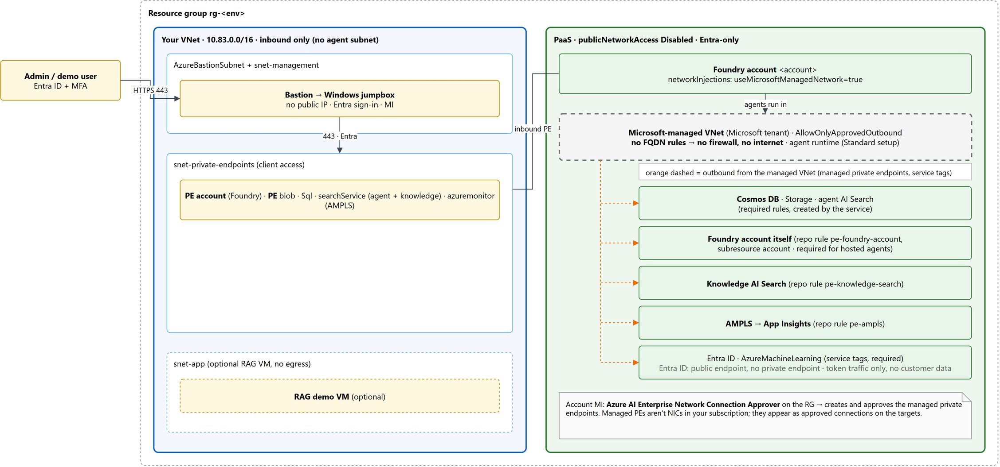

# Outbound option — Managed VNet for agents (`OUTBOUND_NETWORK_MODE=managedVnet`, PREVIEW)

A second way to isolate the Foundry Agent Service runtime: instead of injecting it into a customer
subnet (`byoVnet`, the default), Microsoft runs it in a **Microsoft-managed virtual network** owned by
the Foundry account. Inbound isolation (private endpoints, public network access disabled, Entra-only,
Bastion + jumpbox) is identical in both options.

> **Preview and irreversible.** `Microsoft.CognitiveServices/accounts/managedNetworks` has only preview
> API versions (checked 2026-11-19, newest `2026-11-15-preview`; this repo uses `2026-09-15-preview`,
> the newest with Bicep types). Once enabled, the managed network can't be disabled, and there is no
> switch between BYO VNet and managed VNet: changing it means a new Foundry account (new environment).
> Preflight therefore requires `MANAGED_VNET_PREVIEW_ACK=true` and a supported region.

```powershell
azd env new contoso-mvnet --location swedencentral
Get-Content examples/managed-vnet/managed-vnet.env | ? { $_ -match '^([^#=]+)=(.*)$' } | % { azd env set $Matches[1] $Matches[2] }
azd provision
pwsh ./scripts/validation/Test-Deployment.ps1
```

Source: [Configure managed virtual network for Microsoft Foundry projects](https://learn.microsoft.com/azure/foundry/how-to/managed-virtual-network).

## What the repo deploys



(Page 3 of [architecture.drawio](../img/architecture/architecture.drawio).)


| Component | Configuration |
|---|---|
| Foundry account | `networkInjections: [{ scenario: agent, subnetArmId: '', useMicrosoftManagedNetwork: true }]` at creation (`infra/modules/foundry/account.bicep`) |
| Role | Account managed identity → **Azure AI Enterprise Network Connection Approver** (`b556d68e-…`) on the resource group, so the managed network can create **and approve** its private endpoints to Cosmos DB, Storage, the agent Search and the optional targets (Learn requirement) |
| Managed network | `accounts/managedNetworks/default`, `isolationMode: AllowOnlyApprovedOutbound`, `firewallSku: Basic` (`infra/modules/foundry/managed-network.bicep`). **No FQDN rules** → the managed Azure Firewall is never created (no firewall cost, no internet egress) |
| Required outbound rules | Created by the service: private endpoints to the Standard setup Cosmos DB, Storage and agent AI Search, service tag `AzureActiveDirectory` |
| Additional rules (repo) | Managed private endpoints: **`pe-foundry-account`** (`account`, always: hosted agents call their own project endpoint; without it invokes fail with HTTP 500), `pe-knowledge-search` (`searchService`, modules 1/4/6) and `pe-ampls` (`azuremonitor`, module 5: own AMPLS in standalone, `EXISTING_AMPLS_ID` in hub-spoke) |
| Standard agent setup | Unchanged (BYO Cosmos DB, Storage, AI Search, capability host after the managed network) |
| Customer VNet | No `snet-agent`, no agent delegation, no NAT for agents (NAT only for the jumpbox in standalone). Private endpoints for clients (jumpbox, RAG VM, hub workstation) unchanged |

```text
inbound (unchanged)    client ─► private endpoint in your VNet ─► Foundry / Search / Storage / Cosmos (PNA disabled)
outbound (agents)      agent runtime (Microsoft-managed VNet)
                          ├─ managed PE ─► Cosmos DB, Storage, agent Search      (required rules, auto-approved)
                          ├─ managed PE ─► knowledge search (MCP, AI Search tool) (repo rule)
                          ├─ managed PE ─► AMPLS → App Insights (traces)          (repo rule)
                          └─ service tag AzureActiveDirectory                      (required rule)
                          everything else: denied (AllowOnlyApprovedOutbound, no FQDN rules)
```

Managed private endpoints don't appear as NICs in your subscription; they show up as approved private
endpoint connections on the target resources (requester in a Microsoft subscription).

## BYO VNet vs. managed VNet

| | `byoVnet` (default) | `managedVnet` (preview) |
|---|---|---|
| Agent network | Your delegated `/24` `snet-agent` | Microsoft-managed, per Foundry account |
| Egress control | Your NSG + NAT (standalone) or **your firewall** via UDR (hub-spoke) | Outbound rules on the account; managed firewall only if FQDN rules are added |
| Egress logging | Your firewall logs | **None** (not supported yet) |
| Address planning | `/24` + reserved-range checks | None |
| On-premises / non-PaaS targets | Peering / routing | Only through an Application Gateway private endpoint |
| Reversibility | Fixed per account | Fixed per account; can't be disabled |
| Status | GA | Preview API |

Choose `managedVnet` when the customer doesn't want to operate agent subnets and egress firewalling and
accepts the lack of egress logs; choose `byoVnet` when egress must go through the customer's firewall
and be logged.

## Validation

| Layer | Check |
|---|---|
| Preflight | `MANAGED_VNET_PREVIEW_ACK=true`, region in the Learn list, agent demo / Foundry IQ allowed, warning if monitoring has no AMPLS route |
| Static (profile `managed-vnet`) | Injection uses the managed network, no `snet-agent`; managed network `AllowOnlyApprovedOutbound`; only private endpoint outbound rules (no FQDN); knowledge search rule present; account MI gets exactly one Network Connection Approver assignment |
| Live `Test-Deployment.ps1` | Injection mode; isolation mode; outbound rules listed; **no FQDN rule**; repo rules `Active`; no customer agent subnet; plus every existing check (agent create/run, AI Search tool, Foundry IQ, traces, RAG, public negatives) |

**Live result (2026-11-19, standalone + all optional modules, swedencentral): 104/104 PASS**
(see [validation summary](../security/validation-summary.md)); latest:
**105/105 + hosted agent PASS** (2026-11-23). Observed outbound rules:
the service-created private endpoint rules to Cosmos DB (`sql`), Storage (`blob`) and the agent Search,
the repo's `pe-knowledge-search` and `pe-ampls` (+ `pe-foundry-account` since 2026-11-23), and the service tags `AzureActiveDirectory` and
`AzureMachineLearning` (both `Required`); no FQDN rule, no firewall. Agent create/run with the AI Search
tool, Foundry IQ via MCP and server-side traces (via the AMPLS rule) all worked.

## Gotchas found live

| Item | Note |
|---|---|
| Ordering | Creating project connections while the managed network provisions fails with `409` ("A resource with this name already exists or is in a conflicting state"). The Bicep serialises: account → account PE → managed network (+ rules) → project → capability host |
| Rule names | `GET …/outboundRules` returns rules **without names**; read a rule by name (`…/outboundRules/<name>`) to check it |
| Required rules | Learn lists Cosmos DB, Storage, Search and `AzureActiveDirectory`; the service also added `AzureMachineLearning` (`Required`) |
| Managed network kind | Created as `managedNetworkKind: V2` (default) |
| Teardown | The service-created account capability host (`<account>@aml_aiagentservice`) survives project deletion and blocks the account delete (`Deleting` → `Failed`). `Remove-Environment.ps1` / the `predown` hook delete it first (validated 2026-11-20) |

## Limitations (Learn + repo)

- Preview API; irreversible; supported regions listed in Learn (preflight enforces the list).
- No bring-your-own firewall and no outbound traffic logging.
- FQDN rules (e.g. for Bing, web, external MCP servers) create a managed Azure Firewall with its own cost; this
  repo adds none, so public-endpoint tools stay blocked as in the BYO profile.
- On-premises targets need an Application Gateway private endpoint.
- Learn's Bicep sample (`foundry-samples/18-managed-virtual-network`) returned HTTP 404 on 2026-11-19; this
  implementation follows the Learn article and the published resource schema.
