# Private Microsoft Foundry — networking walk-through

**Audience:** network and security architects who know Azure networking (VNets, NSGs, UDRs, Private
Link, Private DNS, Azure Firewall, hub-spoke) and need to understand exactly how this template wires
Microsoft Foundry, and which packets go where.

**Scope:** every network mode implemented in this repository: A standalone, B hub-spoke, C spoke-ready,
D/E with optional modules, F managed VNet, G public quick demo. It also covers the request flows a
reviewer usually asks about: portal sign-in, LLM call, agent run, Foundry IQ, telemetry and logs,
management and automation, DNS in hub-spoke, and hosted agents (A, B, F).

**Evidence:** IP addresses and results come from live environments in Sweden Central
(November 2026, one environment per option) and from the Bicep in
`infra/`. Everything marked *validated* was exercised by `scripts/validation/Test-Deployment.ps1`. Statements from Microsoft Learn link to their source.

Diagram source: [`networking-walkthrough.drawio`](../img/networking/networking-walkthrough.drawio) (20 pages,
draw.io) · PDF: [networking-walkthrough.pdf](networking-walkthrough.pdf).

## Contents

1. [Key ideas in one page](#1-key-ideas-in-one-page)
2. [Building blocks](#2-building-blocks)
3. [Option A — standalone](#3-option-a--standalone-default)
4. [Option B — hub-spoke](#4-option-b--hub-spoke)
5. [Option C — spoke-ready](#5-option-c--spoke-ready)
6. [Options D/E — optional modules](#6-options-de--optional-modules)
7. [Option F — managed VNet (preview)](#7-option-f--managed-vnet-preview)
8. [Option G — public quick demo](#8-option-g--public-quick-demo-not-private)
9. [Request flows](#9-request-flows)
10. [Egress allow-lists and observed denies](#10-egress-allow-lists-and-observed-denies)
11. [Security controls per option and residual risks](#11-security-controls-per-option-and-residual-risks)
12. [Appendices](#12-appendices)

## 1. Key ideas in one page

| # | Statement | Consequence for the design |
|---|---|---|
| 1 | Foundry is a **PaaS resource** (`Microsoft.CognitiveServices/accounts`, kind `AIServices`) with projects as child resources. The old hub/AML workspace model is not used. | One account → one private endpoint (group `account`) covers the project API, agents, the OpenAI-compatible and the Cognitive Services endpoints. |
| 2 | **Control plane ≠ data plane.** ARM (`management.azure.com`) stays public and Entra-protected; `publicNetworkAccess: Disabled` affects only the data plane. Private Link for ARM is uncommon and not in scope: tenant-wide (root management group only), breaks Azure Bastion (`privatelink.azure.com` overlaps `management.azure.com`), not supported for AKS or multi-tenant accounts, needs root-MG Owner/Contributor ([Learn](https://learn.microsoft.com/azure/azure-resource-manager/management/create-private-link-access-portal)). | `azd provision` works from anywhere with RBAC. Data-plane tests run *inside* the VNet (Run Command). |
| 3 | **Inbound** to the services = private endpoints + `publicNetworkAccess: Disabled` + Entra-only (`disableLocalAuth: true`). | Nobody without a private network path *and* an RBAC role reaches the data plane. |
| 4 | **Outbound** from the agent runtime = either your delegated subnet (BYO VNet injection) or a Microsoft-managed VNet. Both reach your PaaS through private endpoints. | Egress control is an explicit, separate decision ([network directions](../network-directions.md)). |
| 5 | **Outbound from AI Search** (Foundry IQ query planning) needs a Search **shared private link**, approved on the Foundry account. | The only place where a PaaS service calls another PaaS service over a link that the target owner must approve. |
| 6 | **DNS makes or breaks Private Link.** The client always uses the public FQDN; the private zone turns the public CNAME into a private A record. | Hub-spoke: central zones + resolver + conditional forwarders for the *public* zone names. |
| 7 | Authorization is evaluated **before** the network ACL (observed, Option G). | A caller without a role gets 401 even from an allowed IP; an authorized caller from a non-allowed network gets 403. |

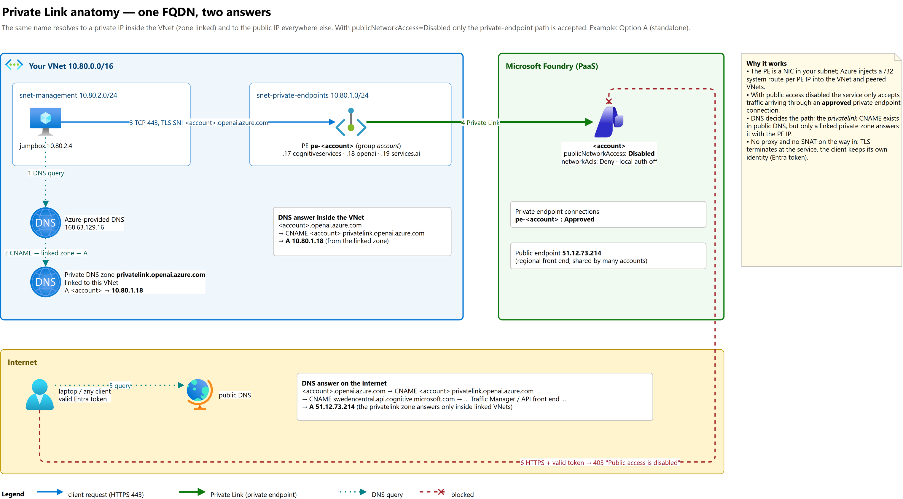

*Figure 1 — Private Link anatomy: the private endpoint (NIC with private IPs in your subnet), the
private DNS zone that maps the public name to those IPs, and the target resource with public access
disabled. The connection must be approved on the target (auto-approved when the requester has
`…/privateEndpointConnectionsApproval/action` on it). Background: [Private Link explained](../private-link-explained.md).*

## 2. Building blocks

### 2.1 Foundry endpoints, private endpoint and DNS zones

A Foundry account exposes three public FQDN families. One private endpoint with group ID `account`
gets **three IP configurations on one NIC**, one per zone (verified live):

| NIC IP config (`requiredMemberName`) | Public FQDN | Private DNS zone | Option A | Option B |
|---|---|---|---|---|
| `default` | `<account>.cognitiveservices.azure.com` | `privatelink.cognitiveservices.azure.com` | 10.80.1.17 | 10.81.1.4 |
| `secondary` | `<account>.openai.azure.com` | `privatelink.openai.azure.com` | 10.80.1.18 | 10.81.1.5 |
| `third` | `<account>.services.ai.azure.com` (project API, agents) | `privatelink.services.ai.azure.com` | 10.80.1.19 | 10.81.1.6 |

The project endpoint is `https://<account>.services.ai.azure.com/api/projects/<project>`. All three
records must exist; a missing one breaks only the SDKs that use that host name, which is hard to
diagnose.

Resolution chain (Option A):

```text
<account>.openai.azure.com
  CNAME <account>.privatelink.openai.azure.com
     ├── inside the VNet (zone linked):  A 10.80.1.18                        → private endpoint
     └── public DNS:  CNAME swedencentral.api.cognitive.microsoft.com
                        → cognitivesecprod.trafficmanager.net → … → A <public IP> → 403
```

### 2.2 Other private endpoints

| Resource | Group ID | Zone | Used by |
|---|---|---|---|
| Storage (agent files) | `blob` | `privatelink.blob.core.windows.net` | agent runtime (Standard setup) |
| Cosmos DB (threads) | `Sql` | `privatelink.documents.azure.com` | agent runtime; the regional endpoint gets a second IP |
| AI Search (agent vector store) | `searchService` | `privatelink.search.windows.net` | agent runtime |
| AI Search (knowledge, modules 1/4/6) | `searchService` | `privatelink.search.windows.net` | agent tool, Foundry IQ MCP, RAG VM |
| AMPLS (module 5) | `azuremonitor` | `privatelink.monitor.azure.com`, `privatelink.oms.opinsights.azure.com`, `privatelink.ods.opinsights.azure.com`, `privatelink.agentsvc.azure-automation.net`, `privatelink.blob.core.windows.net` | OTel exporters, Log Analytics queries |

The AMPLS endpoint alone uses 13 IPs (Option A: 10.80.1.4–.16): global and regional ingestion,
live metrics, profiler, snapshot, query (`api.monitor`, `api.loganalytics`) and the agent-service blob.
Plan PE subnets with that in mind (`/24` in this template).

### 2.3 Private endpoint mechanics that matter here

| Mechanism | Behaviour | Template setting |
|---|---|---|
| Routes | `/32` routes take priority: each PE IP is added as a `/32` *InterfaceEndpoint* route in its VNet **and peered VNets**; as the most specific route it takes priority over a `0.0.0.0/0` UDR, so PE traffic does not pass the firewall. Overriding it needs network policies for route tables on the PE subnet and a UDR at least as specific as the VNet address space; a `0/0` UDR never overrides it ([Learn](https://learn.microsoft.com/azure/private-link/disable-private-endpoint-network-policy)). | No UDR on the PE subnet |
| Network policies | With `privateEndpointNetworkPolicies: Enabled`, NSGs (and UDRs) apply to traffic **to** the PE. Without it, NSGs on the PE subnet are ignored. | `Enabled` + NSG: allow 443 from `VirtualNetwork`, deny all else |
| Approval | Auto-approved when the requester holds `privateEndpointConnectionsApproval/action` on the target (here: same deployment identity). Otherwise *Pending* until the target owner approves. | All PEs auto-approve; Search shared private links need explicit approval (§7, §9.4) |
| Zone groups | `privateDnsZoneGroups` writes and removes the A records automatically. A zone group can't be re-pointed to other zones in place (`UpdatingPrivateDnsZoneIdOnPrivateDnsZoneConfigNotAllowed`). | Spoke-ready handover deletes and recreates it (§5) |
| Public access | A PE adds a private path; it does **not** remove the public one. | `publicNetworkAccess: Disabled` on every PaaS resource (except Option G) |
| Trusted services | `networkAcls.bypass: AzureServices` lets trusted Microsoft services in with managed identity. | Defaults `AzureServices` on Foundry and agent Storage (documented choice); `None` validated 101/101 (§11) |

### 2.4 Subnets and NSGs (BYO VNet modes)

All subnets have `defaultOutboundAccess: false` (no implicit SNAT); egress exists only where a NAT
gateway or UDR provides it.

| Subnet (Option A default) | Prefix | NSG highlights | Egress |
|---|---|---|---|
| `snet-private-endpoints` | 10.80.1.0/24 | In: 443 from `VirtualNetwork` (100), deny all (4096). Out: deny `Internet` (4000). PE network policies on. | — |
| `snet-management` (jumpbox) | 10.80.2.0/24 | In: 3389 from the Bastion subnet only. Out: 443 → PE subnet, app port → `snet-app`, 443/80 + KMS 1688 → `Internet`, deny other `VirtualNetwork` (4010), deny `Internet` (4000). | NAT gateway |
| `AzureBastionSubnet` | 10.80.3.0/26 | Platform-required Bastion rule set (443 in from Internet, GatewayManager, AzureLoadBalancer, 8080/5701 VNet; out 22/3389 VNet, 443 AzureCloud, 80 Internet). | Bastion public IP |
| `snet-app` (RAG VM, module 3) | 10.80.4.0/24 | In: app port 8443 from `VirtualNetwork` only; deny all. Out: deny `Internet`. | **None** |
| `snet-agent` (delegated `Microsoft.App/environments`) | 10.80.6.0/24 | Out: 443 → service tags `AzureActiveDirectory`, `AzureMonitor`, `MicrosoftContainerRegistry`, `AzureFrontDoor.FirstParty`; all → `VirtualNetwork`; deny `Internet` (4000). In: `AzureLoadBalancer`, `VirtualNetwork`; deny all. | NAT gateway (A) / UDR → firewall (B) |

The agent subnet must be dedicated and delegated; Learn reserves `100.100.192.0/19` (and other ranges)
for the Agent Service, so your address plan must not overlap them.

## 3. Option A — standalone (default)

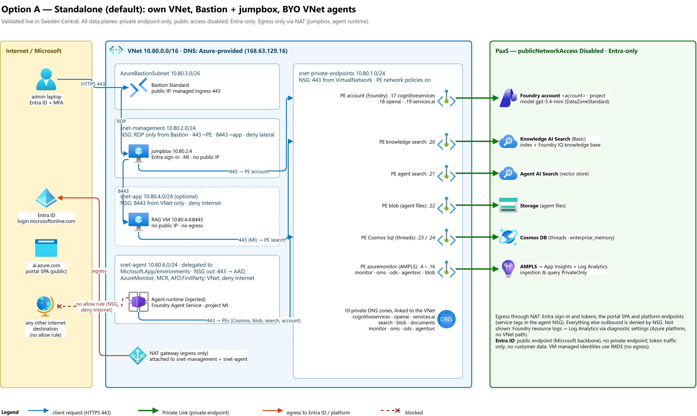

*Figure 2 — Option A: one self-contained VNet with Bastion, jumpbox, private endpoints, the injected
agent subnet and a NAT gateway. Private DNS zones are created in the workload resource group and
linked to this VNet only. Red: the agent NSG denies Internet destinations outside the allowed service tags.*

| Element | Value (Option A) |
|---|---|
| VNet | 10.80.0.0/16, Azure-provided DNS (168.63.129.16) |
| Private DNS | `PRIVATE_DNS_ZONE_MODE=create`: zones in the workload RG, linked to this VNet |
| Admin path | Internet → Bastion (Standard, public IP) → RDP 10.80.2.4 (jumpbox, no public IP) |
| Egress | NAT gateway `ng-<env>` on `snet-agent` + `snet-management` only. PE and app subnets have none |
| PaaS | Foundry account, Storage, Cosmos DB, AI Search ×2, App Insights, Log Analytics: all `publicNetworkAccess: Disabled` (LAW: public ingestion/query disabled when AMPLS is used) |
| Agents | Standard setup, BYO VNet injection into `snet-agent` (capability host) |
| Validation | 101/101 incl. Foundry IQ `low` and trusted-service bypass `None` |

**Why NAT and not a firewall?** A standalone deployment has no customer hub. The NAT provides
deterministic egress for the jumpbox (portal, Windows Update, Entra) and the agent runtime's platform
dependencies; the agent NSG restricts the runtime to service tags. If the customer needs FQDN filtering
and egress logs, use Option B (their firewall) or add a firewall to the standalone VNet.

## 4. Option B — hub-spoke

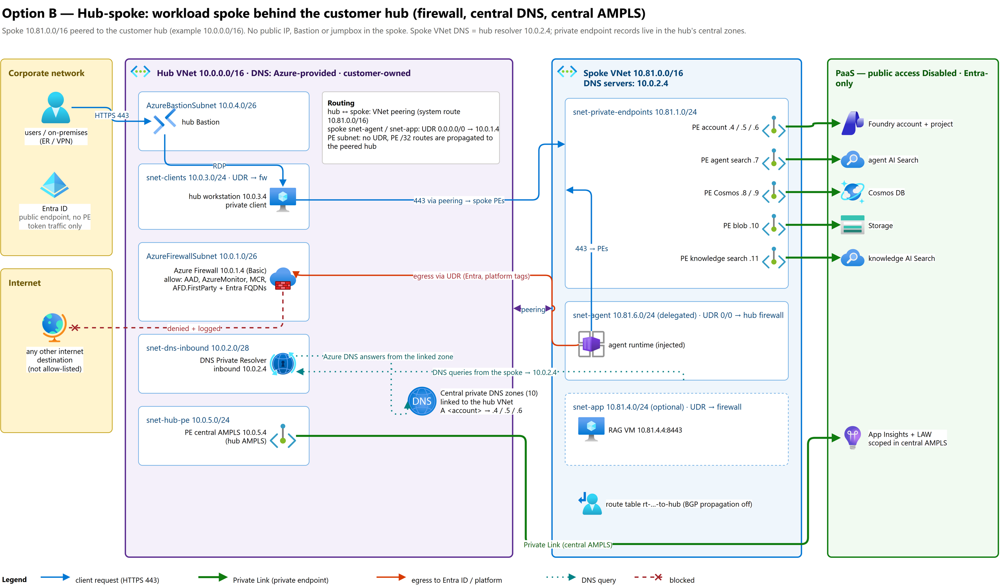

*Figure 3 — Option B: the workload spoke contains only private endpoints, the agent subnet and the
optional app subnet. Admin access, DNS, egress and central AMPLS are the customer's hub
(here the sample hub for testing, `tests/integration/sample-hub/`). Red: the firewall denies and logs every destination that isn't on its allow-list.*

| Element | Hub (sample hub, 10.0.0.0/16) | Spoke (10.81.0.0/16) |
|---|---|---|
| DNS | Azure-provided; DNS Private Resolver inbound 10.0.2.4; **central** private zones linked to the hub | VNet DNS servers = 10.0.2.4 (`CUSTOM_DNS_SERVERS`) |
| Private DNS mode | — | `existing`: PE zone groups write A records into the central zones (`EXISTING_PRIVATE_DNS_ZONE_IDS`); no zones in the spoke |
| Routing | Peering (system route 10.81.0.0/16); `snet-clients` UDR 0/0 → 10.0.1.4 | UDR `rt-<env>-to-hub` on `snet-agent` + `snet-app`: 0/0 → 10.0.1.4, BGP propagation off. PE subnet: no UDR |
| Egress | Azure Firewall Basic 10.0.1.4 (policy in §10) | via hub firewall only |
| Admin | Bastion 10.0.4.0/26 → `vm-hub-workstation` 10.0.3.4 | no Bastion, jumpbox or public IP in the spoke |
| Monitoring | Central AMPLS PE 10.0.5.4 (`ampls-sample-hub`) | App Insights joins the central AMPLS (`EXISTING_AMPLS_ID`) |
| Validation | — | 91/91 + hosted agent (2026-11-23) |

Points a network reviewer usually checks:

- **Hub client → spoke PE:** the hub's 0/0 UDR doesn't apply, because the peering route 10.81.0.0/16 and
  the `/32` PE routes are more specific and take priority. The firewall doesn't see this traffic. If the
  customer *wants* PE traffic inspected, they need UDRs at least as specific as the spoke address space
  (`/16` or longer, e.g. `/32`) on the hub client subnets, private endpoint network policies for route
  tables on the PE subnet (`Enabled` in this template) and SNAT on the firewall (not part of this template).
- **Agent runtime → spoke PEs:** in-VNet routes (more specific than 0/0); never via the firewall.
- **Agent runtime → Entra/platform:** 0/0 UDR → hub firewall; the firewall allow-list mirrors the NSG
  service tags plus Entra FQDNs (§10).
- **DNS:** the spoke uses the hub resolver, which answers from the central zones (§9.7). Never link a
  local and a central zone of the same name to one VNet; Azure doesn't allow it anyway.
- **One AMPLS per DNS scope:** AMPLS shares global endpoints, so a spoke must join the hub's AMPLS
  instead of creating its own ([monitoring](../modules/monitoring.md)).

## 5. Option C — spoke-ready

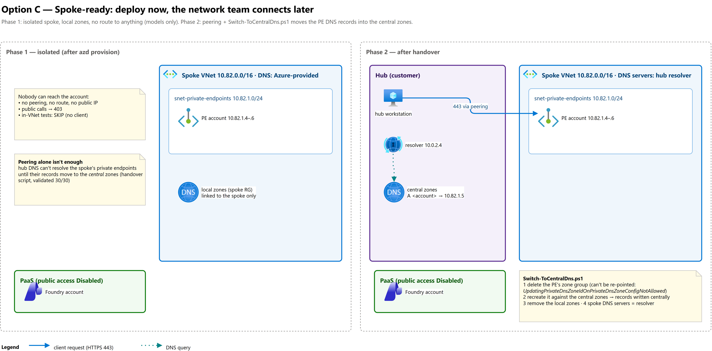

*Figure 4 — Option C: deploy an isolated spoke now (phase 1), and hand it over to the network team
later (phase 2).*

| Phase | State | What a client sees |
|---|---|---|
| 1 isolated | Spoke 10.82.0.0/16, local zones linked to the spoke only, no peering, no route, no client | Nobody can reach the data plane; public calls → 403. In-VNet tests are skipped (no client) |
| 2a peering only | Hub ↔ spoke peered | **Peering alone isn't enough:** hub DNS can't resolve the spoke's private endpoints until their records move to the central zones (handover script, validated 30/30). Hub clients query the **central** zones, which don't have the account's records → NXDOMAIN (finding F1) |
| 2b handover | `scripts/handover/Switch-ToCentralDns.ps1`: delete each PE zone group, recreate it against the central zones (records written centrally), remove the local zones, set spoke DNS to the resolver | Private answers from the hub; same as Option B |

Zone groups can't be re-pointed in place (finding F2), hence delete + recreate (seconds of DNS gap per
PE). Details: [spoke-ready handover](../spoke-ready-handover.md).

## 6. Options D/E — optional modules

The modules don't change the network model; they add private endpoints and flows:

| Module | Network additions |
|---|---|
| 1 AI Search | Knowledge Search (Basic) + PE (`.20` in A, `.11` in B); public access disabled; Entra-only |
| 3 RAG demo | `snet-app` 10.x.4.0/24, Ubuntu VM 10.x.4.4:8443, **no egress at all** (no NAT, deny Internet); calls the account PE and the knowledge PE with its managed identity |
| 4 Demo agent | Agent with the AI Search tool → knowledge PE (project MI: Search Index Data Contributor + Search Service Contributor) |
| 5 Advanced monitoring | AMPLS (PrivateOnly/PrivateOnly) + PE, App Insights/LAW public ingestion + query disabled. **Ordering:** AMPLS PE and DNS must exist before the Foundry account is created, otherwise agent traces are lost |
| 6 Foundry IQ | Knowledge base + RemoteTool connection (MCP) → knowledge PE. With `FOUNDRY_IQ_REASONING=low`: Search shared private link → Foundry (§9.4, Figure 7) |

## 7. Option F — managed VNet (preview)

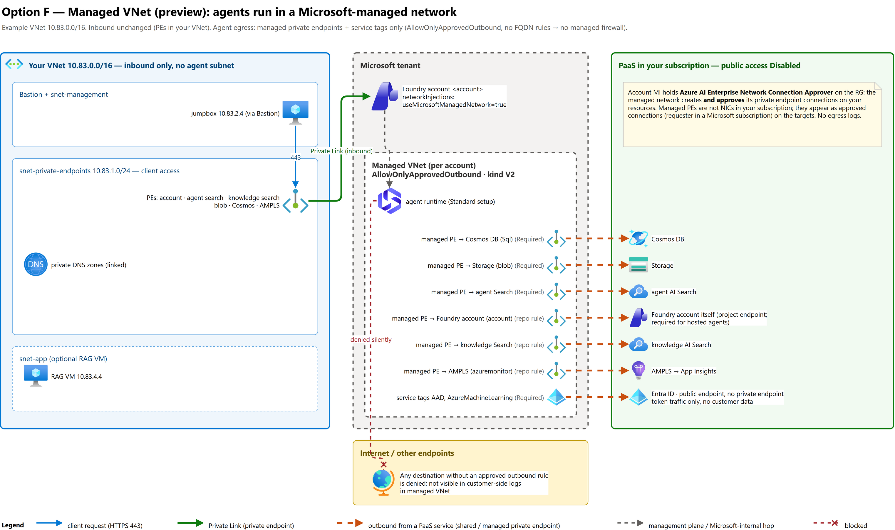

*Figure 5 — Option F: inbound is unchanged (PEs in your VNet). The agent runtime runs in a
Microsoft-managed VNet that reaches your PaaS through managed private endpoints. Red: anything without an outbound rule is denied without a log entry.*

| Element | Value (10.83.0.0/16) |
|---|---|
| Injection | `networkInjections: [{ scenario: agent, useMicrosoftManagedNetwork: true }]` at account creation; irreversible |
| Managed network | `accounts/managedNetworks/default`, `isolationMode: AllowOnlyApprovedOutbound`, kind V2; **no FQDN rules**, so no managed firewall and no Internet egress |
| Outbound rules | Required (service-created): PE → Cosmos DB (`Sql`), Storage (`blob`), agent Search; service tags `AzureActiveDirectory`, `AzureMachineLearning`. Repo: PE → Foundry account itself (`pe-foundry-account`, subresource `account`, always; required for hosted agents, §9.8), PE → knowledge Search, PE → AMPLS |
| Approval | Account MI holds *Azure AI Enterprise Network Connection Approver* on the RG; the managed network creates **and approves** its PE connections on your resources |
| Your VNet | No `snet-agent`, no delegation; NAT only for the jumpbox |
| Validation | 105/105 + hosted agent (2026-11-23; agent + AI Search tool + Foundry IQ + traces via the AMPLS rule) |

For a network architect, the trade-off is visibility: managed private endpoints aren't NICs in your
subscription. They appear only as approved connections on the targets, with a Microsoft-owned
requester. There are **no egress logs**. Destinations without an approved outbound rule are denied silently. BYO
VNet keeps egress in your firewall logs. Details: [managed VNet](../modules/managed-vnet.md).

## 8. Option G — public quick demo (NOT private)

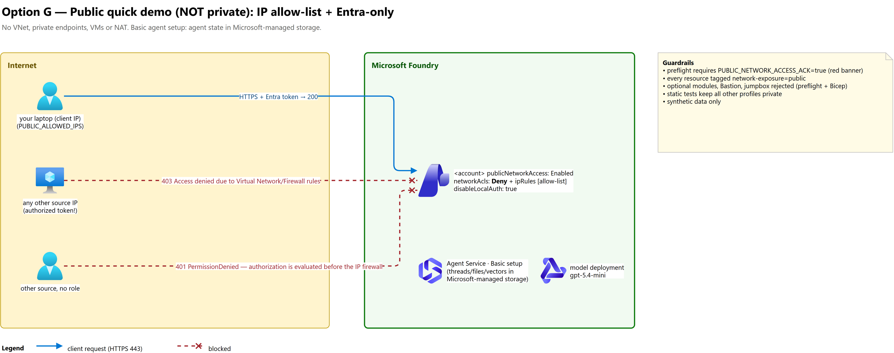

*Figure 6 — Option G: no VNet at all. The account is public but limited to an IP allow-list and
Entra ID. Use it only for synthetic demo data.*

| Control | Setting |
|---|---|
| Network | `publicNetworkAccess: Enabled`, `networkAcls.defaultAction: Deny`, `ipRules = PUBLIC_ALLOWED_IPS` |
| Identity | `disableLocalAuth: true` (no keys) |
| Agents | Basic setup: Microsoft-managed storage, no network isolation |
| Guardrails | `NETWORK_MODE=public` requires `PUBLIC_NETWORK_ACCESS_ACK=true`; tag `network-exposure=public`; preflight + Bicep reject modules, Bastion and jumpbox |
| Validation | 14/14, including an *outsider* VM (other IP) with a temporary role: **403** "Access denied due to Virtual Network/Firewall rules"; without the role: **401** |

## 9. Request flows

Each flow is shown for Option A (IP addresses from the validated Option A environment); differences for other options
are listed below each diagram.

### 9.1 S1 — Portal sign-in and project access

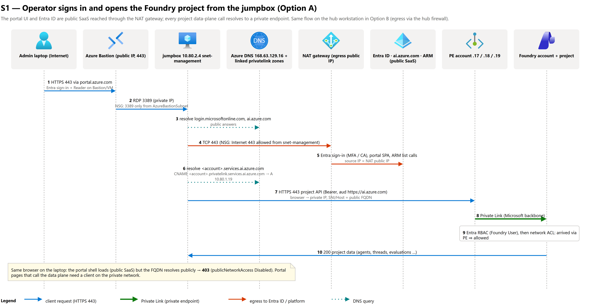

*Figure S1 — The Foundry portal (`ai.azure.com`) is a public single-page app; Entra ID and ARM are
public too. The browser then calls the project data plane, which resolves to a private endpoint.*

- **What must be reachable from the client:** `login.microsoftonline.com` and related Entra endpoints,
  `ai.azure.com` (portal assets), `management.azure.com` (resource lists) — over the NAT (A) or the hub
  firewall (B) — **plus** the three Foundry FQDNs via private DNS.
- **What fails from outside:** the portal shell loads, but data-plane calls get 403. That's expected
  and is the main proof that the data plane is private.
- **Option B:** same flow from `vm-hub-workstation` (egress via the hub firewall's workstation rule,
  DNS via the resolver). **Option F:** identical to A. **Option G:** direct from the allowed laptop.
- **Entra ID** has no private endpoint: token traffic goes to the public Entra endpoints
  (`AzureActiveDirectory` service tag / login FQDNs) over the Microsoft backbone and carries no customer
  data. VM managed identities use IMDS (no egress); platform identities get their tokens inside the service.

### 9.2 S2 — LLM call

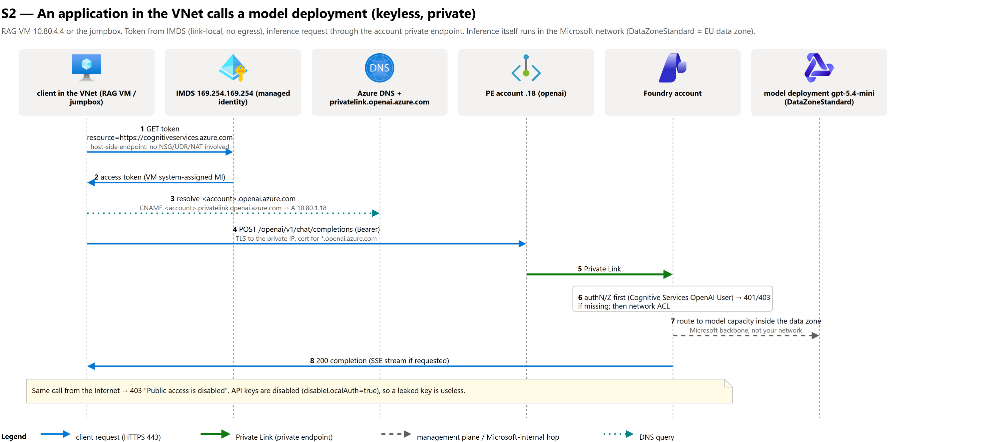

*Figure S2 — An in-VNet client calls a model deployment through the account private endpoint with a
managed-identity token.*

- IMDS (169.254.169.254) is host-local, so it needs no NSG rule, UDR or NAT. The RAG VM (optional
  module 3) has **no
  egress** at all and still works.
- Token audience `https://cognitiveservices.azure.com`; role *Cognitive Services OpenAI User*.
- The deployment type `DataZoneStandard` keeps processing in the EU data zone; the hop from the account
  to model capacity is Microsoft-internal and is not your network.
- Option B: the PE is in the spoke; a hub client reaches it via peering. Option G: same request to the
  public IP, accepted only from the allow-list.

### 9.3 S3 — Agent run (Standard setup)

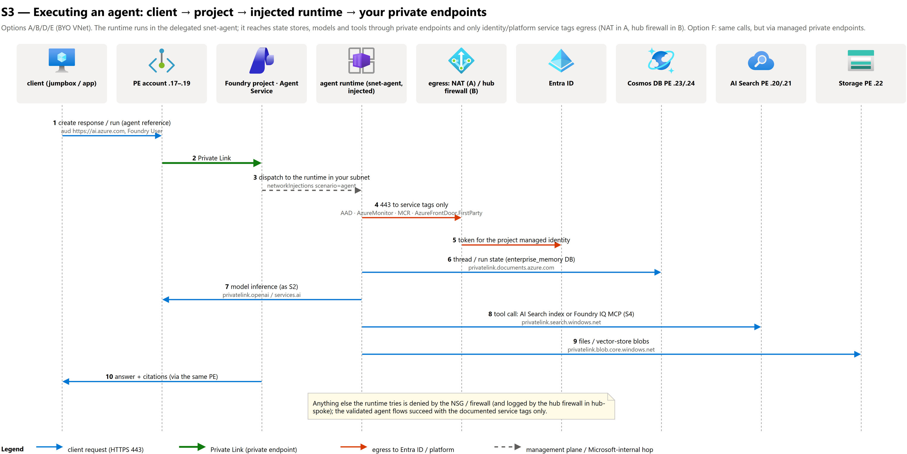

*Figure S3 — The client talks only to the project endpoint. The Agent Service dispatches the run to the
runtime injected in your `snet-agent`, which then calls Cosmos DB, the model, AI Search and Storage
through their private endpoints.*

| Hop | From → to | Path | Control |
|---|---|---|---|
| 1–2 | client → project API | PE `.19` | Entra (`https://ai.azure.com`), *Foundry User* (formerly *Azure AI User*) |
| 3 | Agent Service → runtime | Microsoft-internal (injection) | delegation + capability host |
| 4–5 | runtime → Entra / platform | NAT (A) or hub firewall (B) | NSG service tags; firewall allow-list |
| 6 | runtime → Cosmos DB | PE `.23/.24` | project MI, Cosmos data-plane role |
| 7 | runtime → model | account PE | project MI |
| 8 | runtime → AI Search | PE `.20/.21` | project MI: Search Index Data Contributor + Search Service Contributor |
| 9 | runtime → Storage | PE `.22` | project MI, Storage Blob Data roles |

**Option F:** hops 4–9 leave the managed VNet through the outbound rules (managed PEs, service tags)
instead of your subnet. **Option G:** Basic setup; Microsoft-managed state, no customer network.

### 9.4 S4 — Foundry IQ

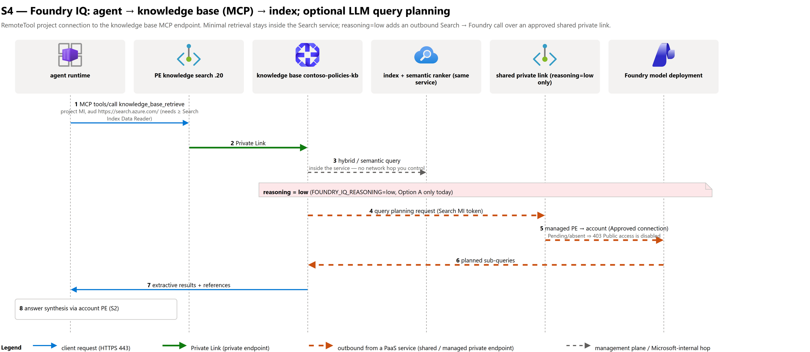

*Figure S4 — Foundry IQ via the knowledge base MCP endpoint. Minimal retrieval stays inside AI Search.
With `reasoning=low`, Search itself calls the model, which is an outbound call from a PaaS service.*

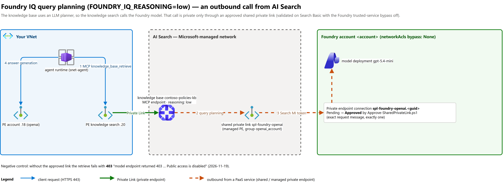

*Figure 7 — The query-planning call is private only through an approved shared private link
(`openai_account`). Validated live on Search Basic with the Foundry bypass `None`: no link → 403;
Pending → 403; Approved → 200.*

- The project connection is `category: RemoteTool`, `authType: ProjectManagedIdentity`, audience
  `https://search.azure.com/`.
- The shared private link is a managed PE in Search's Microsoft-managed network. It's created by the
  Bicep and approved by `scripts/ai-search/Approve-SharedPrivateLink.ps1`, which matches the exact
  request message and expects exactly one pending connection. An approved link can't be modified
  (`PrivateLinkStatusChangeNotAllowed`); recreate it instead.
- `low` is implemented and validated in Option A; B/F use minimal retrieval (deferred).

### 9.5 S5 — Traces, metrics and logs

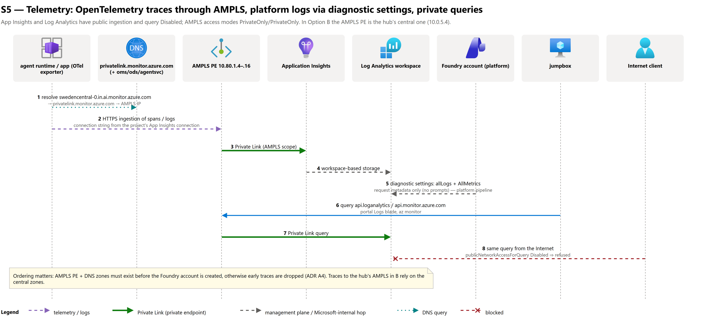

*Figure S5 — OpenTelemetry exports go to the regional ingestion endpoint, which resolves to the AMPLS
private endpoint. Platform resource logs go via diagnostic settings, outside your network. Queries run
through the AMPLS query endpoints.*

- Ingestion host example: `swedencentral-0.in.ai.monitor.azure.com` → `privatelink.monitor.azure.com` →
  AMPLS IP. AMPLS access modes `PrivateOnly` for ingestion and query; App Insights and LAW public
  ingestion and query `Disabled`.
- Diagnostic settings (`allLogs`, `AllMetrics`) on the Foundry account, Search, Cosmos DB, Storage and
  Bastion write to the workspace through the Azure Monitor pipeline. They contain request metadata, not
  prompts or completions.
- Option B: the spoke joins the hub's AMPLS (PE 10.0.5.4) and uses the central zones. Option F: the
  runtime exports via the `pe-ampls` managed PE. Option G: public endpoints.
- **Ordering:** if the account exists before the AMPLS PE and DNS, agent traces go missing. The Bicep
  creates the account after the AMPLS PE.

### 9.6 S6 — Management plane and automation

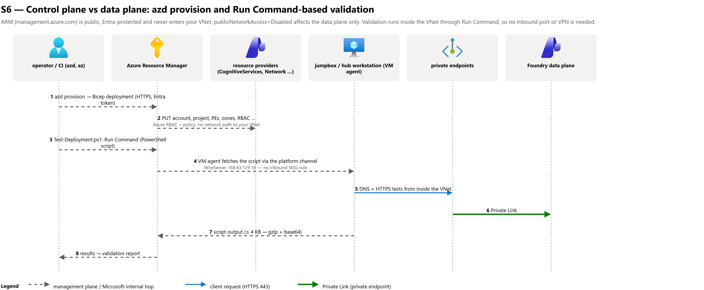

*Figure S6 — The control plane never enters the VNet. Validation uses Run Command, so no inbound port,
VPN or public IP on a test VM is needed.*

- `azd provision` → ARM → resource providers. Works with the data plane fully private.
- Run Command: ARM → VM agent (platform channel via WireServer 168.63.129.16, no NSG rule required) →
  script runs **inside** the VNet → output returned via ARM. Output is limited to 4 KB, so the test
  scripts gzip + base64 their results.
- The hub-spoke spoke has no VM: the workstation in the hub (`PRIVATE_CLIENT_VM_ID`) runs the tests.

### 9.7 S7 — DNS in hub-spoke

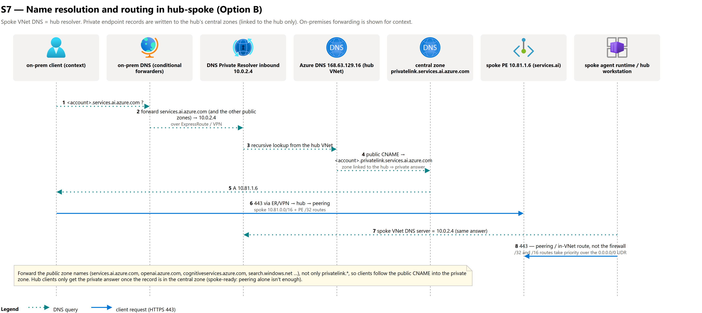

*Figure S7 — Name resolution from on-premises (context) and from the spoke. Traffic then follows the
most specific route: the PE `/32` takes priority over the 0/0 UDR.*

- On-premises DNS: conditional forwarders for the **public** zones (`services.ai.azure.com`,
  `openai.azure.com`, `cognitiveservices.azure.com`, `search.windows.net`, `blob.core.windows.net`,
  `documents.azure.com`, Azure Monitor zones) → resolver inbound IP. Forwarding only `privatelink.*`
  breaks resolution, because clients ask for the public name first.
- The resolver VNet (hub) must be linked to every `privatelink.*` zone. Spokes don't need links when
  they use the resolver.
- The sample hub used for testing has no ExpressRoute/VPN; the on-premises steps are shown for context only.

### 9.8 S8 — Hosted agents

A hosted agent is your own code (Agent Framework, `FoundryChatClient` + `FoundryToolbox`), run by Foundry
in a per-session micro VM. The path is the same in every network mode:

- client → account private endpoint (`services.ai.azure.com`) → agent Responses endpoint
  `{project}/agents/{name}/endpoint/protocols/openai/responses` → **agent guardrail** (agent RAI policy:
  a jailbreak gets `HTTP 400 content_filter` at input stage, before your code runs) → micro VM;
- agent code → project endpoint → model deployment (the deployment's content filter applies too) and
  project **toolbox** (MCP) → Foundry tools service → single-tenant **data proxy** → knowledge AI Search
  private endpoint (`Agents.Mcp` in the Search logs comes from the data proxy IP, not from the micro VM);
- deployment: `azd deploy` (source-code deploy, `remote_build` runs platform-side, no ACR) from an
  in-network runner with its managed identity (*Foundry Project Manager* on the project);
- telemetry: agent code → App Insights through the AMPLS private endpoint; the **agent identity** needs
  *Monitoring Metrics Publisher* on App Insights;
- Internet with a valid token → `403 Public access is disabled`.

What changes per mode is where the micro VM and the data proxy live and how they leave the network:
A and B use the delegated agent subnet in your VNet, F uses the Microsoft-managed VNet.

#### A — standalone

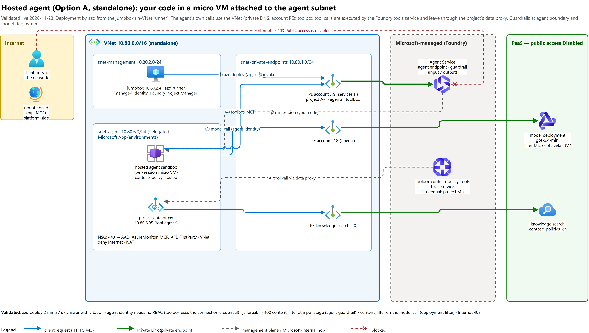

*Figure 8 — A hosted agent is your own code, run by Foundry in a per-session micro VM attached to the
delegated agent subnet. It is deployed by azd from the jumpbox (in-VNet runner), because the data plane is
private.*

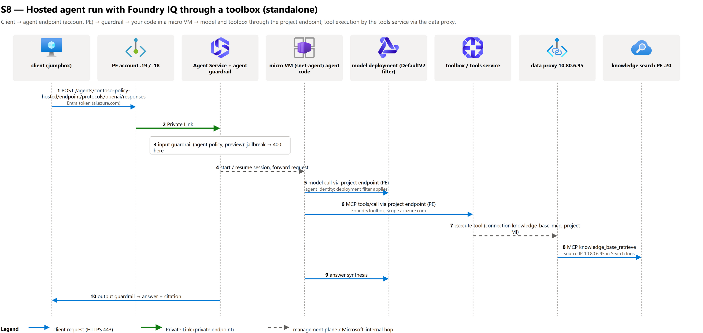

*Figure S8 — Hosted agent run with Foundry IQ through a project toolbox.*

| Path | Route | Evidence |
|---|---|---|
| Deploy | jumpbox (azd, managed identity with *Foundry Project Manager*) → account PE → Agent Service; source zip, remote build platform-side (no registry) | `azd deploy` 2 min 37 s |
| Invoke | client → account PE `.19` → agent endpoint → **agent guardrail** (input/output, preview) → micro VM | jailbreak → `400 content_filter` at input stage |
| Agent's own calls | micro VM (agent subnet) → project endpoint via account PE → model deployment (**deployment filter** `Microsoft.DefaultV2`) | jailbreak without agent policy → `content_filter` on the model call |
| Tool calls (toolbox) | micro VM → toolbox (project endpoint) → tools service → **data proxy 10.80.6.95** → knowledge search PE | Search logs: caller 10.80.6.95 (same as prompt agents) |
| Tool calls (direct MCP, first test) | micro VM → knowledge search PE directly | Search logs: caller 10.80.6.119/.12 (micro VM) |
| Platform egress | agent subnet → NSG → NAT gateway | NSG rules in [§10](#10-egress-allow-lists-and-observed-denies) |
| Internet | → `403 Public access is disabled` | live |

#### B — hub-spoke

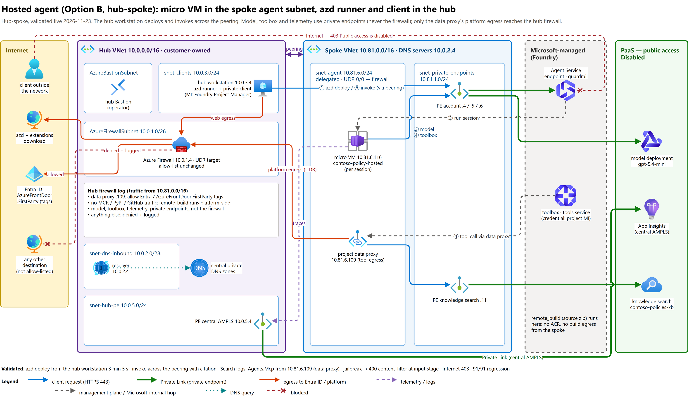

*Figure 9 — Hub-spoke with a sample hub: the micro VM (10.81.6.116) and the data proxy
(10.81.6.109) sit in the spoke agent subnet. The hub workstation is both the azd runner and the private
client; it reaches the spoke private endpoints over the peering. Only the data proxy's platform egress and
one SDK call from the micro VM reach the hub firewall.*

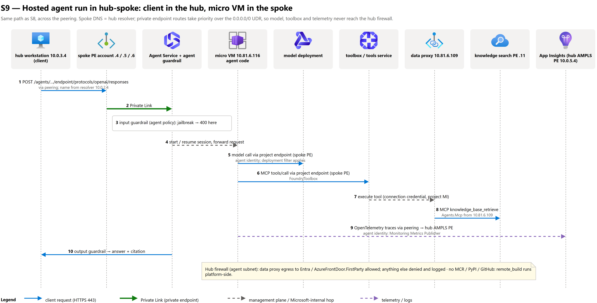

*Figure S9 — The S8 run across the peering. Private endpoint `/32` routes take priority over the `0.0.0.0/0` UDR, so model,
toolbox and telemetry traffic never crosses the firewall.*

| Path | Route | Evidence |
|---|---|---|
| Deploy | hub workstation 10.0.3.4 (azd, managed identity with *Foundry Project Manager*) → peering → spoke account PE; azd and extensions downloaded through the hub firewall (workstation web rule) | `azd deploy` 3 min 5 s |
| Invoke | hub workstation → peering → account PE (`.4`/`.5`/`.6`, name from the hub resolver 10.0.2.4) → agent guardrail → micro VM 10.81.6.116 | answer with citation; jailbreak → `400 content_filter` at input stage |
| Agent's own calls | micro VM → project endpoint via the spoke account PE → model deployment | not in the firewall log |
| Tool calls (toolbox) | micro VM → toolbox → tools service → **data proxy 10.81.6.109** → knowledge search PE `.11` | Search logs: `Agents.Mcp` from 10.81.6.109 |
| Telemetry | micro VM → peering → central AMPLS PE 10.0.5.4 (hub) → App Insights | not in the firewall log |
| Platform egress | agent subnet → UDR → hub firewall 10.0.1.4: data proxy allowed to the Entra / `AzureFrontDoor.FirstParty` tags; other destinations denied | firewall log, 3 h; no MCR / PyPI / GitHub traffic (`remote_build` is platform-side); **allow-list unchanged** |
| Internet | → `403 Public access is disabled` | live |

#### F — managed VNet (preview)

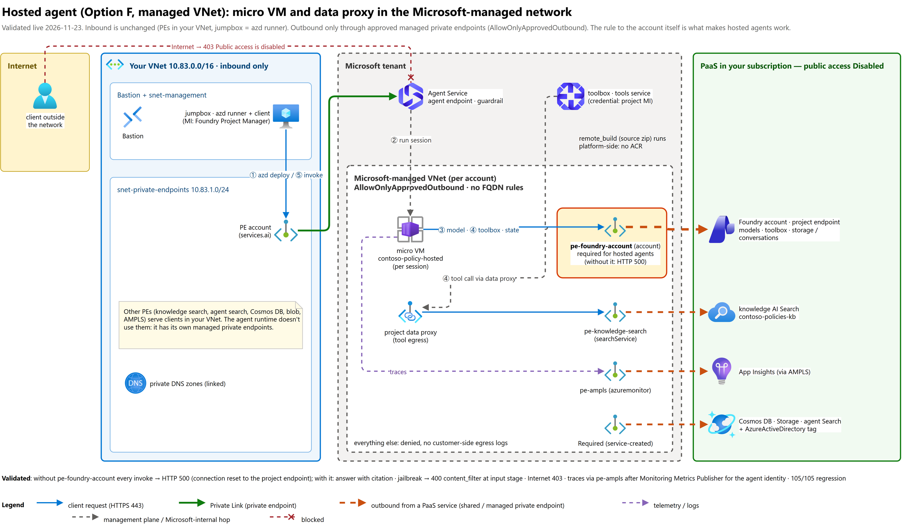

*Figure 10 — Managed VNet: your VNet keeps the inbound private endpoints and the jumpbox
(azd runner). The micro VM and the data proxy run in the Microsoft-managed VNet
(`AllowOnlyApprovedOutbound`) and leave it only through managed private endpoints. The rule
`pe-foundry-account` (subresource `account`) is required for hosted agents.*

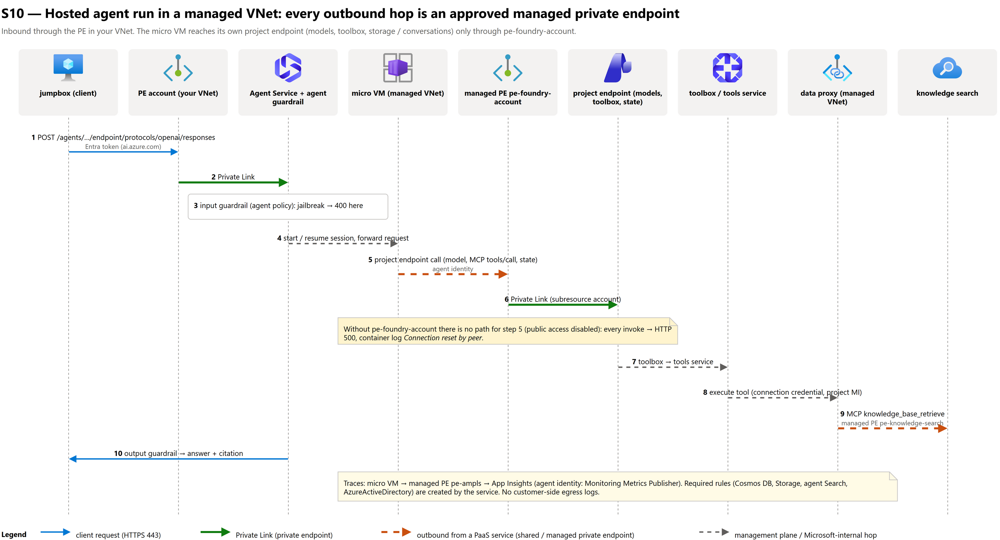

*Figure S10 — The S8 run in a managed VNet: every outbound hop of the agent runtime is an approved managed
private endpoint.*

| Path | Route | Evidence |
|---|---|---|
| Deploy | jumpbox (azd, managed identity with *Foundry Project Manager*) → account PE in your VNet | `azd deploy` PASS |
| Invoke | client → account PE (your VNet) → agent guardrail → micro VM (managed VNet) | answer with citation; jailbreak → `400 content_filter` at input stage |
| Agent's own calls | micro VM → managed PE **`pe-foundry-account`** → project endpoint (models, toolbox, storage / conversations) | without the rule: every invoke `HTTP 500` (*Connection reset by peer* in the container log); with it: PASS |
| Tool calls (toolbox) | micro VM → toolbox → tools service → data proxy (managed VNet) → managed PE `pe-knowledge-search` → knowledge search | answer with citation |
| Telemetry | micro VM → managed PE `pe-ampls` → App Insights | traces arrive after *Monitoring Metrics Publisher* for the agent identity |
| Platform egress | Required rules created by the service (Cosmos DB, Storage, agent Search, `AzureActiveDirectory` tag); everything else denied | no customer-side egress logs |
| Internet | → `403 Public access is disabled` | live |

Differences to prompt agents: the agent loop runs in **your** code (set iteration/time limits); the
agent's own egress goes through the agent subnet (NSG, NAT / hub firewall) or the managed outbound rules;
with a toolbox, the agent identity needs **no** RBAC on the tool target (the connection's credential is
used). Details: [hosted agent module](../modules/hosted-agent-demo.md).

## 10. Egress allow-lists and observed denies

**Agent subnet NSG (A, B):** 443 to `AzureActiveDirectory`, `AzureMonitor`, `MicrosoftContainerRegistry`,
`AzureFrontDoor.FirstParty`; everything to `VirtualNetwork`; deny `Internet`.

**Sample hub firewall policy (B, Basic SKU):**

| Rule | Source | Destination | Port |
|---|---|---|---|
| Network | spoke 10.81.0.0/16 | service tags `AzureActiveDirectory`, `AzureMonitor`, `MicrosoftContainerRegistry`, `AzureFrontDoor.FirstParty` | 443 |
| Application | spoke 10.81.0.0/16 | `login.microsoftonline.com`, `*.login.microsoftonline.com`, `*.login.microsoft.com`, `*.identity.azure.net` | 443 |
| Application | `snet-clients` 10.0.3.0/24 | `*` (portal, updates) | 443/80 |
| Network | `snet-clients` 10.0.3.0/24 | any (KMS) | 1688 |

## 11. Security controls per option and residual risks

| Control | A | B | C | F | G |
|---|---|---|---|---|---|
| Data plane public access | Disabled | Disabled | Disabled | Disabled | **Enabled + IP allow-list** |
| Local auth (keys) | off | off | off | off | off |
| Private endpoints + private DNS | ✔ local zones | ✔ central zones | ✔ local → central | ✔ local zones | ✘ |
| Agent egress control | NSG tags + NAT | NSG tags + customer firewall (logged) | n/a until handover | managed outbound rules (not logged) | none (Basic setup) |
| Admin access | Bastion → jumpbox | customer hub | customer hub | Bastion → jumpbox | allowed IPs |
| Telemetry | AMPLS private | central AMPLS | — | AMPLS via managed PE | public |
| Live validation | 101/101 + hosted agent | 91/91 + hosted agent | 20/20, 30/30 after handover | 105/105 + hosted agent | 14/14 |

**Residual risks and decisions to review with the customer:**

1. **Trusted-service bypass** defaults to `AzureServices` on Foundry and agent Storage (convenient for
   some Microsoft services). `None` is validated (101/101); choose it for maximum isolation
   (`FOUNDRY_NETWORK_ACLS_BYPASS`, `AGENT_STORAGE_NETWORK_BYPASS`).
2. **Jumpbox egress** to the Internet on 443/80 (standalone) supports the portal and updates. Restrict it
   via a firewall or proxy if required.
4. **Portal dependency:** the Foundry portal is public SaaS. Administration needs Internet egress for the
   portal and Entra, plus private DNS for the data plane.
5. **Control plane** remains public by design; protect it with Entra Conditional Access, PIM and RBAC,
   not with network rules.
6. **Option G** is not private by design; synthetic data only.

## 12. Appendices

### A. Ports and protocols

| Flow | Port | Notes |
|---|---|---|
| All PaaS data planes (Foundry, Search, Storage, Cosmos DB, Monitor) | TCP 443 (TLS 1.2+) | Through PEs; certificates for the public names (`*.openai.azure.com`, …) |
| Bastion → jumpbox | TCP 3389 | From `AzureBastionSubnet` only |
| RAG app | TCP 8443 | From `VirtualNetwork` only |
| DNS | UDP/TCP 53 | To 168.63.129.16 (A, C, F) or 10.0.2.4 (B) |
| Windows activation | TCP 1688 | Jumpbox / workstation |
| IMDS / WireServer | 169.254.169.254, 168.63.129.16 | Host-local platform endpoints |

### B. Private endpoint IPs (Option A, 10.80.1.0/24)

| IP | Target | Zone(s) |
|---|---|---|
| .4–.16 | AMPLS (13 FQDNs) | monitor, oms, ods, agentsvc, blob |
| .17 / .18 / .19 | Foundry account | cognitiveservices / openai / services.ai |
| .20 | knowledge AI Search | search.windows.net |
| .21 | agent AI Search | search.windows.net |
| .22 | Storage blob | blob.core.windows.net |
| .23 / .24 | Cosmos DB (global / regional) | documents.azure.com |

Option B (10.81.1.0/24): account .4/.5/.6, agent Search .7, Cosmos DB .8/.9, blob .10,
knowledge Search .11; records in the hub's central zones.

### C. Address plans

| Option | VNet | PE | mgmt | Bastion | app | agent |
|---|---|---|---|---|---|---|
| A standalone | 10.80.0.0/16 | .1.0/24 | .2.0/24 | .3.0/26 | .4.0/24 | .6.0/24 |
| B spoke | 10.81.0.0/16 | .1.0/24 | — | — (hub) | .4.0/24 | .6.0/24 |
| C spoke-ready | 10.82.0.0/16 (validated; profile default 10.80.0.0/16) | .1.0/24 | — | — | — | — |
| F managed VNet | 10.83.0.0/16 | .1.0/24 | .2.0/24 | .3.0/26 | .4.0/24 | — (managed) |
| Hub (sample) | 10.0.0.0/16 | hub-pe 10.0.5.0/24 | clients 10.0.3.0/24 | 10.0.4.0/26 | firewall 10.0.1.0/26 | resolver in 10.0.2.0/28 |

### D. References

- [Configure network isolation for Microsoft Foundry](https://learn.microsoft.com/azure/foundry/how-to/configure-private-link)
- [Agent Service virtual networks (Standard setup)](https://learn.microsoft.com/azure/foundry/agents/how-to/virtual-networks)
- [Managed virtual network for Foundry](https://learn.microsoft.com/azure/foundry/how-to/managed-virtual-network)
- [Azure AI Search shared private links](https://learn.microsoft.com/azure/search/search-indexer-howto-access-private)
- [Azure Monitor Private Link Scope](https://learn.microsoft.com/azure/azure-monitor/logs/private-link-security)
- [Private endpoint DNS values](https://learn.microsoft.com/azure/private-link/private-endpoint-dns)
- Repository: [ADR](../adr/0001-foundry-resource-architecture.md) · [Private DNS](../private-dns.md) ·
  [Network directions](../network-directions.md) · [Private Link explained](../private-link-explained.md) ·
  [Hub integration](../hub-integration.md)
