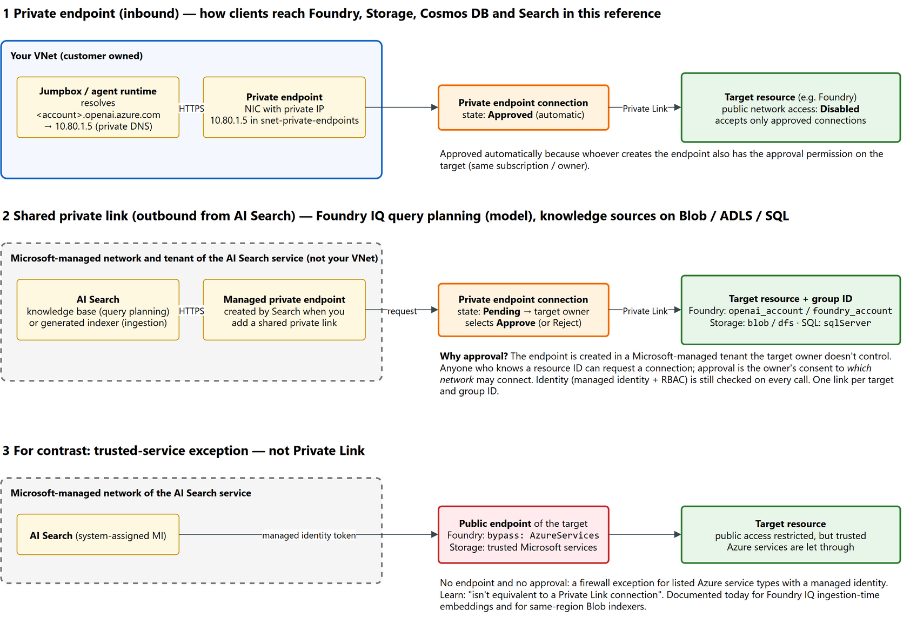

# Private Link explained: private endpoints, shared private links and approvals



Background on inbound vs. outbound: [network-directions.md](network-directions.md).

Source: [`architecture/private-link-explained.drawio`](architecture/private-link-explained.drawio) (editable with draw.io).

## 1. Private endpoint (inbound) — what this repo deploys

A private endpoint is a network interface with a private IP **in your VNet**, connected through
Azure Private Link to one sub-resource of a PaaS service (for example the Foundry `account`, Storage
`blob`, Cosmos DB `Sql`, Search `searchService`). Private DNS makes the normal FQDN
(`aif-<token>.openai.azure.com`) resolve to that private IP, so clients don't change URLs.

With `publicNetworkAccess: Disabled` the service accepts traffic **only** through approved private
endpoint connections. Every connection has a state on the target resource: `Pending`, `Approved`,
`Rejected` or `Disconnected` (portal: *Networking → Private endpoint connections*).

In this repo all inbound endpoints are **approved automatically** (the optional Foundry IQ query planning
link in section 2 is the only connection that needs an approval step): the deployer creates the endpoint
and owns the target resource in the same subscription, so it already holds the approval permission
(`…/privateEndpointConnectionsApproval/action`).

## 2. Shared private link (outbound from AI Search) — needs explicit approval

AI Search runs its indexers and knowledge-base model calls in a **Microsoft-managed network**, not in
your VNet. When Search must reach a resource whose public access is disabled, you add a
**shared private link** on the search service: Search creates a managed private endpoint (in a
Microsoft-managed tenant) to the target resource and group ID. The connection then appears on the
target as **Pending** until its owner approves it.

Why approval is required:

- The endpoint lives in a tenant and network the target owner doesn't control. Anyone who knows a
  resource ID can *request* a private endpoint to it; approval is the owner's consent to **which
  network** may connect.
- Learn: "Approval of the private endpoint connection is granted on the Azure PaaS side. Explicit
  approval by the resource owner is required." The backend endpoint "is provisioned by Microsoft in a
  Microsoft-managed tenant" ([shared private link](https://learn.microsoft.com/azure/search/search-indexer-howto-access-private#2---approve-the-private-endpoint-connection)).
- Approval is a **network** decision only. Every call still needs the search service's managed
  identity and an RBAC role on the target (for example *Storage Blob Data Reader*,
  *Cognitive Services OpenAI User*).
- One link per target resource **and** group ID (Storage `blob` and `dfs` are two links). Indexers that
  should use the links run with `executionEnvironment: private`.

Shared private link targets relevant here (Learn, *Supported resource types*):

| Target | Resource type | Group ID |
|---|---|---|
| Foundry model (embeddings, knowledge-base query planning) | `Microsoft.CognitiveServices/accounts` | `openai_account` (Azure OpenAI endpoint) or `foundry_account` (Foundry model skills) |
| Blob Storage / ADLS Gen2 | `Microsoft.Storage/storageAccounts` | `blob` / `dfs` |
| Azure SQL Database | `Microsoft.Sql/servers` | `sqlServer` |
| Azure SQL Managed Instance (preview) | `Microsoft.Sql/managedInstances` | `managedInstance` |
| Cosmos DB for NoSQL | `Microsoft.DocumentDB/databaseAccounts` | `Sql` |

## 3. Trusted-service exception — not Private Link

Some targets let selected Azure services through their firewall when those services authenticate with
a managed identity: Foundry `networkAcls.bypass: AzureServices`, Storage *Allow trusted Microsoft
services*. There is no endpoint and no approval. Learn: "An endpoint firewall, trusted-service
exception, or network security perimeter access rule **isn't equivalent to a Private Link
connection**" ([network security for agentic retrieval](https://learn.microsoft.com/azure/search/agentic-retrieval-network-security)).
This repo keeps the trusted-service exception on the Foundry account and the agent Storage account by
default (Microsoft's Standard setup templates do the same), with parameters to turn it off:
`FOUNDRY_NETWORK_ACLS_BYPASS=None`, `AGENT_STORAGE_NETWORK_BYPASS=None`. **With both off, the full
validation passed 101/101 (2026-11-19)**, so no tested path depends on the exception; see
[security/security-design.md](security/security-design.md#trusted-service-bypass-trade-off) for what isn't covered.

## 4. What this means for Foundry IQ knowledge sources

Private ingestion of **indexed** knowledge sources is GA with Search REST `2026-10-01` on Dedicated
services, but only on documented tiers. Learn's matrix (checked 2026-11-19):

| Knowledge source | Shared private links needed | Search tier for private managed ingestion | Notes |
|---|---|---|---|
| **Existing search index / push** (this repo's sample) | None — data is pushed by a client through the inbound private endpoint | Basic and higher | What this repo does today: `Seed-KnowledgeIndex.ps1` pushes from the jumpbox |
| **Azure Blob Storage** | `blob` to the storage account; plus `openai_account` / `foundry_account` if embeddings or model skills are used | **S2, S3, L1, L2** (Basic/S1 not established for managed ingestion) | Same-region Storage: Learn notes the connection uses the Microsoft backbone and a link is redundant — **unless the storage account has a private endpoint, then a shared private link is required** or Storage refuses the connection |
| **ADLS Gen2** | Both storage links from the blob guide (`blob` and `dfs`) | S2+ | As above |
| **Azure SQL Database, no embeddings** | `sqlServer` | S2+ | No embedding skillset, no model link |
| **Azure SQL Database, with embeddings** | `sqlServer` + the embedding model link | S2+ | |
| **Azure SQL Managed Instance** | `managedInstance` (preview procedure) | S2+ | Target still preview |
| **OneLake** | Fabric `workspace` | Eligible Dedicated tiers | |
| **SharePoint (indexed or remote), web** | Not possible — public endpoints | — | Not private by design |
| **File (direct upload)** | Foundry connection per file-source prerequisites | — | No generated indexer |

Even with all links approved, Learn's private Foundry IQ tutorial states that the
**ingestion-time embedding call still relies on the Foundry trusted-service bypass**. Fully
private ingestion with embeddings is therefore not achievable today; ingestion without embeddings
(e.g. SQL without `embeddingColumns`) avoids the model call.

For **query time** (Foundry IQ option A+, LLM query planning) Learn lists "Knowledge bases calling
Azure OpenAI: Basic and higher" as a supported shared private link workload, while a footnote on the
limits page says private connections from Basic to a Foundry resource are unsupported. **Live test
2026-11-19 (Search Basic, Foundry trusted-service exception `None`):** without the link the model call
fails with 403; with the approved `openai_account` link query planning works. The repo implements this
as the optional `FOUNDRY_IQ_REASONING=low|medium`, see
[modules/foundry-iq.md](modules/foundry-iq.md#optional-a-llm-query-planning-foundry_iq_reasoninglowmedium).

## 5. How to check and approve

```powershell
# on the target (Foundry / Storage / SQL): list connections and their state
az network private-endpoint-connection list --id <target resource ID> -o table
# approve a pending shared private link connection
az network private-endpoint-connection approve --id <connection ID> --description "Search SPL approved by <owner>"
# on the search service: provisioning + approval state of its shared private links
az search shared-private-link-resource list -g <rg> --service-name <search> -o table
```

Approve only connections whose requesting search service you recognise; reject anything else.
