# Microsoft Foundry in a private network: networking and identity architecture

## Abstract

Enterprises that adopt Microsoft Foundry for models and agents usually require that prompts, documents,
conversation state and telemetry never traverse a public endpoint, and that every call is made by an
identifiable principal with the smallest workable set of permissions. Meeting both requirements is less a
matter of switching off public access than of understanding how the platform is built: which endpoints a
Foundry account exposes, which Microsoft-operated components act on the customer's behalf, in which
direction each connection is opened, and which identity presents a token at every hop.

This paper describes a reference architecture for running Microsoft Foundry, including prompt agents,
hosted agents, Foundry IQ and private telemetry, with the data plane reachable only through Azure Private
Link. It covers four private deployment options: a self-contained standalone virtual network, a spoke in an
existing hub-spoke landing zone, a spoke-ready variant that is connected to the hub later, and the
Microsoft-managed virtual network for agents, which is in preview. A public, IP-restricted mode is described
only for contrast. For each option the paper explains the network topology, the private DNS resolution
chain, the request flows from client to model and from agent to tool, the outbound (egress) paths of the
agent runtime, and the complete set of identities and role assignments. It closes with the security controls,
the validation approach used to prove the isolation (public negatives with a valid token, functional tests
from inside the network), the options for deploying hosted agents into the private network, and the operational
consequences of the choices that can only be made when the Foundry account is created. An appendix outlines the SDK
and private container registry deployment paths schematically.

The architecture is implemented as Bicep templates orchestrated by the Azure Developer CLI (`azd`) in the
repository *azure-foundry-private-networking*, and every option described here was deployed and tested
end to end in Azure. Statements about platform behaviour refer to Microsoft Learn; the references are listed
at the end.

## Contents

- [Abstract](#abstract)
- [1. Introduction](#1-introduction)
- [2. Foundry resource model and endpoints](#2-foundry-resource-model-and-endpoints)
- [3. Network architecture per deployment option](#3-network-architecture-per-deployment-option)
- [4. Private Link and private DNS](#4-private-link-and-private-dns)
- [5. Request flows](#5-request-flows)
- [6. Agent egress](#6-agent-egress)
- [7. Identity and access](#7-identity-and-access)
- [8. Monitoring without public endpoints](#8-monitoring-without-public-endpoints)
- [9. Security considerations and validation](#9-security-considerations-and-validation)
- [10. Deployment and operations](#10-deployment-and-operations)
- [11. Conclusion](#11-conclusion)
- [Appendix A — Alternative deployment paths (schematic)](#appendix-a--alternative-deployment-paths-schematic)
- [References](#references)

## 1. Introduction

### 1.1 The problem

Microsoft Foundry is a platform-as-a-service offering. By default its endpoints are reachable from the
Internet and are protected by authentication only. For many organisations that is not acceptable for
production workloads: security policy demands that the data plane of every PaaS service is reachable only
from the corporate network, that API keys are not used, that outbound traffic is controlled and logged, and
that the design is compatible with landing-zone policies that deny public IP addresses and public network
access.

Two properties of Foundry make this harder than it first appears. First, Foundry is not one endpoint but
several host names, a portal that is itself a public web application, and an agent runtime that runs on
Microsoft-operated compute but has to reach the customer's own storage, databases and search indexes.
Second, several components connect *outbound* to other services: the agent runtime calls tools and data
stores, Azure AI Search calls the model for query planning, and agent code emits telemetry. A design that
only addresses inbound access leaves these paths either open or broken. The architecture therefore has to
answer four questions for every connection: who opens it, which path it takes, how the name is resolved,
and which identity authorises it.

### 1.2 Scope and deployment options

The paper covers the deployment options summarised in Table 1. All private options share the same
inbound model (private endpoints, public network access disabled, Entra ID only); they differ in who owns
access, DNS and egress, and in where the agent runtime runs.

*Table 1 — Deployment options covered in this paper.*

| Option | Network mode | Agent outbound | Typical use |
|---|---|---|---|
| **A standalone** | One self-contained VNet with Azure Bastion, a jumpbox, private endpoints and a NAT gateway | Customer subnet (BYO VNet injection), GA | Proof of concept, isolated workload, no hub available |
| **B hub-spoke** | Workload spoke peered to the customer hub; access, DNS, egress firewall and monitoring scope are central | Customer subnet, egress via the hub firewall, GA | Production in an enterprise landing zone |
| **C spoke-ready** | Isolated spoke with local DNS zones; connected to the hub later by a documented handover | Customer subnet (after handover) | Workload team is ready before the network team |
| **F managed VNet** | Inbound as in A; the agent runtime runs in a Microsoft-managed VNet | Managed outbound rules, **preview** | No agent subnet or egress firewall to operate |
| Public (contrast) | No VNet; public endpoint with IP allow-list | None (Basic agent setup) | Laptop demos with synthetic data only |

Optional modules add a private knowledge search service, a demo prompt agent with the Azure AI Search tool,
Foundry IQ (knowledge base exposed through the Model Context Protocol, MCP), a private retrieval-augmented
generation (RAG) application and private monitoring. They do not change the network model; they add private
endpoints and request flows, which are described in Sections 5 and 8. Hosted agents were validated in
options A, B and F.

### 1.3 Evidence and conventions

The architecture was deployed in Azure (Sweden Central) for every option and validated with an automated
test suite that checks configuration, identity, public isolation and in-network functionality
(Section 9.4). IP addresses in this paper are the example address plan of the templates: `10.80.0.0/16` for
option A, `10.81.0.0/16` for the hub-spoke spoke, `10.82.0.0/16` for spoke-ready, `10.83.0.0/16` for the
managed-VNet option and `10.0.0.0/16` for a hub. `<account>` and `<project>` denote the Foundry account and
project names. Numbers in square brackets refer to the Microsoft Learn articles in the reference list.

## 2. Foundry resource model and endpoints

### 2.1 Account, projects and model deployments

The architecture uses the current Foundry resource model: a resource of type
`Microsoft.CognitiveServices/accounts` with kind `AIServices` and `allowProjectManagement: true`, and child
resources of type `accounts/projects`. Model deployments, projects, connections and capability hosts are all
children of the same account. The older hub-based model built on Azure Machine Learning workspaces, which
needed a separate AI Services account, storage account and key vault, each with its own private endpoint, is
not used. In this paper "hub" therefore always means the network hub of a hub-spoke topology, never a Foundry
hub.

The project is the unit of isolation for agents, connections and data, and it has its own system-assigned
managed identity. The model deployment in the reference configuration is `gpt-5.4-mini` with the deployment
type `DataZoneStandard`, which keeps processing within the EU data zone.

### 2.2 Control plane and data plane

The single most important distinction in a private Foundry design is between the control plane and the data
plane (Table 2). Setting `publicNetworkAccess: Disabled` affects the data plane only. Azure Resource Manager
(ARM) remains a public, Entra-protected API, so infrastructure deployment works from anywhere with the right
roles. Every operation that touches the data plane, such as seeding a search index, creating an agent,
deploying a hosted agent or running a functional test, must run inside the network.

*Table 2 — Control plane and data plane of a Foundry account.*

| Plane | Endpoint | Exposure in the private options |
|---|---|---|
| Control plane (ARM) | `management.azure.com` | Public, protected by Microsoft Entra ID and Azure RBAC |
| Data plane | `<account>.services.ai.azure.com` (project API, agents), `<account>.openai.azure.com`, `<account>.cognitiveservices.azure.com` | Private endpoint only |

Private Link for Azure Resource Manager exists, but it is uncommon and not in scope of this design: it is a
tenant-wide decision (root management group only), it breaks Azure Bastion (`privatelink.azure.com` overlaps
`management.azure.com`), it is not supported for AKS or multi-tenant accounts, and it needs Owner or
Contributor at the root management group [22].

### 2.3 Three host names behind one private endpoint

A Foundry account exposes three families of host names. One private endpoint with the group ID `account`
serves all of them: its network interface carries three IP configurations, one per DNS zone (Table 3). The
project endpoint is `https://<account>.services.ai.azure.com/api/projects/<project>`.

*Table 3 — The Foundry account private endpoint (example addresses from option A).*

| IP configuration | Public host name | Private DNS zone | Example IP |
|---|---|---|---|
| `default` | `<account>.cognitiveservices.azure.com` | `privatelink.cognitiveservices.azure.com` | 10.80.1.17 |
| `secondary` | `<account>.openai.azure.com` | `privatelink.openai.azure.com` | 10.80.1.18 |
| `third` | `<account>.services.ai.azure.com` (project API, agents) | `privatelink.services.ai.azure.com` | 10.80.1.19 |

All three records must exist. If one is missing, only the SDKs and tools that use that host name fail, which is
a failure mode that is easy to misdiagnose as an application error. The private endpoint's DNS zone group
therefore references all three zones, so that each zone receives its own A record automatically.

### 2.4 Agent Service and the Standard setup

Foundry Agent Service runs two kinds of agents. A **prompt agent** is declarative: the customer supplies
instructions, a model and tools, and Agent Service runs the agent loop. A **hosted agent** is the customer's
own code (for example Microsoft Agent Framework, LangGraph or custom code, in Python or C#), run by Foundry in
per-session, VM-isolated sandboxes ("micro VMs") with an endpoint under the project
(`{project}/agents/{name}/endpoint/protocols/...`) [5]. Managed hosting of hosted agents is generally
available; the agent-level guardrails used in Section 5.9 are in preview [18], [19]. Table 4 compares the two
agent types from a network and identity point of view.

*Table 4 — Prompt agents and hosted agents.*

| | Prompt agent | Hosted agent |
|---|---|---|
| Agent loop | Agent Service | Customer code |
| Compute with BYO VNet | Agent runtime injected into the delegated agent subnet | Per-session micro VM attached to the same delegated subnet |
| Compute with managed VNet | Microsoft-managed VNet | Microsoft-managed VNet |
| Tool calls | Through the project's single-tenant data proxy | Through a project toolbox, executed via the data proxy |
| Runtime identity | Project managed identity | Platform-created agent identity, plus the project managed identity for platform operations |
| Deployment | REST/SDK call from a private client | `azd deploy` from an in-network runner (source-code deployment) |

All private options use the **Standard agent setup**: conversation threads are stored in the customer's
Azure Cosmos DB account, files in the customer's storage account and vector stores in the customer's Azure AI
Search service, each behind its own private endpoint and with key-based access disabled. A project
**capability host** (`capabilityHostKind: Agents`) tells Agent Service which connections to use; the
account-level host is created by the resource provider from the account's network injection setting. The
**Basic setup**, in which agent state lives in Microsoft-managed storage, is used only by the public contrast
mode.

### 2.5 Decisions fixed at account creation

Several properties of the account cannot be changed after creation (Table 5). They should be decided before
the first deployment, even when agents are not yet planned: adding agents to an account created without network
injection means redeploying the account.

*Table 5 — Decisions that are fixed when the Foundry account is created.*

| Decision | Values | Changeable later? |
|---|---|---|
| Agent outbound mode | BYO VNet (default, GA), managed VNet (preview), none (models only) | No. A managed network cannot be disabled and there is no path between BYO and managed VNet |
| Agent subnet | Dedicated subnet delegated to `Microsoft.App/environments`, one account per subnet | No |
| Address plan | Must avoid the address ranges reserved by Agent Service (Section 3.1) | No, for a deployed environment |
| Network mode | Standalone, hub-spoke, spoke-ready | Spoke-ready to hub-spoke by a documented handover; otherwise redeploy |

## 3. Network architecture per deployment option

### 3.1 Common building blocks

Every private option is assembled from the same components. All subnets are created with
`defaultOutboundAccess: false`, so no subnet has implicit Internet access; outbound connectivity exists only
where a NAT gateway or a user-defined route (UDR) to a firewall provides it. Table 6 lists the subnets and their
network security group (NSG) rules for option A; the other options use subsets of them.

*Table 6 — Subnets and NSG rules (option A address plan).*

| Subnet | Prefix | NSG highlights | Egress |
|---|---|---|---|
| `snet-private-endpoints` | 10.80.1.0/24 | Inbound 443 from `VirtualNetwork`, deny all else; outbound deny `Internet`; private endpoint network policies enabled | None |
| `snet-management` (jumpbox) | 10.80.2.0/24 | Inbound RDP only from the Bastion subnet; outbound 443 to the endpoint subnet, the application port to `snet-app`, 443/80 and KMS 1688 to `Internet`, deny other `VirtualNetwork` (lateral movement) | NAT gateway |
| `AzureBastionSubnet` | 10.80.3.0/26 | Platform-required Bastion rule set | Bastion public IP |
| `snet-app` (RAG VM, optional module 3 only) | 10.80.4.0/24 | Inbound application port 8443 from `VirtualNetwork` only; outbound deny `Internet` | None |
| `snet-agent` (delegated `Microsoft.App/environments`) | 10.80.6.0/24 | Outbound 443 to the service tags `AzureActiveDirectory`, `AzureMonitor`, `MicrosoftContainerRegistry`, `AzureFrontDoor.FirstParty`; all to `VirtualNetwork`; deny `Internet`. Inbound `AzureLoadBalancer` and `VirtualNetwork` only | NAT gateway (A) or UDR to the hub firewall (B) |

Three details of Table 6 deserve explanation. The private endpoint subnet has network policies enabled, which
makes the NSG effective for traffic *to* the endpoints; without that setting, NSGs on a private endpoint subnet
are ignored. The subnet is sized as a `/24` because private endpoints consume more addresses than expected: the
Azure Monitor Private Link Scope endpoint alone uses 13 addresses (Section 8). And the agent subnet must be
dedicated to Agent Service, delegated to `Microsoft.App/environments`, at least `/27` and preferably `/24` for
production; a `/24` supports roughly 60,000 planned hosted-agent sessions, and exhaustion is reported as
`429 subnet_exhausted` [3]. The address plan must avoid `172.17.0.0/16` and, for agent-injected VNets,
`169.254.0.0/16`, `172.30.0.0/16`, `172.31.0.0/16`, `192.0.2.0/24`, `100.100.0.0/17`, `100.100.192.0/19` and
`100.100.224.0/19`; private endpoint addresses must also stay out of `192.168.0.0/24`, which hosted agents use
as an internal sandbox network [2]. The templates' preflight checks enforce these ranges.

Every PaaS data plane in the private options, namely the Foundry account, Cosmos DB, both AI Search services,
the agent storage account, and Application Insights and Log Analytics when private monitoring is enabled, has
public network access disabled and is reachable only through its private endpoint.

### 3.2 Option A: standalone

Option A is a single, self-contained virtual network (Figure 1). Administrators reach it through Azure Bastion
(Standard SKU), whose public IP address is the Bastion service's managed HTTPS ingress and not a path to any
workload. From Bastion they open an RDP session to a Windows jumpbox that has no public IP address, uses
Trusted Launch, and is signed in to with Microsoft Entra ID. Its local administrator password is random and
never output. The jumpbox is also the *private client* for the in-network functional tests and for the
deployment steps that need the data plane (Section 10.2).

Private DNS zones are created in the workload resource group and linked only to this VNet, which uses
Azure-provided DNS (168.63.129.16). A NAT gateway is attached to two subnets only: the management subnet, so
that the jumpbox can reach Entra ID, the Foundry portal and Windows Update, and the agent subnet, so that the
agent runtime can reach its platform dependencies, restricted by the NSG to the service tags in Table 6. The
private endpoint and application subnets have no egress at all.

A NAT gateway rather than a firewall is used because a standalone deployment has no customer hub. It provides
deterministic, outbound-only egress; NSG service tags restrict what can use it. If a customer needs FQDN
filtering and egress logs in a standalone deployment, a firewall can be added, or option B used instead.

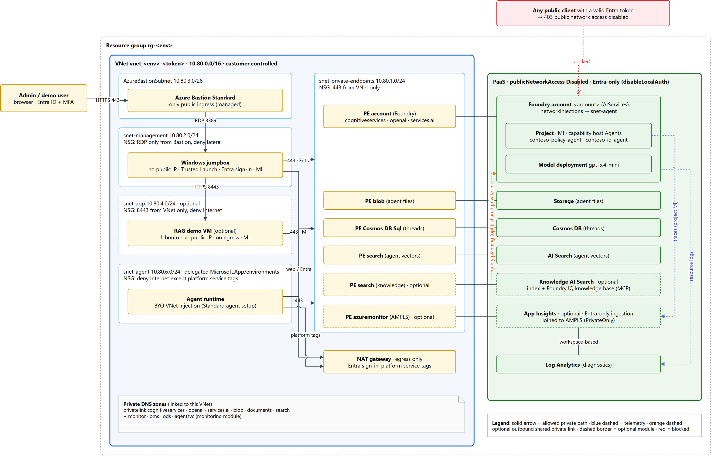

*Figure 1 — Option A, standalone: one VNet with Bastion, a jumpbox, private endpoints for every PaaS data
plane, the delegated agent subnet and a NAT gateway. Private DNS zones are created in the workload resource
group and linked to this VNet only. A public client with a valid token is rejected.*

### 3.3 Option B: hub-spoke

In option B the workload is a spoke of the customer's landing zone (Figure 2). The spoke contains only private endpoints,
the delegated agent subnet and, optionally, the application subnet. It has no public IP address, no Bastion and
no jumpbox. Everything that a landing zone centralises is provided by the hub (Table 7).

*Table 7 — Responsibilities in the hub-spoke option (example address plan).*

| Function | Hub (10.0.0.0/16) | Spoke (10.81.0.0/16) |
|---|---|---|
| DNS | Azure DNS Private Resolver (inbound endpoint, e.g. 10.0.2.4); central `privatelink.*` zones linked to the hub VNet | VNet DNS servers set to the resolver inbound IP; no zones in the spoke |
| Private DNS records | — | Private endpoint zone groups write A records into the central zones |
| Routing | Peering; client subnets route through the firewall | UDR `0.0.0.0/0` to the firewall (e.g. 10.0.1.4) on the agent and application subnets, BGP propagation disabled; no UDR on the private endpoint subnet |
| Egress | Customer firewall with an explicit allow-list (Section 6.5) | Only through the hub firewall |
| Administrative access | Customer access path (ExpressRoute/VPN, hub Bastion, workstations) | None in the spoke |
| Monitoring | Central Azure Monitor Private Link Scope and its private endpoint | Workspace and Application Insights join the central scope |

The spoke-to-hub peering is created by the deployment; the hub-to-spoke peering is opt-in, because it modifies
customer networking and needs Network Contributor on the hub VNet. Otherwise the network team creates it. The
spoke can also use the hub's VPN or ExpressRoute gateway.

Routing deserves careful attention, because `/32` routes take priority: each private endpoint IP is added as a
`/32` route in its VNet *and in peered VNets*, and as the most specific route it takes priority over a
`0.0.0.0/0` UDR, so private endpoint traffic does not pass the firewall. The spoke's `0.0.0.0/0` UDR therefore
does not capture traffic from the agent runtime to the spoke's private endpoints, and a hub client's route to
the firewall does not capture its traffic to the spoke's private endpoints either: the peering route and the
`/32` endpoint routes are more specific. Only traffic to destinations outside the VNets, essentially Entra ID
and the platform dependencies of the agent runtime, reaches the firewall. A customer who wants to inspect
private endpoint traffic in the firewall needs private endpoint network policies for route tables on the
endpoint subnet, UDRs on the client subnets with a prefix at least as specific as the VNet address space (a
`0.0.0.0/0` UDR never overrides the `/32` route), and SNAT on the firewall [23]; this is not
part of the reference design.

The design is compatible with common landing-zone policies: deny public IP addresses, deny public network
access on PaaS, require private DNS zone groups (policies that add zone groups produce identical records), deny
local authentication and require an NSG on every subnet.

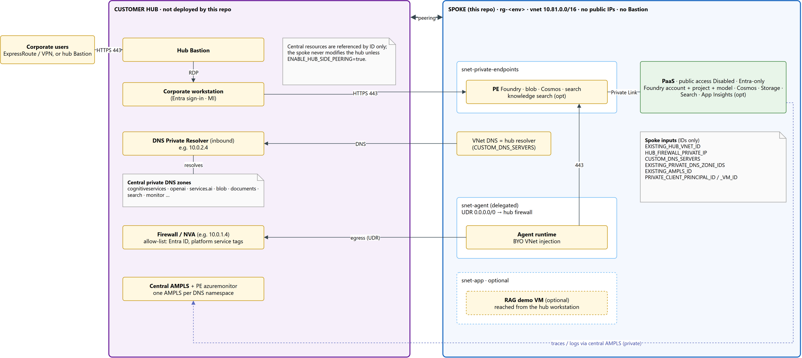

*Figure 2 — Option B, hub-spoke: the workload spoke holds only private endpoints, the delegated agent subnet and
the optional application subnet. Administrative access, DNS (resolver and central private DNS zones), the egress
firewall and the Azure Monitor Private Link Scope are hub services; the spoke is connected by VNet peering.*

### 3.4 Option C: spoke-ready

Option C addresses a common organisational situation: the workload team is ready before the network team has
provisioned peering, routes and DNS. The spoke is deployed in isolation (phase 1) and handed over later
(phase 2), as Figure 3 shows.

The figure also shows why peering alone is not enough: hub DNS can't resolve the spoke's private endpoints
until their records move to the central zones. After peering, hub clients query the *central* zones, which
do not contain the account's records, and receive NXDOMAIN. The private endpoint zone groups cannot be
re-pointed to other zones in place, so the handover deletes each zone group and recreates it against the
central zones (records are written centrally, with a DNS gap of seconds per endpoint), removes the local zones
and sets the spoke's DNS servers to the resolver. Afterwards the spoke behaves exactly like option B.

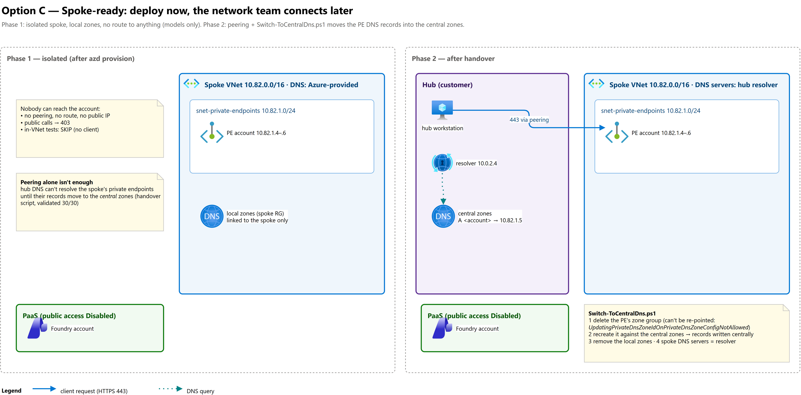

*Figure 3 — Option C, spoke-ready. Phase 1: isolated spoke with local DNS zones, no peering, no route and no
client; nobody can reach the account. Phase 2: after peering, a handover script moves the private endpoint DNS
records into the hub's central zones and points the spoke at the hub resolver.*

### 3.5 Option F: managed virtual network (preview)

Option F keeps the inbound side of option A, with private endpoints in the customer VNet, Bastion and jumpbox,
but runs the agent runtime in a Microsoft-managed virtual network owned by the Foundry account (Figure 4) [4].
The customer VNet has no agent subnet and no delegation; the NAT gateway serves only the jumpbox.

The managed network is created as `accounts/managedNetworks/default` with the isolation mode
`AllowOnlyApprovedOutbound`. The reference design adds no FQDN rules, so the managed Azure Firewall is never
created and the runtime has no Internet egress. The service creates the *required* outbound rules itself:
private endpoints to the Standard-setup Cosmos DB, storage account and agent search service, and the service tags
`AzureActiveDirectory` and `AzureMachineLearning`. The template adds managed private endpoint rules for the
knowledge search service (`pe-knowledge-search`), for the Azure Monitor Private Link Scope (`pe-ampls`), and,
in every managed-VNet deployment, for the Foundry account itself (`pe-foundry-account`, subresource `account`).
The last rule is required for hosted agents, which call their own project endpoint (Section 5.9). The account's
managed identity holds *Azure AI Enterprise Network Connection Approver* on the resource group, so that the
managed network can create and approve its private endpoint connections on the target resources.

For a network architect the trade-off is visibility. Managed private endpoints are not network interfaces in
the customer subscription; they appear only as approved connections on the target resources, with a requester
in a Microsoft subscription. There are no customer-side egress logs, and anything without an outbound rule is
denied silently. The managed network uses a preview API, is available in a subset of regions, cannot be
disabled, and reaches on-premises targets only through an Application Gateway private endpoint. BYO VNet
injection remains the default because it is GA and keeps agent egress in the customer's firewall logs.

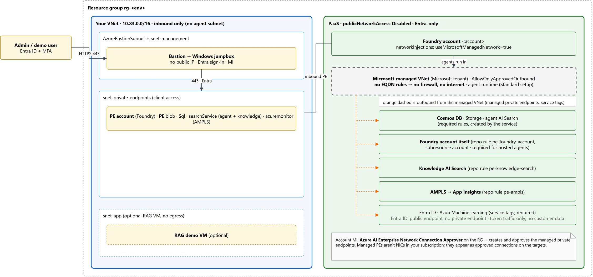

*Figure 4 — Option F, managed VNet: inbound is unchanged; the agent runtime runs in a Microsoft-managed VNet with
the isolation mode `AllowOnlyApprovedOutbound` and leaves it only through managed private endpoints and
required service tags. The account identity is allowed to approve those endpoints on the target resources.*

### 3.6 The public option as contrast

The public option is not private and is included only to make the private options easier to understand. The
account has `publicNetworkAccess: Enabled` with the network ACL default action `Deny` and an IP allow-list;
local authentication is disabled; agents use the Basic setup with Microsoft-managed storage; there is no VNet.
The deployment requires an explicit acknowledgement, tags the resources `network-exposure=public`, and rejects
the optional modules, Bastion and the jumpbox. It is intended for synthetic demo data only.

### 3.7 Summary

Table 8 summarises how the private options differ.

*Table 8 — Network characteristics of the private options.*

| | A standalone | B hub-spoke | C spoke-ready | F managed VNet |
|---|---|---|---|---|
| Inbound | Private endpoints, public access disabled | Same | Same | Same |
| Private DNS | Local zones linked to the VNet | Central zones + resolver | Local, then central | Local zones linked to the VNet |
| Agent runtime | Delegated customer subnet | Delegated customer subnet | Delegated customer subnet | Microsoft-managed VNet |
| Agent egress | NSG service tags + NAT gateway | NSG service tags + hub firewall (logged) | After handover as B | Managed outbound rules (not logged) |
| Administrative access | Bastion and jumpbox | Customer hub | Customer hub | Bastion and jumpbox |
| Public IPs in the workload | Bastion ingress, NAT egress | None | None | Bastion ingress, NAT egress |
| Status | GA | GA | GA | Preview |

## 4. Private Link and private DNS

### 4.1 Anatomy of a private endpoint

A private endpoint is a network interface with private IP addresses in a customer subnet, connected through
Azure Private Link to one sub-resource of a PaaS service: the Foundry `account`, storage `blob`, Cosmos DB
`Sql`, AI Search `searchService` or Azure Monitor `azuremonitor`. Private DNS makes the normal host name resolve
to that private IP, so clients do not change URLs and TLS certificates for the public names remain valid. Every
connection has a state on the target resource: *Pending*, *Approved*, *Rejected* or *Disconnected*. Figure 5
contrasts the inbound private endpoint with the two other mechanisms that appear in this architecture.

All inbound private endpoints in this architecture are approved automatically, because the identity that
creates them owns the target resources and therefore holds the approval permission
(`…/privateEndpointConnectionsApproval/action`). Table 9 lists the mechanics that matter for the design.

*Table 9 — Private endpoint mechanics and how the architecture uses them.*

| Mechanism | Behaviour | Design choice |
|---|---|---|
| Routes | Each endpoint IP is added as a `/32` route in its VNet and peered VNets; as the most specific route it takes priority over a `0.0.0.0/0` UDR. Overriding it needs network policies for route tables on the endpoint subnet and a UDR at least as specific as the VNet address space | No UDR on the endpoint subnet |
| Network policies | With network policies enabled, NSGs apply to traffic to the endpoint | Enabled; allow 443 from `VirtualNetwork`, deny all else |
| Approval | Automatic when the requester holds the approval permission on the target; otherwise *Pending* | Inbound endpoints auto-approve; shared private links are approved explicitly (Section 4.7) |
| DNS zone groups | Write and remove A records automatically; cannot be re-pointed to other zones in place | One zone group per endpoint; spoke-ready handover recreates them |
| Public access | A private endpoint adds a private path but does not remove the public one | Public network access disabled on every data plane |

### 4.2 Closing the public path

Because a private endpoint does not remove the public path, each data plane is closed explicitly. The Foundry
account is configured with `publicNetworkAccess: Disabled`, a network ACL with `defaultAction: Deny` and no IP
or VNet rules, and `disableLocalAuth: true` [1]. The storage account disables public access, shared-key access
and public blob access; Cosmos DB disables public access, local authentication and key-based metadata writes;
both AI Search services disable public access and local authentication and use `bypass: None`.

The remaining setting is the **trusted-service bypass** on the Foundry account and the agent storage account.
With `networkAcls.bypass: AzureServices`, selected Azure services, for example AI Search indexers or Foundry
Tools, can reach the resource through its firewall when they authenticate with a managed identity that has an
RBAC role. This is a firewall exception, not Private Link; Microsoft Learn states explicitly that a
trusted-service exception "isn't equivalent to a Private Link connection" [13]. The template defaults to
`AzureServices`, as Microsoft's network-secured reference templates do, and makes the setting a parameter for
both resources. With **both set to `None`**, the full validation passed on the standalone option with every
optional module, and all hosted-agent validations ran with both set to `None` as well, so no tested path
depends on the exception. For maximum isolation `None` is the recommended choice unless a required feature
relies on the bypass. Paths not covered by the tests are file upload, file search and Code Interpreter files,
evaluations, and AI Search skillsets or integrated vectorization that call Foundry; Learn documents the bypass
as still required for Foundry IQ ingestion-time embeddings [14].

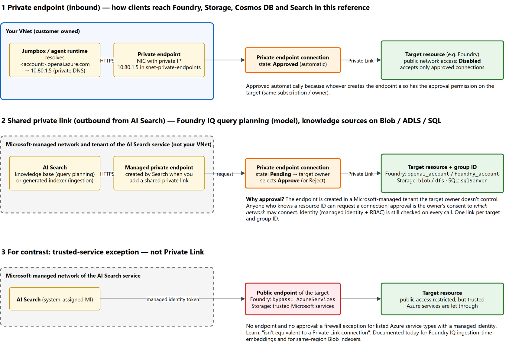

*Figure 5 — Three ways a PaaS service can be reached when its public access is restricted: (1) an inbound private
endpoint in the customer VNet, approved automatically; (2) a shared private link created by AI Search from its
Microsoft-managed network, which the target owner must approve; (3) the trusted-service exception, which is a
firewall exception and not Private Link.*

### 4.3 The resolution chain

A client always uses the public host name. Public DNS answers with a CNAME into the `privatelink` subdomain;
where the corresponding private zone is visible, it answers that CNAME with the endpoint's private IP. Where it
is not, resolution continues to the public front end, and the request is rejected there:

```text
<account>.openai.azure.com
  CNAME <account>.privatelink.openai.azure.com
     ├── inside the network (private zone visible):  A 10.80.1.18       → private endpoint
     └── public DNS: CNAME → regional front end → public IP              → 403, public access disabled
```

Two consequences follow. A DNS misconfiguration does not open a bypass; it produces a 403, i.e. an outage
rather than an exposure. And every network that should reach the data plane, including on-premises networks,
must resolve the public name through a resolver that can see the private zones [16]. Table 10 lists the zones
the architecture uses.

*Table 10 — Private DNS zones.*

| Service | Group ID | Private DNS zone | Public zone to forward from on-premises |
|---|---|---|---|
| Foundry account (project API, agents) | `account` | `privatelink.services.ai.azure.com` | `services.ai.azure.com` |
| Foundry OpenAI-compatible inference | `account` | `privatelink.openai.azure.com` | `openai.azure.com` |
| Foundry Tools / Cognitive Services | `account` | `privatelink.cognitiveservices.azure.com` | `cognitiveservices.azure.com` |
| Storage (agent files) | `blob` | `privatelink.blob.core.windows.net` | `blob.core.windows.net` |
| Cosmos DB (agent threads) | `Sql` | `privatelink.documents.azure.com` | `documents.azure.com` |
| AI Search (agent vectors, knowledge) | `searchService` | `privatelink.search.windows.net` | `search.windows.net` |
| Azure Monitor Private Link Scope | `azuremonitor` | `privatelink.monitor.azure.com`, `privatelink.oms.opinsights.azure.com`, `privatelink.ods.opinsights.azure.com`, `privatelink.agentsvc.azure-automation.net`, `privatelink.blob.core.windows.net` | Shared Azure Monitor endpoints (Section 8.4) |

### 4.4 Standalone: zones linked to the workload VNet

In options A, C (phase 1) and F the deployment creates the zones in the workload resource group and links them to
the workload VNet, which uses Azure-provided DNS. Azure DNS answers from the linked zones, so the jumpbox, the
RAG VM and the injected agent runtime receive private answers without any further configuration. Azure-provided
DNS (168.63.129.16) is reachable only from inside Azure VNets, so these zones are invisible to every other
network by construction.

### 4.5 Hub-spoke: central zones and the DNS Private Resolver

In option B the deployment creates no zones and no links. The private endpoint zone groups write their A
records directly into the customer's central zones, which are passed to the deployment as resource IDs; the
deploying identity needs Private DNS Zone Contributor (or the equivalent record-write and join permissions) on
those zones. The platform team links the central zones to the VNet that hosts the DNS Private Resolver. The
spoke's VNet DNS servers point to the resolver's inbound endpoint, so the spoke itself needs no zone links
(Figure 6). Two rules avoid the most common failures:

- **Forward the public zones, not the `privatelink` zones.** On-premises DNS servers need conditional forwarders
  for the *public* zone names in Table 10 (`services.ai.azure.com`, `openai.azure.com`,
  `cognitiveservices.azure.com`, `search.windows.net`, `blob.core.windows.net`, `documents.azure.com` and the
  Azure Monitor zones) to the resolver inbound IP. Forwarding only `privatelink.*` breaks resolution, because
  clients query the public name first.
- **Never mix local and central zones of the same name.** A VNet cannot be linked to two zones with the same
  name, and a local zone in a spoke would hide the central records from that spoke. This is why spoke-ready
  environments are handed over rather than simply peered (Section 3.4).

Once a name has been resolved, traffic follows the most specific route: the private endpoint `/32` takes
priority over the `0.0.0.0/0` route to the firewall. Conditional forwarding from on-premises follows the documented
pattern; on-premises connectivity itself was outside the scope of the live validation.

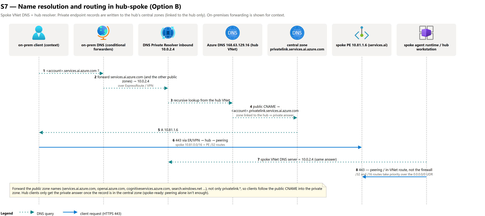

*Figure 6 — Name resolution in hub-spoke: on-premises DNS forwards the public zone names to the resolver inbound
endpoint, and the spoke uses the resolver as its DNS server; both receive the private endpoint address from the
central `privatelink.*` zones. Traffic then follows the most specific route: the private endpoint `/32` takes
priority over the `0.0.0.0/0` route to the firewall.*

### 4.6 What a public caller sees

The isolation has a characteristic signature. From the Internet, a caller with a *valid* Entra ID token receives
a network rejection from every data plane: Foundry returns `403 Public access is disabled`, Cosmos DB reports
that the request is blocked by the account firewall, AI Search reports `publicNetworkAccess: Disabled`, storage
returns an `AuthorizationFailure` firewall code, and a Log Analytics query returns
`PrivateLinkValidationFailedError`. The Foundry portal (`ai.azure.com`) is a public single-page application, so
its shell loads from anywhere, but its data-plane calls are made by the browser to the account host names and
fail outside the network. That is the most visible proof that the data plane is private.

Network isolation and authorization are independent layers. A request from the Internet with a valid token is
rejected by the network; a request from inside the network without a role assignment is rejected by
authorization. In the public contrast mode, authorization was observed to be evaluated *before* the IP firewall:
an outsider without a role receives 401, an authorized outsider from a non-allowed address receives 403. For
that reason a 401 says nothing about network isolation, and the validation treats it as inconclusive
(Section 9.4).

### 4.7 Outbound Private Link: shared private links and managed private endpoints

Private endpoints secure connections *into* a service. Some services also open connections *out* to other
services from their own Microsoft-managed networks, and those connections need their own private path. In this
architecture that happens in two places.

The first is **Foundry IQ query planning** (Figure 7). With the reasoning effort `low` or `medium`, the knowledge
base uses the model deployment to decompose a question and plan sub-queries, so AI Search calls the Foundry
account at query time. With public access on the account disabled, this call is private only through an AI
Search **shared private link** with the group ID `openai_account`. Search creates a managed private endpoint in a
Microsoft-managed tenant; the connection appears on the Foundry account as *Pending* until the account owner
approves it [12]. Approval is the owner's consent to *which network* may connect; every call still needs the
search service's managed identity and the *Cognitive Services OpenAI User* role on the account.

Because the requesting endpoint lives in a network the account owner does not control, the approval step is
automated narrowly: the approval script approves only a pending connection with the exact request message
created by the deployment, and only if there is exactly one; otherwise it fails. A switch hands the approval to
the account owner instead (separation of duties). An approved link cannot be modified; it must be deleted and
recreated. Query planning is implemented and validated in option A; options B and F use the default *minimal*
retrieval, in which AI Search makes no outbound call at all.

The second place is the **managed VNet** of option F (Section 3.5): its outbound rules are managed private
endpoints of the same kind, created by the Foundry managed network and approved through the account identity's
approver role.

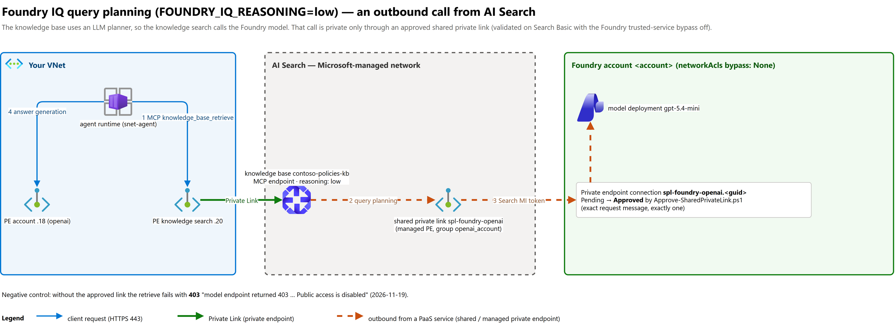

*Figure 7 — Foundry IQ query planning is an outbound call from AI Search to the Foundry model. It is private only
through an approved shared private link. Validated on Search Basic with the Foundry trusted-service bypass set
to `None`: without the link the call returns 403, while the link is *Pending* it still returns 403, and once
the link is *Approved* the call returns 200.*

## 5. Request flows

This section follows the requests that a reviewer typically asks about, hop by hop. The sequence diagrams show
option A with its example addresses; differences for the other options are described in the text.

### 5.1 Portal access from a private client

An administrator signs in to Bastion over HTTPS, opens an RDP session to the jumpbox and uses the Foundry portal
in the jumpbox browser (Figure 8). The portal shell, Entra ID and ARM are public services; they are reached
through the NAT gateway in option A or through the hub firewall in option B. Every data-plane call that the
portal makes resolves to the account private endpoint.

The client therefore needs two kinds of connectivity: outbound HTTPS to `login.microsoftonline.com` and related
Entra endpoints, `ai.azure.com` and `management.azure.com`, plus private resolution of the three Foundry host
names. The portal call to the project API uses a token with the audience `https://ai.azure.com` and requires the
*Foundry User* role on the project. In option B the same flow runs from a hub workstation, with egress through
the hub firewall and resolution through the hub resolver; option F is identical to option A.

Entra ID has no private endpoint: token traffic goes to the public Entra endpoints (`AzureActiveDirectory`
service tag / login FQDNs) over the Microsoft backbone and carries no customer data. VM managed identities use
IMDS (no egress); platform identities get their tokens inside the service.

### 5.2 Model inference

An application inside the network calls a model deployment with a managed-identity token (Figure 9). The token is
obtained from the instance metadata service (IMDS, 169.254.169.254), which is host-local and needs no NSG rule,
UDR or NAT; a VM without any egress, like the RAG VM, can still obtain tokens. The request goes to
`<account>.openai.azure.com`, which resolves to the account private endpoint, with a token for
`https://cognitiveservices.azure.com` and the *Cognitive Services OpenAI User* role on the account. The hop from
the account to model capacity is Microsoft-internal and is not part of the customer network.

In option B the private endpoint is in the spoke and hub clients reach it over the peering.

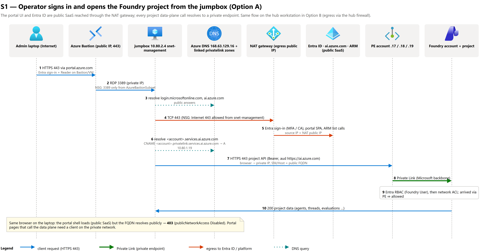

*Figure 8 — Portal access from the jumpbox (option A). Steps 3–5: public names and Entra sign-in through the
NAT gateway. Steps 6–8: the project host name resolves to the private endpoint and the request crosses Private
Link. Step 9: Foundry checks the caller's role, then confirms that the request arrived through an approved
private endpoint.*

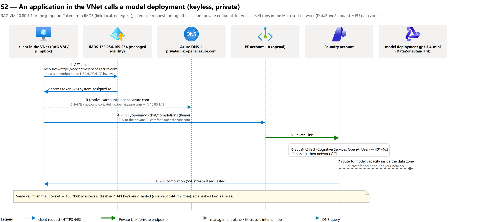

*Figure 9 — Keyless model inference from a client in the VNet: token from IMDS, private name resolution, request
over the account private endpoint, authorization first and then the network check. The same call from the
Internet returns 403, and API keys are disabled.*

### 5.3 Prompt agent run

A prompt agent run involves the client, Agent Service and the agent runtime that is injected into the customer's
delegated subnet. The client talks only to the project endpoint. Agent Service dispatches the run to the
runtime, which then reaches the Standard-setup dependencies, the model and the tools through their private
endpoints. Figure 10 shows the sequence and Table 11 lists the hops.

*Table 11 — Hops of a prompt agent run with the Standard setup (option A).*

| Hop | From → to | Path | Control |
|---|---|---|---|
| 1–2 | Client → project API | Account private endpoint | Entra token (`https://ai.azure.com`), Foundry User on the project |
| 3 | Agent Service → runtime | Microsoft-internal (network injection) | Subnet delegation and capability host |
| 4–5 | Runtime → Entra ID / platform | NAT gateway (A) or hub firewall (B) | NSG service tags, firewall allow-list |
| 6 | Runtime → Cosmos DB | Cosmos DB private endpoint | Project managed identity, Cosmos DB data role at database scope |
| 7 | Runtime → model | Account private endpoint | Project managed identity |
| 8 | Runtime → AI Search | Search private endpoint | Project managed identity: Search Index Data Contributor and Search Service Contributor |
| 9 | Runtime → Storage | Storage private endpoint | Project managed identity: Storage Blob Data roles, Owner restricted by an ABAC condition |

In option F, hops 4–9 leave the Microsoft-managed VNet through the outbound rules instead of the customer
subnet. Tool calls of prompt agents are not made by the runtime directly; they leave through the project's data
proxy (Section 6.2).

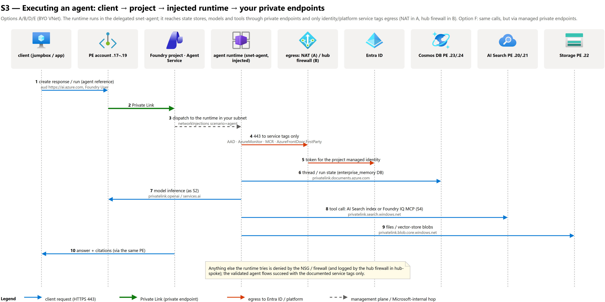

*Figure 10 — A prompt agent run with the Standard setup (option A): the client talks only to the project endpoint;
Agent Service dispatches the run to the runtime injected into the delegated agent subnet, which reaches Cosmos DB,
the model, AI Search and storage through their private endpoints with the project managed identity.*

### 5.4 Agent with the Azure AI Search tool

The demo prompt agent uses the native `azure_ai_search` tool on a project connection to the private knowledge
search service, with Entra ID authentication (`authType: AAD`) and no keys. The tool call reaches the knowledge
search private endpoint from the agent network. Two observations are relevant for the design. The project managed
identity needs both *Search Index Data Contributor* and *Search Service Contributor* on the knowledge search
service, as documented by Microsoft [11]; *Search Index Data Reader* alone fails with 403 on reading the index
definition. And the tool requires VNet injection: with the Basic setup it cannot reach a private search service,
so the template refuses to deploy the agent without network injection rather than deploying a broken agent. The
agent has no other tools; in particular no web search, Bing grounding or SharePoint grounding, which use public
endpoints and are excluded from the private profiles.

### 5.5 Foundry IQ through MCP

Foundry IQ exposes a knowledge base as an MCP endpoint (`knowledge_base_retrieve`). The project connection to it
is of category `RemoteTool`, uses `authType: ProjectManagedIdentity` and the audience `https://search.azure.com/`,
and targets the MCP endpoint of the private knowledge search service. Figure 11 shows the flow.

With the default *minimal* reasoning effort and extractive output, the knowledge base uses no model and AI Search
makes no outbound call at retrieval time; the whole flow consists of one inbound private connection. With query
planning, the additional outbound hop of Section 4.7 appears. The data-plane objects of Foundry IQ (knowledge
source, knowledge base and agent) are created from inside the network by the private client, because the Search
and Foundry data planes are not reachable from the deployment machine.

### 5.6 RAG application

The RAG application is optional module 3, the "private app tier" (full-demo profile E); it is not part of the
option A baseline. It shows the customer-app pattern: a small, keyless web application on an Ubuntu VM in
`snet-app`, with no public IP and no Internet egress at all, managed identity only, an NSG that admits only
port 8443 from the VNet, and the citation target for the agents. For production, App Service or Container
Apps with private endpoints and VNet integration are the usual choice. Its flow combines the patterns above:

```text
browser on a private client ──HTTPS 8443 (VNet only)──► RAG VM (snet-app, no egress)
   1. IMDS → Entra tokens for search.azure.com and cognitiveservices.azure.com (VM managed identity)
   2. query the knowledge index      → knowledge search private endpoint
   3. generate the answer            → Foundry account private endpoint (model deployment)
```

The VM's managed identity holds exactly two roles: *Cognitive Services OpenAI User* on the account and *Search
Index Data Reader* on the knowledge search service. The application code is delivered over the management plane
with VM Run Command, so neither SSH, package feeds nor a deployment endpoint is needed. The application also
serves read-only source-document pages, which the agents use as citation targets so that a citation opens the
source from any private client.

### 5.7 Telemetry

Agent traces, metrics and logs follow their own private path through the Azure Monitor Private Link Scope. Because
monitoring has several distinctive design constraints, it is described separately in Section 8.

### 5.8 Management plane and in-network automation

The control plane never enters the VNet (Figure 12). `azd provision` sends a Bicep deployment to ARM, which
creates the resources through the resource providers; this works while the data plane is fully private. For
the data-plane steps, the automation uses VM Run Command: ARM passes a script to the VM agent of a private client
over the platform channel (WireServer, 168.63.129.16, which needs no inbound NSG rule), the script runs *inside*
the VNet with the VM's managed identity, and the output is returned through ARM. Run Command output is limited to
4 KB, so the test scripts compress their results.

In option B there is no VM in the spoke; an existing private client in the hub, such as a workstation VM, is
registered with the deployment by its resource ID and managed identity and runs the same steps.

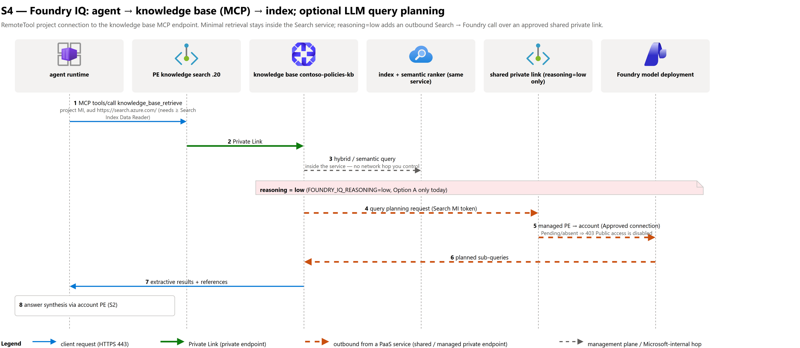

*Figure 11 — Foundry IQ: the agent runtime calls the knowledge base MCP endpoint through the knowledge search
private endpoint with the project identity. Minimal retrieval stays inside the Search service; with query
planning (`reasoning = low`), Search calls the model over the shared private link of Figure 7.*

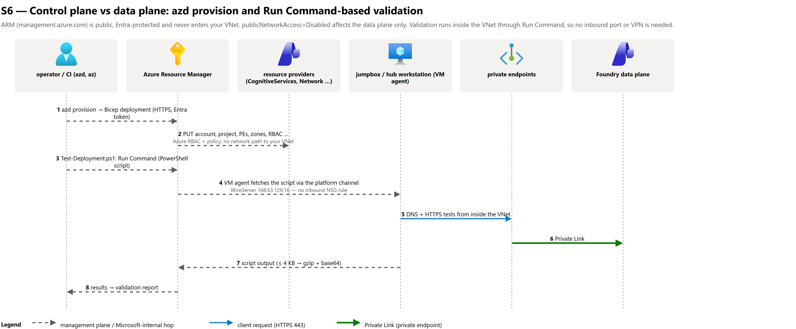

*Figure 12 — Control plane and data plane: `azd provision` and Run Command use ARM only; the tests and
deployment steps execute inside the VNet and reach the data plane through the private endpoints. No inbound
port, VPN or public IP on a test VM is needed.*

### 5.9 Hosted agents

A hosted agent is customer code run by Foundry in a per-session micro VM. The invocation path is the same in
every option: the client calls the agent's Responses endpoint
`{project}/agents/{name}/endpoint/protocols/openai/responses` through the account private endpoint; the request
passes the **agent guardrail** and is then forwarded to the micro VM. The agent code calls the project endpoint
for the model deployment, whose content filter applies as well, and for the project **toolbox**, an MCP endpoint
that exposes the tools configured in the project. The toolbox call is executed by the Foundry tools service and
leaves through the single-tenant **data proxy** to the knowledge search private endpoint. What differs between
the options is where the micro VM and the data proxy run and how they leave the network.

Deployment is part of the flow. With public access disabled, `azd deploy` from an Internet workstation fails, so
the hosted agent is deployed by `azd` running on a private client, the **in-network runner**: the jumpbox in
options A and F, a hub workstation in option B. The runner signs in with its VM managed identity
(`azd auth login --managed-identity`) and holds *Foundry Project Manager* on the project. The deployment is a
source-code deployment with `remote_build`: the source is uploaded as an archive and dependencies are resolved
platform-side, so no container registry is involved [7].

**Option A.** The micro VM and the data proxy are attached to the delegated agent subnet (Figure 13). The agent's
own calls to the project endpoint use private DNS and the account private endpoint; its platform egress uses the
agent subnet NSG and the NAT gateway.

Figure 14 shows a single run as a sequence. The search service's logs confirmed the path: the knowledge base calls
of the toolbox came from the data proxy's address in the agent subnet, which is the same address used by the
prompt agents, and not from the micro VM.

**Option B.** The micro VM and the data proxy sit in the spoke's agent subnet; the hub workstation is both runner
and client and reaches the spoke's private endpoints over the peering, with names resolved by the hub resolver
(Figure 15).
Because private endpoint routes are more specific than the `0.0.0.0/0` UDR, the agent's model, toolbox and
telemetry traffic never crosses the firewall; telemetry goes to the central Azure Monitor Private Link Scope
endpoint in the hub. Only platform egress reaches the firewall, and the hosted agent required no change to the
documented allow-list (Section 6.5). The firewall saw no container registry, package index or source repository
traffic from the spoke, because the remote build runs platform-side. Figure 16 shows the run as a sequence.

**Option F.** Inbound is unchanged: private endpoints in the customer VNet, with the jumpbox as runner. The micro VM
and the data proxy run in the Microsoft-managed VNet and leave it only through managed private endpoints
(Figure 17).

The rule `pe-foundry-account` is what makes hosted agents work in a managed VNet. A hosted agent calls its own
project endpoint for models, the toolbox, and conversation storage; from the managed VNet, with public access on
the account disabled, there is no path back to the account without a private endpoint to it. Without the rule
every invocation failed with HTTP 500 (the container log showed the connection to the project endpoint being
reset); with it, the agent answered with citations. The rule is therefore part of every managed-VNet deployment
of the template. Figure 18 shows the run as a sequence.

In all three options the agent-level guardrail (an RAI policy on the hosted agent definition, `Microsoft.DefaultV2`
in the reference configuration, preview) blocked a jailbreak prompt with `HTTP 400 content_filter` at the input
stage, before the agent code ran, and the Internet call with a valid token returned
`403 Public access is disabled`. Without the agent-level policy, the model deployment's content filter still
screened the model call made by the agent code [8], [9]. Because a hosted agent owns its loop, iteration,
tool-call and wall-clock limits must be set in the agent code before production.

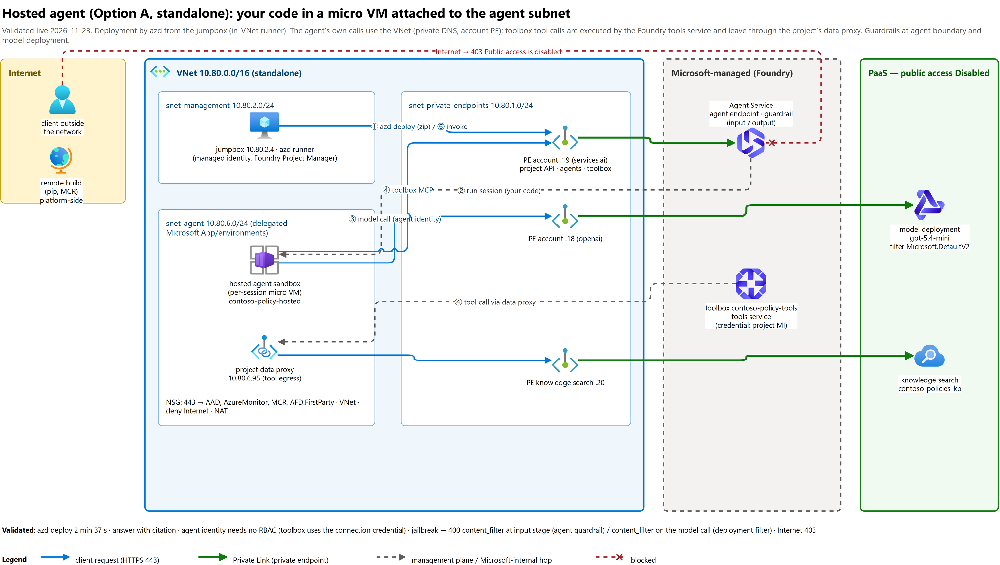

*Figure 13 — Hosted agent in option A: the jumpbox is the azd runner and the private client; the micro VM and the
project data proxy are attached to the delegated agent subnet; toolbox tool calls leave through the data proxy to
the knowledge search private endpoint.*

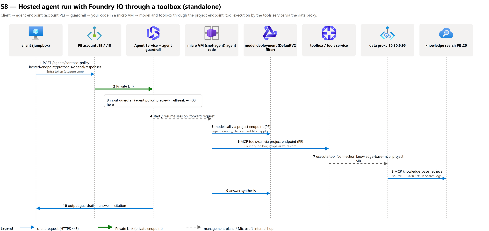

*Figure 14 — A hosted agent run with Foundry IQ through a project toolbox (option A): input guardrail at the agent
endpoint, model and toolbox calls from the micro VM through the project endpoint, tool execution by the tools
service via the data proxy, output guardrail on the way back.*

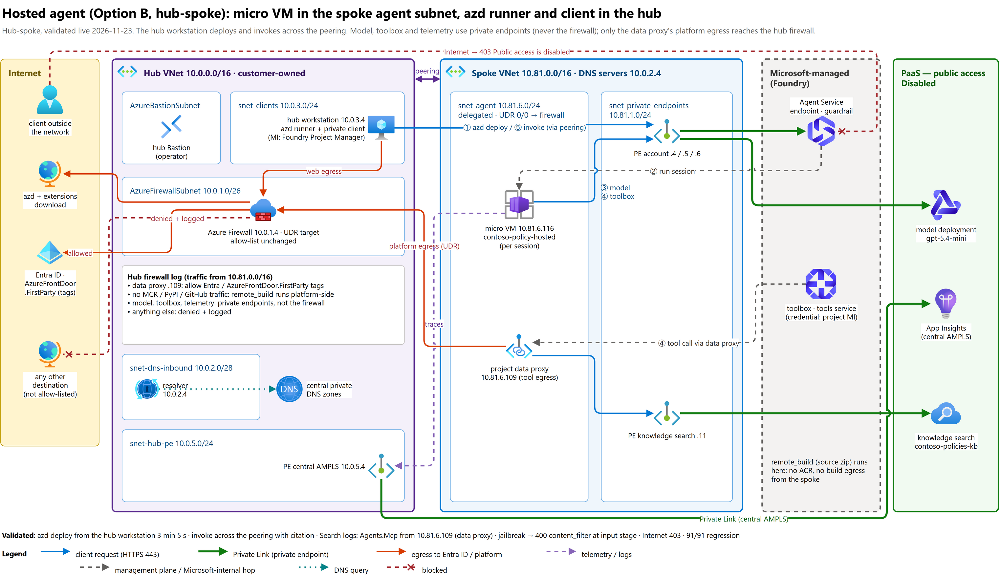

*Figure 15 — Hosted agent in option B: the micro VM and the project data proxy sit in the spoke's delegated agent
subnet; the hub workstation is azd runner and private client and reaches the spoke's private endpoints over the
peering. Model, toolbox and telemetry traffic use private endpoints; only platform egress reaches the hub firewall,
whose allow-list needed no change.*

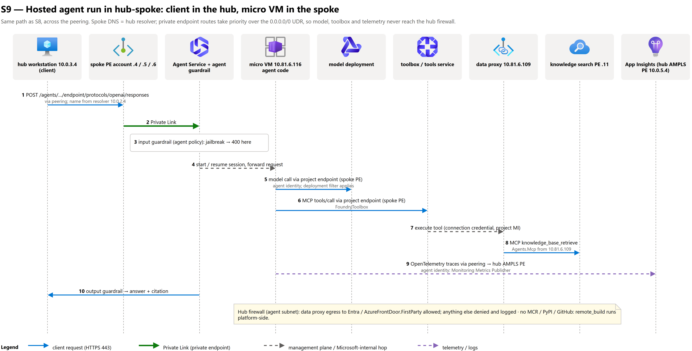

*Figure 16 — A hosted agent run across the peering (option B): private endpoint `/32` routes take priority over the
`0.0.0.0/0` UDR, so the model, toolbox and telemetry calls never cross the firewall.*

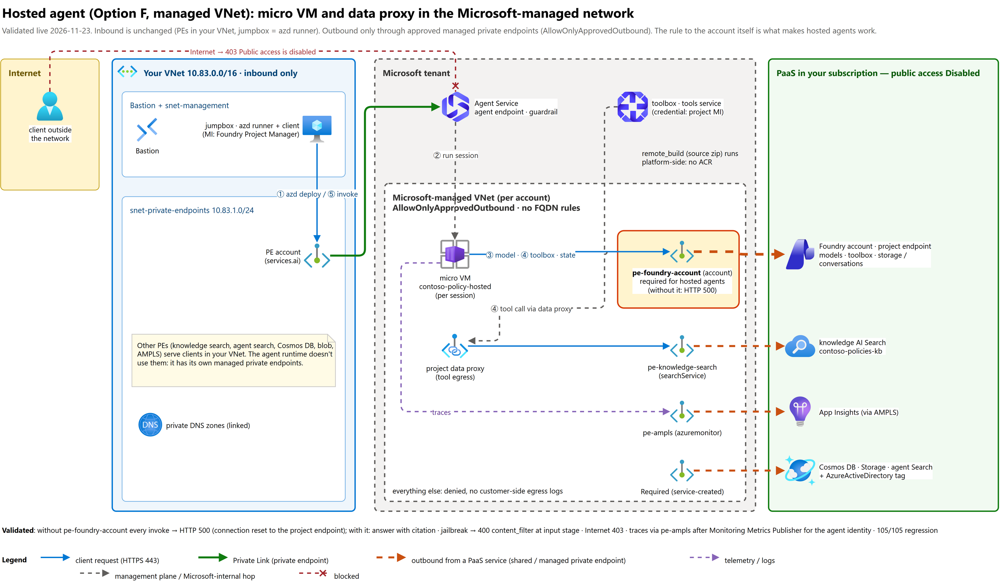

*Figure 17 — Hosted agent in option F: the micro VM reaches its own project endpoint (models, toolbox, state)
through the managed private endpoint `pe-foundry-account`, the data proxy reaches the knowledge search through
`pe-knowledge-search`, and telemetry goes through `pe-ampls`.*

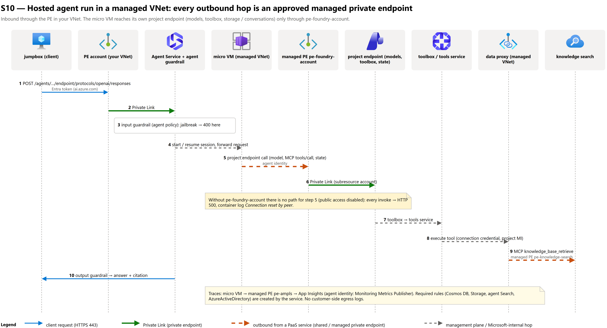

*Figure 18 — A hosted agent run in a managed VNet: every outbound hop of the agent runtime is an approved managed
private endpoint.*

## 6. Agent egress

### 6.1 Two kinds of outbound traffic

Agent egress is often discussed as a single topic, but it consists of two different kinds of traffic. The first
is traffic to the customer's own resources (Cosmos DB, storage, AI Search, the knowledge base, Application
Insights), which always goes to private endpoints, either in the customer VNet (options A and B) or through
managed private endpoints (option F). The second is traffic to the platform's own dependencies, such as Entra ID
for token acquisition and the container platform, which leaves the network through the NAT gateway, the hub
firewall or the managed network's service-tag rules. Egress control is about the second kind; the first is
governed by private endpoints and RBAC.

### 6.2 Prompt agents

For prompt agents the runtime is platform-managed. Its connections to the Standard-setup resources and the model
use the private endpoints (Table 11). Tool calls, such as the Azure AI Search tool or an MCP tool, are executed
through the project's single-tenant data proxy, which is attached to the agent network [3]. In the BYO VNet options
both the runtime and the data proxy are subject to the agent subnet's NSG, its NAT gateway or firewall route, and
private DNS.

### 6.3 Hosted agents

Hosted agents add a third participant: the customer's own code in the micro VM. Microsoft documents that the
hosted agent's **own outbound traffic goes directly through the delegated subnet**, so it is subject to the
customer's NSG, NAT or firewall and private DNS, while **tool-server calls go through the data proxy**, as for
prompt agents [3]. In practice the recommended toolbox pattern keeps tool calls on the data proxy path and the
agent's own traffic on the project endpoint, i.e. on the account private endpoint. The only egress that leaves
the network is the platform traffic that the agent subnet's NSG and the firewall allow-list already cover.

Two configuration choices keep hosted-agent egress minimal. Source-code deployment with `remote_build` needs no
container registry; Learn lists `mcr.microsoft.com` and `*.login.microsoft.com`, plus Application Insights, as the
egress it needs [7], and these are covered by the existing service tags and rules. And the optional Agent 365 data
collection, which sends hosted-agent telemetry to `agent365.svc.cloud.microsoft`, stays disabled unless it is
needed.

### 6.4 Managed VNet outbound rules

In option F the egress policy is the list of outbound rules on the account's managed network (Table 12). Because
the reference design adds no FQDN rules, there is no managed firewall and no Internet egress; everything not
listed is denied.

*Table 12 — Outbound rules of the managed network in option F.*

| Rule | Type | Target | Created by |
|---|---|---|---|
| Cosmos DB, storage, agent search | Private endpoint (`Sql`, `blob`, `searchService`) | Standard-setup dependencies | Service (required) |
| `AzureActiveDirectory`, `AzureMachineLearning` | Service tag | Entra ID and platform | Service (required) |
| `pe-foundry-account` | Private endpoint (`account`) | The Foundry account itself | Template, always (required for hosted agents) |
| `pe-knowledge-search` | Private endpoint (`searchService`) | Knowledge search service | Template, with the AI Search module |
| `pe-ampls` | Private endpoint (`azuremonitor`) | Azure Monitor Private Link Scope | Template, with the monitoring module |

Adding FQDN rules, for example for web search or external MCP servers, would create a managed Azure Firewall with
its own cost; the reference design adds none, so public-endpoint tools remain blocked as in the BYO VNet options.

### 6.5 Allow-list design for a hub firewall

In option B the agent subnet's `0.0.0.0/0` route points to the customer firewall. Its allow-list should contain
only what Microsoft documents for the BYO VNet agent runtime (Table 13) [2], [7]. Broad `Internet` access must not
be allowed; tools that require public endpoints are intentionally excluded from the private profile.

*Table 13 — Documented egress allow-list for the agent subnet.*

| Purpose | FQDN or service tag | Port |
|---|---|---|
| Entra ID token acquisition | `login.microsoftonline.com`, `*.login.microsoftonline.com`, `*.login.microsoft.com`, `{region}.login.microsoft.com`, or the tag `AzureActiveDirectory` | 443 |
| Managed identity (container platform) | `*.identity.azure.net`, `control-{region}.identity.azure.net` | 443 |
| Container platform | Tags `MicrosoftContainerRegistry`, `AzureFrontDoor.FirstParty` | 443 |
| Monitoring | Tag `AzureMonitor` | 443 |
| Evaluations and tracing (optional) | `*.livediagnostics.monitor.azure.com`, `*.in.applicationinsights.azure.com`; not needed when Application Insights is reached through the private link scope | 443 |
| Hosted agent → Agent 365 (optional) | `agent365.svc.cloud.microsoft`, only if Agent 365 data collection is enabled | 443 |

Entra ID has no private endpoint, which is why it appears in every allow-list: token traffic goes to the public
Entra endpoints (`AzureActiveDirectory` service tag / login FQDNs) over the Microsoft backbone and carries no
customer data. VM managed identities use IMDS (no egress); platform identities get their tokens inside the
service.

In the validated configuration the firewall policy consisted of one network rule from the spoke to the four
service tags on port 443 and one application rule from the spoke to the Entra ID FQDNs. Hub clients that act as
administrative workstations get a separate web rule for the portal and updates, which does not apply to the
spoke. Everything else is denied and logged, which gives the customer the egress visibility that option F cannot
provide. Service tags such as `AzureFrontDoor.FirstParty` are broad; data exfiltration through them is therefore
rated a medium residual risk in the threat model, mitigated by the absence of public tools and by disabled public
access on all data stores.

## 7. Identity and access

### 7.1 Entra-only by construction

All data-plane access uses Microsoft Entra ID. Key-based or local authentication is disabled on the Foundry
account, Cosmos DB, both AI Search services, the storage account (shared key) and Log Analytics, and Application
Insights accepts only Entra-authenticated ingestion. No API keys are created, listed, output or stored, and the
templates contain no secrets; a linter rule configured as an error and a static test forbid secrets in outputs.
A leaked key would therefore be useless, and every request in the flows of Section 5 carries a token that
identifies a principal.

The identities fall into four groups: people, platform-managed identities of the Foundry resources,
platform-managed identities of other services, and the managed identities of the VMs that act as private clients
(Table 14).

### 7.2 Identity inventory

*Table 14 — Identities in the architecture.*

| Identity | Type | Purpose |
|---|---|---|
| Deployer (`azd` user or CI service principal) | User or service principal; OIDC-federated in CI | Deployment time only: creates resources and role assignments |
| Administrator / demo user (or group) | User or group | Builds and runs agents in the project, invokes models, signs in to the jumpbox, views traces |
| Foundry **project** managed identity | System-assigned | Identity of the prompt-agent runtime: provisions and uses the Standard-setup resources, calls tools and the knowledge base, emits server-side traces |
| Foundry **account** managed identity | System-assigned | No role in the core; in option F approves the managed network's private endpoints |
| **Agent identity** of a hosted agent | Entra identity created by the platform, stable across versions [6] | Runtime identity of the hosted agent code (model, toolbox, code-emitted telemetry) |
| Knowledge search managed identity | System-assigned (AI Search) | Calls the model for Foundry IQ query planning |
| Validation client (jumpbox, or an existing private client such as a hub workstation) | System-assigned VM identity | In-network tests and post-provision steps: index seeding, demo agents |
| In-network `azd` runner | The same VM identity | Deploys hosted agents |
| RAG VM managed identity | System-assigned | Retrieval and inference for the RAG application |
| Diagnostic settings | No identity | Platform logs are delivered by the Azure Monitor pipeline, configured through ARM |

### 7.3 Role assignments

Table 15 lists every role assignment that the deployment creates, together with its scope and purpose. Except for
the two assignments made by the hosted-agent deployment script, all are declared in the Bicep templates. Role
definition IDs are those of the built-in roles; the Cosmos DB data role is a Cosmos DB SQL role. Role names
follow the current Foundry built-in roles: *Foundry User* and *Foundry Project Manager* were formerly named
*Azure AI User* and *Azure AI Project Manager*; the role IDs are unchanged [24].

*Table 15 — Role assignments, scopes and purposes.*

| Principal | Role (definition ID) | Scope | Purpose | When |
|---|---|---|---|---|
| User / group | Foundry User (`53ca6127-…`) | Foundry project | Create and run agents, read the project | Core |
| User / group | Cognitive Services OpenAI User (`5e0bd9bd-…`) | Foundry account | Inference on the account endpoints | Core |
| User / group | Virtual Machine User Login (`fb879df8-…`) | Jumpbox VM | Entra RDP sign-in through Bastion, without local administrator rights | A, F |
| User / group | Reader (`acdd72a7-…`) | Jumpbox VM, its NIC, Bastion | Required by Azure Bastion to connect (no data access) | A, F |
| User / group | Search Index Data Reader (`1407120a-…`) | Knowledge search | Query the knowledge index | AI Search module |
| User / group | Log Analytics Reader (`73c42c96-…`) | Application Insights and Log Analytics workspace | View agent traces in the portal, run saved queries | Monitoring module |
| Project MI | Storage Blob Data Contributor (`ba92f5b4-…`) | Agent storage account | Provision the agent containers before the capability host | Core |
| Project MI | Storage Blob Data Owner (`b7e6dc6d-…`) with ABAC condition | Agent storage account | Own blobs only in containers whose names start with the project's workspace ID and end in `-azureml-agent` | Core, after the capability host |
| Project MI | Cosmos DB Operator (`230815da-…`) | Cosmos DB account | Provision the `enterprise_memory` database | Core |
| Project MI | Cosmos DB Built-in Data Contributor (SQL role `…0002`) | Database `enterprise_memory` | Read and write threads in its own database only | Core, after the capability host |
| Project MI | Search Index Data Contributor (`8ebe5a00-…`) + Search Service Contributor (`7ca78c08-…`) | Agent search service | Create and use the agent vector indexes | Core |
| Project MI | Search Index Data Contributor + Search Service Contributor | Knowledge search | Azure AI Search tool and Foundry IQ MCP (documented requirement) | AI Search module |
| Project MI | Monitoring Metrics Publisher (`3913510d-…`) | Application Insights | Entra-authenticated server-side agent traces | Monitoring module |
| Account MI | Azure AI Enterprise Network Connection Approver (`b556d68e-…`) | Resource group | Create and approve the managed network's private endpoints | F only |
| Knowledge search MI | Cognitive Services OpenAI User | Foundry account | Foundry IQ query planning (documented on the parent resource) | Query planning |
| RAG VM MI | Cognitive Services OpenAI User | Foundry account | Model inference for the RAG application | RAG module |
| RAG VM MI | Search Index Data Reader | Knowledge search | Retrieval only (read-only) | RAG module |
| Validation client MI | Cognitive Services OpenAI User | Foundry account | In-network inference tests | Optional (on by default) |
| Validation client MI | Foundry User | Foundry project | In-network project and agent tests; creates the demo agents | Optional (on by default) |
| Validation client MI | Search Service Contributor + Search Index Data Contributor | Knowledge search | Seed the sample index and the Foundry IQ knowledge source and base from inside the network | Optional, AI Search module |
| Validation client MI | Log Analytics Reader | Application Insights and Log Analytics workspace | Verify that traces and resource logs are stored (query through the private link scope) | Optional, monitoring module |
| Runner VM MI | Foundry Project Manager (`eadc314b-…`) | Foundry project | Deploy hosted agents and create role assignments for the agent identity | Hosted agents (script) |
| Agent identity | Monitoring Metrics Publisher | Application Insights | Code-emitted traces with Entra-only ingestion [10] | Hosted agents (script) |

Three entries need comment. The project identity's search roles are broader than *Search Index Data Reader*
because the Azure AI Search tool documents both *Search Index Data Contributor* and *Search Service Contributor*
as required, and the reader role alone fails when the tool reads the index definition [11]; both roles are scoped
to the single service, and admin keys cannot be used because local authentication is disabled. The storage
*Owner* role is restricted by an attribute-based access control condition to the project's own agent containers,
and the Cosmos DB data role is scoped to the project's own database rather than to the account. And the agent
identity of a hosted agent needs **no role on the tool target** when tools are consumed through a toolbox: the
toolbox executes the knowledge base call with the connection's credential, which is the project managed identity.
(The deployment script notes that the agent identity's project-level access for the toolbox is assigned by
`azd`.) An earlier variant in which the agent code called the knowledge base MCP endpoint directly worked as well,
but required *Search Index Data Reader* for the agent identity on the search service.

The deployment never assigns **Owner, Contributor, User Access Administrator or Role Based Access Control
Administrator** to any identity; static tests and the live validation enforce this.

### 7.4 Deployment-time permissions

The deployer is the only privileged identity, and only during deployment (Table 16). For CI, a federated (OIDC)
service principal is used, so no client secret exists; time-bound elevation through Privileged Identity
Management is recommended.

*Table 16 — Permissions of the deploying identity.*

| Task | Permission | Scope |
|---|---|---|
| Create resources and role assignments | Contributor + Role Based Access Control Administrator, or Owner | Subscription (`azd` creates the resource group) |
| Hub-side peering (opt-in) | Network Contributor | Hub VNet |
| Records in existing central DNS zones | Private DNS Zone Contributor (or record write and `join` permissions) | Central zones |
| Join a central Azure Monitor Private Link Scope | Write on the scope, e.g. Monitoring Contributor | Central scope |
| Approve the Foundry IQ shared private link | `…/privateEndpointConnectionsApproval/action` (included in Owner and Contributor) | Foundry account; can be left to the account owner |

### 7.5 Least-privilege reasoning

The role design follows a small number of rules. **Data plane, not control plane, at runtime:** workload
identities receive data-plane roles; the exceptions are Cosmos DB Operator and Search Service Contributor, which
Agent Service needs to provision its database and indexes and which are scoped to a single resource. No runtime
identity can change the network configuration of any resource. **Narrowest scope:** people receive Foundry User on
the *project*, not the account, so new projects are not automatically accessible; data roles are scoped to a
database, to ABAC-filtered containers, or to a single search service. **Purpose-specific roles:** inference needs
only Cognitive Services OpenAI User; users who should only run agents, not author them, can be given *Foundry Agent
Consumer* or *Foundry Project Runtime User* instead of Foundry User; and groups can replace individual users.
**Remove what is only needed for testing:** the validation client's roles are switched on by default so that the
in-network tests can run, and can be removed with a single parameter after acceptance testing; the compromise of
the jumpbox identity is rated a medium residual risk until they are.

Bastion adds its own identity controls. Jumpbox sign-in uses Entra ID through the `AADLoginForWindows` extension
and Bastion's Entra authentication [17]. The template assigns *Virtual Machine User Login*, which grants sign-in
without local administrator rights; *Virtual Machine Administrator Login* is the alternative when administrator
rights are required. Connecting through Bastion also requires *Reader* on the VM, its network interface and the
Bastion resource (and on the virtual network if Bastion runs in a peered network); the template assigns these
Reader roles to the same principal. Bastion has shareable links, IP-based connection and file copy disabled; native-client
tunnelling is enabled. Combined with MFA and Conditional Access on the Entra side, this leaves no shared
credential on the access path.

## 8. Monitoring without public endpoints

### 8.1 Azure Monitor Private Link Scope

Monitoring is the part of a private design that is most often left public, because Azure Monitor uses shared,
global endpoints. The monitoring module creates a workspace-based Application Insights resource and connects it
to the project (connection category `AppInsights`, `authType: ProjectManagedIdentity`), which turns on server-side
tracing for every agent in the project without code changes. Log Analytics and Application Insights are placed in
an **Azure Monitor Private Link Scope** (AMPLS) with the access mode *PrivateOnly* for both ingestion and query,
and their public ingestion and query are disabled [15]. The scope's private endpoint (group `azuremonitor`) uses
13 addresses and the five DNS zones of Table 10. Figure 19 shows the resulting flows.

Platform resource logs take a different route: diagnostic settings (`allLogs`, `AllMetrics`) on the Foundry
account, the search services, Cosmos DB, storage and Bastion write to the workspace through the Azure Monitor
pipeline, outside the customer network and without an identity to manage. They contain request metadata, not
prompts or completions. Viewing traces in the Foundry portal or running queries works only from inside the
network; from outside, the portal shows the trace list as inaccessible.

### 8.2 Entra-only ingestion and trace identities

Application Insights has local authentication disabled, so instrumentation keys are rejected and every exporter
must present an Entra token with *Monitoring Metrics Publisher* on the resource. Two identities emit traces. The
**project managed identity** emits the server-side spans of prompt agents, for example `invoke_agent`,
`execute_tool` and `chat` spans that follow the OpenTelemetry GenAI semantic conventions. The **agent identity**
of a hosted agent emits the traces that the agent code produces itself. Without the role, the hosted agent's
exporter receives `Forbidden`; with it, the traces and dependencies of the agent arrive in Application Insights
through the private endpoint [10]. Readers of traces need *Log Analytics Reader* on Application Insights and on the
workspace.

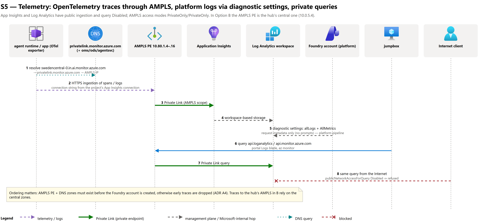

*Figure 19 — Telemetry: OpenTelemetry exports resolve the regional ingestion endpoint to the AMPLS private
endpoint and are ingested over Private Link; platform resource logs arrive through diagnostic settings; queries
from the jumpbox use the AMPLS query endpoints; the same query from the Internet is refused.*

### 8.3 Deployment order

The private ingestion path depends on deployment order. In a from-scratch deployment in which the Foundry account,
and with it the injected agent runtime, existed before the AMPLS private endpoint and its DNS records, the runtime
resolved the ingestion endpoint to its public address, which is rejected because public ingestion is disabled,
and kept using that path: no server-side traces were stored, although the connection, the roles and the network
settings were correct. The templates therefore create the Foundry account only after the AMPLS private endpoint
and its DNS records exist, and a static test guards that ordering. Fresh deployments with this order store traces
with public ingestion disabled. In option B the issue does not arise, because the central scope and its DNS exist
before the spoke.

### 8.4 Hub-spoke: one AMPLS per DNS scope

An AMPLS private endpoint registers the *shared* Azure Monitor host names in the private DNS zones. In a
hub-spoke network the hub DNS serves every spoke, so a spoke-owned scope would redirect all Azure Monitor traffic of
the organisation to a scope that knows only this workload's resources and break everyone else's monitoring.
Microsoft's guidance is therefore one AMPLS per DNS scope [15]. Only the standalone options create their own scope.
In option B the spoke adds its workspace and Application Insights as scoped resources to the customer's central
scope and creates neither an AMPLS private endpoint nor monitoring DNS records. In option F the agent runtime reaches
the scope through the managed private endpoint `pe-ampls`.

### 8.5 Trace content

Server-side tracing also records message content (prompts, tool inputs and outputs, responses) in the workspace.
It is protected by private-only query and Log Analytics RBAC, and retained for a configurable period (30 days by
default). The workspace should be treated as containing business data: readers should be restricted and
retention aligned with policy. The monitoring module also adds alerts for security drift (writes or deletes on the
Foundry account, the search services, storage, Cosmos DB, private endpoints, NSG rules and the scope, for example
someone enabling public access), for server errors, and for requests rejected by the content filters.

## 9. Security considerations and validation

### 9.1 Defence in depth

The architecture combines three independent layers (Table 17). Each must hold on its own: a request with a valid
token from the wrong network is stopped by the first layer, a request from the right network without a role by the
third.

*Table 17 — The three layers of access control.*

| Layer | Question it answers | Enforced by |
|---|---|---|
| Network isolation | Can the packet reach the service? | Public network access disabled, ACL deny, private endpoints, NSGs, private DNS |
| Authentication | Who is calling? | Entra ID only, local authentication disabled, no keys |
| Authorization | What may the caller do? | Azure RBAC with data-plane roles at the narrowest scope |

On top of these layers, the design follows two further principles. **Explicit egress:** subnets have no default
outbound access, and every outbound path is a deliberate resource (NAT gateway, hub firewall or managed outbound
rule) constrained by NSGs or rules. **Fail closed:** preflight stops unsupported configurations before
deployment; the template never opens network access to make them work. For example, the demo agent is not
deployed without network injection, and the public mode cannot be combined with the private modules.

### 9.2 Controls per option

*Table 18 — Security controls per option.*

| Control | A | B | C | F |
|---|---|---|---|---|
| Data-plane public access | Disabled | Disabled | Disabled | Disabled |
| Local authentication (keys) | Off | Off | Off | Off |
| Private endpoints and private DNS | Local zones | Central zones | Local, then central | Local zones |
| Trusted-service bypass | `AzureServices` default, `None` validated | Same | Same | Same |
| Agent egress control | NSG service tags + NAT gateway | NSG service tags + customer firewall (logged) | After handover | Managed outbound rules (not logged) |
| Administrative access | Bastion → jumpbox | Customer hub | Customer hub | Bastion → jumpbox |
| Telemetry | Own AMPLS, private | Central AMPLS | — | AMPLS via managed private endpoint |

The virtual machines have no public IP addresses, use Trusted Launch and Entra sign-in and shut down daily; the
RAG VM has no egress at all. The only public IP addresses in the standalone options are Bastion's managed ingress
and the NAT gateway's egress address, which cannot accept inbound connections; options B and C have none.
Diagnostic logs of the Foundry account, Bastion, Cosmos DB, storage and the search services go to Log Analytics.
The template is compatible with built-in Azure Policy definitions that deny public network access and key-based
access on AI Services, storage and Cosmos DB, and that require an NSG on every subnet.

### 9.3 Residual risks and decisions to review

A private network does not remove every risk, and some decisions are deliberately left to the customer:

1. **Trusted-service bypass.** The default `AzureServices` is convenient for some Microsoft services; `None` is
   validated for every tested path and should be chosen for maximum isolation (Section 4.2).
2. **Jumpbox egress.** In the standalone options the jumpbox may reach the Internet on ports 443 and 80 to support
   the portal and updates. Restrict this with a firewall or proxy if required.
3. **Portal dependency.** The Foundry portal is a public web application; administration needs Internet egress for
   the portal and Entra ID, plus private DNS for the data plane.
4. **Control plane.** ARM remains public by design and is protected with Entra Conditional Access, Privileged
   Identity Management and RBAC rather than with network rules.
5. **Prompt injection and data exfiltration.** Both remain medium risks, inherent to LLM applications and to broad
   service tags. They are mitigated by the content filter with Prompt Shields on the deployment, the optional
   agent-level guardrail, the absence of public tools, least-privilege tool identities and, in option B, a logged
   firewall allow-list.
6. **Managed VNet visibility.** Option F provides no customer-side egress logs; it suits customers who accept this
   in exchange for not operating an agent subnet and firewall.
7. **Not enabled by default.** Customer-managed keys for storage, Cosmos DB and AI Search, Microsoft Defender plans
   for AI, storage and Cosmos DB (recommended for production), and encryption at host for the VMs are subscription
   or policy decisions outside the template.

### 9.4 Validation approach

Isolation that is only configured is not proven. The validation therefore combines offline and live layers. Offline,
the Bicep templates are built and linted with security warnings treated as errors, and unit and static security
tests check the address plans, the parameters and every sample profile, including that no broad role is assigned
and that no profile except the public one exposes a data plane. A what-if run surfaces policy denials before
deployment. Live, a test script checks four areas against the deployed environment:

- **Configuration:** public network access, ACLs, local authentication, network injection, outbound rules,
  shared private link approval state.
- **Identity:** the expected role assignments exist and no broad role is assigned.
- **Public negatives:** every data plane is called from the Internet **with a valid Entra token**, and the check
  passes only on a *network* rejection (Section 4.6). A 401 is reported as inconclusive, because it says nothing
  about the network.
- **In-network functional tests:** executed on a private client through VM Run Command, they resolve every
  host name and require every answer to lie in the private endpoint subnet, open TCP 443, and then exercise model
  inference with a managed identity, the project API, agent creation and runs, tool calls with citations,
  Foundry IQ (including query planning where enabled), the RAG application and the storage of traces.

### 9.5 Results

Table 19 summarises the latest live results for each profile.

*Table 19 — Live validation results.*

| Profile | Result |
|---|---|
| Standalone (A), all optional modules, Foundry IQ query planning, both trusted-service exceptions `None` | **101/101** checks passed |
| Standalone (A), all optional modules, bypasses `None`, hosted agent deployed by the in-network runner | Hosted agent and guardrails **passed** |
| Hub-spoke (B), all optional modules, bypasses `None`, hosted agent deployed from a hub workstation | **91/91** passed, hosted agent **passed** |
| Managed VNet (F, preview), all optional modules, bypasses `None`, hosted agent | **105/105** passed, hosted agent **passed** |
| Spoke-ready (C), models only, with handover | **20/20** in isolation, **30/30** after handover |
| Public contrast mode | **14/14** passed, including rejection of a non-allowed source address |

## 10. Deployment and operations

### 10.1 Azure Developer CLI and Bicep

Each deployment option is an `azd` environment with a small set of parameters, such as the network mode, the agent
outbound mode, the DNS zone mode, the hub resources and the optional modules. `azd provision` runs preflight checks,
deploys the subscription-scoped Bicep template and then runs post-provision hooks. The template serialises the
operations that the platform requires to happen in order: the AMPLS private endpoint before the Foundry account
(Section 8.3); the model deployment, the account private endpoint and, in option F, the managed network and its
rules before the project; the project identity's dependency roles before the capability host; and the
container-scoped and database-scoped roles after it. In option F the project waits for the managed network,
because project connections written while the managed network was still provisioning failed with a conflict.

### 10.2 In-network execution

Because the data plane is private, every data-plane step runs inside the network. The post-provision hooks seed the
knowledge index, create the Foundry IQ knowledge source and base, create the demo agents and deploy the RAG
application by running scripts on a private client through VM Run Command (Section 5.8), with the client's managed
identity. Hosted agents are deployed by `azd` on the same client acting as an in-network runner (Section 5.9). In
an enterprise, the same role is usually played by a self-hosted CI agent inside the network. No temporary public
access is opened at any point.

### 10.3 Choices that cannot be undone

Section 2.5 listed the decisions fixed at account creation: the agent outbound mode, the agent subnet and the
address plan. Two operational recommendations follow. Choose BYO VNet injection even for a models-only start,
unless agents have been ruled out, because adding agents later means a new account. And for option C, decide the
outbound mode and the central DNS integration up front, because the handover moves DNS records but does not change
the account.

### 10.4 Teardown

Removing an environment with network injection has a required order, which the cleanup script and the `azd`
pre-down hook implement: delete the projects, delete the account, **purge** it, wait until the agent subnet's
service association link is released (up to about 20 minutes), unlink the workspace and Application Insights from
any Azure Monitor Private Link Scope (own or central), and only then delete the remaining resources. In option F the
account-level capability host that the service creates survives project deletion and blocks the account deletion,
so it is deleted first. Hub-side peerings that were created manually should be removed before deleting a spoke.

### 10.5 Deploying hosted agents into a private network

Hosted agents add a deployment step that prompt agents do not have: customer code, or an image built from it, must
reach the Foundry data plane, which accepts only the private endpoint. This section assumes the usual enterprise
setup: ExpressRoute or VPN connectivity to the hub, with the hub's DNS Private Resolver answering for the private
zones (Section 4.5), so that corporate workstations and build agents resolve the Foundry host names to the private
endpoint and can route to it. Under that assumption the options differ along three independent axes (Table 20).

*Table 20 — Options for deploying hosted agents into a private network.*

| Axis | Options | Network and identity implications |
|---|---|---|
| **Artifact** | **Source code**: a zip archive uploaded with the agent definition; dependencies resolved platform-side (`remote_build`) or shipped prebuilt in the zip (`bundled`) [7] | No container registry; the build runs in the platform, so no build egress leaves the customer network. For private VNets Learn lists `mcr.microsoft.com` and `*.login.microsoft.com` as required outbound endpoints for source-code deployments [7] |
| | **Container image** from a registry: an existing Azure Container Registry, privately reachable through its own private endpoint [20], or an authenticated non-Azure registry [21] | A registry with a private endpoint and its DNS zone; a pull identity on the registry (Appendix A.2). A private Azure Container Registry is supported only for projects created after 25 June 2026 [2], [6] |
| **Tool** | **`azd`** with an `azure.yaml` (`azd deploy`) | Recommended by Microsoft for most customers [7]: packages and uploads the code, polls until the version is active and configures RBAC; in this reference it also deploys the project toolbox and the agent-level guardrail policy, and versions the agent |
| | **REST API or SDK** (e.g. `create_version_from_code`, or a version with a container image) [7] | Full control over packaging and versioning; the same data-plane calls that `azd` makes (Appendix A.1) |
| | **CI/CD pipelines** (GitHub Actions, Azure DevOps) running `azd` or the SDK | Only from a runner or agent inside the network; Learn recommends self-hosted runners or agents in the VNet [2] |
| **Where it runs** | Any client that resolves and reaches the account private endpoint: a corporate workstation over ExpressRoute/VPN; a self-hosted CI runner or build agent in the hub or a peered spoke (typical for production); a jumpbox or hub workstation (this reference) | Microsoft-hosted or GitHub-hosted runners on the public Internet are rejected on every data-plane call (403 or connection refused); ARM still works from there, so provisioning alone can run anywhere [2] |

The deploying identity, whether a person, a pipeline's federated service principal or a runner's managed
identity, needs **Foundry Project Manager** on the project. Learn names this role for hosted-agent deployment,
because it can create and update agents and create role assignments for the platform-created agent identity [7];
it is also the role validated for the in-network `azd` runner in this reference (Table 15). A container-image
deployment needs additional roles on the registry (Appendix A.2).

**Recommendation.** Use `azd` from a self-hosted pipeline runner inside the network with source-code deployment.
It needs no registry, adds no build egress from the customer network and keeps the deployment repeatable. Choose a
container image from a private Azure Container Registry when policy requires signed or scanned images, or images
from a central registry; Learn names compliance, shared registries and pre-built images from a separate scanning
and signing pipeline as the reasons to bring an existing registry [20].

**What this reference validated.** Validated live: `azd` with source-code deployment (`remote_build`) from the
jumpbox (options A and F) and from a hub workstation (option B), each acting as the in-network runner with its
managed identity; and, earlier, a source-code deployment through the REST API from the jumpbox. Documented by
Microsoft but **not** validated here: container images from a private registry, CI/CD runners inside the network,
and workstations connected over ExpressRoute or VPN. Appendix A describes the SDK/REST path and the private-registry
path schematically.

## 11. Conclusion

Running Microsoft Foundry privately is not achieved by a single setting. A private endpoint adds a private path, but
the public path remains until public network access is disabled; DNS decides which of the two a client uses; the
agent runtime, AI Search and agent code open outbound connections that need private paths of their own; and every
hop must carry a token from an identity that holds exactly the role it needs.

The architecture described here addresses each of these points explicitly. One private endpoint with three DNS
records covers the Foundry data plane; Standard-setup resources and optional services each have their own endpoint
and zone; DNS is either local to a standalone VNet or centralised in the hub with a DNS Private Resolver and
conditional forwarders for the public zone names. Agent egress is a separate, deliberate decision between a
customer subnet, whose traffic is visible in the customer's firewall, and a Microsoft-managed network, which is
simpler to operate but in preview and without egress logs. Outbound calls between PaaS services use approved shared
private links or managed private endpoints rather than trusted-service exceptions, and the private monitoring path
depends on a single AMPLS per DNS scope and on the right deployment order. On the identity side, keys are disabled
everywhere, each workload identity holds narrowly scoped data-plane roles, and broad roles are never assigned.

Finally, the isolation is verified rather than assumed: public calls with valid tokens must fail with network
errors, and the full functional scope, from model inference to hosted agents with tools and private traces, must
work from inside the network. For customer architects and security engineers, that combination of explicit
design and repeatable evidence is what makes a private Foundry deployment reviewable.

## Appendix A — Alternative deployment paths (schematic)

This appendix describes two hosted-agent deployment paths that complement the validated `azd` workflow of
Section 10.5. Both assume ExpressRoute or VPN connectivity to the hub and hub DNS for the private zones. They are
**schematic**: they follow Microsoft Learn but were not deployed in this reference.

### A.1 SDK or REST API

The SDK and REST path sends the same data-plane calls that `azd` makes, from a developer workstation in the
corporate network or from a pipeline agent in the hub. The artifact can be a source-code zip or a container image
reference. Figure 20 separates the calls that must use the private endpoint from those that use public,
Entra-protected endpoints.

1. **Resolve** `<account>.services.ai.azure.com` through the corporate DNS, which forwards the public zone to the
   hub resolver and returns the private endpoint address (Section 4.5).
2. **Acquire a token** from Microsoft Entra ID for `https://ai.azure.com`. Entra ID is public.
3. **Management plane, optional:** create role assignments or project connections through ARM, which is public and
   Entra-protected. Hosted-agent deployment itself does not need this step.
4. **Create the agent version** through the private endpoint. For source code, the SDK uploads a zip
   (`create_version_from_code`); the REST API uses a multipart request with the agent definition (`metadata`) and the
   zip (`code`), plus a header with the zip's SHA-256. The source-code path uses `code_configuration`; the image path
   uses `container_configuration`. The two are mutually exclusive on a version [7].
5. **Provisioning** runs platform-side: with `remote_build` the service installs or restores dependencies; with
   `bundled` the zip runs as-is [7].
6. **Poll** the version until its status is active. This is a data-plane call through the private endpoint.
7. **Invoke** the agent through its endpoint `…/agents/{name}/endpoint/protocols/openai/responses`, from any private
   client, exactly as in Section 5.9.

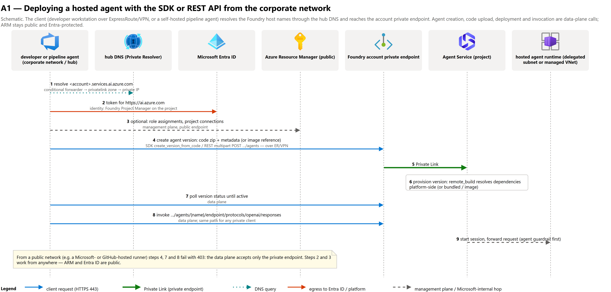

*Figure 20 — Hosted-agent deployment with the SDK or REST API from the corporate network (schematic). Name
resolution through the hub DNS, token from Entra ID, optional management-plane calls to ARM; agent creation,
upload, polling and invocation through the Foundry private endpoint.*

*Table 21 — Identities and prerequisites for the SDK and REST path.*

| Item | Requirement |
|---|---|
| Deploying identity | Foundry Project Manager on the project: creates and updates agents and can create role assignments for the agent identity [7]. Creating an agent version requires `Microsoft.CognitiveServices/accounts/AIServices/agents/write` on the project, which Foundry User also holds [6] |
| Agent identity | Created by the platform; has access to model inference through the project endpoint and to session storage by default. Other resources need explicit roles [7] |
| Network | DNS for the three Foundry zones resolvable from the client; route over ExpressRoute/VPN, hub and peering to the private endpoint; TCP 443 allowed to the private endpoint subnet |
| Agent runtime egress | For source-code deployments, `mcr.microsoft.com` and `*.login.microsoft.com` from the agent network; hosting libraries also send telemetry to Application Insights and, if enabled, to Agent 365 [7] |

### A.2 Container image from a private Azure Container Registry

A container image is the right artifact when images must be built, scanned and signed by a separate pipeline, or
must come from a central registry [20]. Figure 21 shows the flow with a registry whose public network access is
disabled.

1. **Resolve** the registry host names. A registry private endpoint (group ID `registry`) uses the zone
   `privatelink.azurecr.io` for `<registry>.azurecr.io` and `<registry>.<region>.data.azurecr.io` [16]. In a hub-spoke
   landing zone this zone belongs with the other central zones.
2. **Build and push** the image from a self-hosted build agent inside the network. Learn states that with public
   access on the registry disabled, the deployment must run from inside the network: a self-hosted runner, an Azure
   DevOps agent or a jump host [20].
3. **Create the agent version** with `container_configuration` referencing the image (tag or, for reproducible
   deployments, digest) through the Foundry private endpoint, with `azd deploy`, the SDK or the REST API [20], [7].
4. **Image pull.** The hosted-agent runtime pulls the image with the **project managed identity**; the per-agent
   identity is not used for pulls [20].
5. **Network path of the pull.** Learn requires private DNS and network access to the registry from the deployment
   machine *and* from the hosted runtime [2]. It also calls runtime reachability of the registry a platform concern
   and does not describe which network path the pull takes [20]. For the managed virtual network, Azure Container
   Registry is a supported managed private endpoint target, and an outbound rule to a registry requires the
   account's managed identity to also hold Reader on it [4].
6. **Start sessions and invoke** as in A.1.

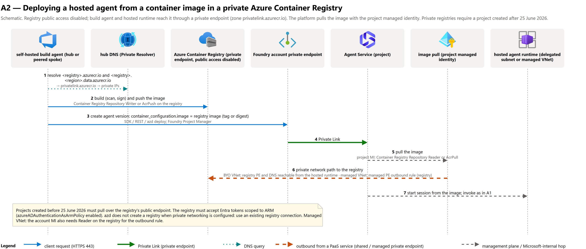

*Figure 21 — Hosted-agent deployment from a container image in a private Azure Container Registry (schematic):
private name resolution and push through the registry private endpoint, version creation through the Foundry
private endpoint, image pull with the project managed identity.*

*Table 22 — Identities and prerequisites for the private-registry path.*

| Item | Requirement |
|---|---|
| Project eligibility | A registry behind a private endpoint with public access disabled is supported only for projects **created after 25 June 2026**; older projects must pull over the registry's public endpoint [2], [6] |
| Registry configuration | `azureADAuthenticationAsArmPolicy` enabled, so the registry accepts Entra tokens scoped to ARM [6]; public network access disabled; private endpoint and `privatelink.azurecr.io` zone |
| Pull identity | Project managed identity with **Container Registry Repository Reader** (preferred) or **AcrPull** on the registry [6]. `azd deploy` grants AcrPull automatically [20] |
| Who can grant the pull role | Requires `Microsoft.Authorization/roleAssignments/write` on the registry, e.g. Owner or Role Based Access Control Administrator; Foundry Project Manager can't, because it may assign only Foundry User [6]. In practice, the platform team pre-assigns the role or grants the deploying identity that right on the registry |
| Push identity | **Container Registry Repository Writer** (preferred) or **AcrPush** on the registry [6]; for a registry-side build (`docker.remoteBuild: true`, the `azd` default), **Container Registry Tasks Contributor** [20] |
| Deploying identity | Foundry Project Manager on the project (A.1) |
| Registry connection | A project connection to the registry, used by the project for image pulls [6]. When private networking is configured, `azd` doesn't create a registry automatically; use an existing registry connection or source-code deployment [2] |
| Managed VNet (option F) | A managed private endpoint outbound rule to the registry; the account's managed identity needs Reader on the registry in addition to the connection-approver role [4] |
| Non-Azure registries | Supported through a project connection with OIDC token exchange. In a VNet-isolated account, the registry must be reachable through Azure Private Link (a provider Private Link resource or a customer Private Link Service), with private DNS for the registry and token endpoint [21] |

**What Learn does not state** (as of this writing): the network path of the image pull in a BYO VNet, i.e. whether it
traverses the delegated agent subnet; and whether a private registry's DNS zone must be linked to the agent subnet's
VNet, beyond the general statement that the hosted runtime needs DNS resolution and network access to the registry.
Validate both in a test environment before relying on this path.

## References

Microsoft Learn:

1. [Configure network isolation for Microsoft Foundry](https://learn.microsoft.com/azure/foundry/how-to/configure-private-link)
2. [Agent Service virtual networks (Standard setup)](https://learn.microsoft.com/azure/foundry/agents/how-to/virtual-networks)
3. [Agent networking deep dive](https://learn.microsoft.com/azure/foundry/agents/concepts/agents-networking-deep-dive)
4. [Configure a managed virtual network for Microsoft Foundry projects](https://learn.microsoft.com/azure/foundry/how-to/managed-virtual-network)
5. [What are hosted agents?](https://learn.microsoft.com/azure/foundry/agents/concepts/hosted-agents)
6. [Hosted agent permissions](https://learn.microsoft.com/azure/foundry/agents/concepts/hosted-agent-permissions)
7. [Deploy a hosted agent from source code](https://learn.microsoft.com/azure/foundry/agents/how-to/deploy-hosted-agent-code)
8. [Hosted agent content safety](https://learn.microsoft.com/azure/foundry/agents/concepts/hosted-agent-guardrails)
9. [Add guardrails to a hosted agent](https://learn.microsoft.com/azure/foundry/agents/how-to/add-hosted-agent-guardrails)
10. [Entra authentication for hosted agent traces](https://learn.microsoft.com/azure/foundry/observability/how-to/trace-ingestion-entra-authentication#set-up-entra-authentication-for-hosted-agent-traces)
11. [Azure AI Search tool for agents: troubleshooting](https://learn.microsoft.com/azure/foundry/agents/how-to/tools/ai-search#troubleshooting)
12. [Make outbound connections through a shared private link (Azure AI Search)](https://learn.microsoft.com/azure/search/search-indexer-howto-access-private)
13. [Network security for agentic retrieval](https://learn.microsoft.com/azure/search/agentic-retrieval-network-security)
14. [Foundry IQ in a private network (tutorial)](https://learn.microsoft.com/azure/foundry/agents/how-to/foundry-iq-tutorial-private-overview)
15. [Azure Monitor Private Link Scope](https://learn.microsoft.com/azure/azure-monitor/logs/private-link-security)
16. [Azure private endpoint DNS values](https://learn.microsoft.com/azure/private-link/private-endpoint-dns)
17. [Microsoft Entra ID authentication for Azure Bastion](https://learn.microsoft.com/azure/bastion/bastion-entra-id-authentication)
18. [Agent Service limits, quotas and regions](https://learn.microsoft.com/azure/foundry/agents/concepts/limits-quotas-regions)
19. [Guardrails overview](https://learn.microsoft.com/azure/foundry/guardrails/guardrails-overview)
20. [Deploy a hosted agent with a private Azure Container Registry](https://learn.microsoft.com/azure/foundry/agents/how-to/deploy-hosted-agent-private-azure-container-registry)
21. [Bring your own registry for hosted agents](https://learn.microsoft.com/azure/foundry/agents/how-to/private-registry-connections)
22. [Use portal to create private link for managing Azure resources](https://learn.microsoft.com/azure/azure-resource-manager/management/create-private-link-access-portal)
23. [Manage network policies for private endpoints](https://learn.microsoft.com/azure/private-link/disable-private-endpoint-network-policy)
24. [Role-based access control for Microsoft Foundry](https://learn.microsoft.com/azure/foundry/concepts/rbac-foundry)

Implementation: the Bicep templates in [`infra/`](../../infra/main.bicep) and the repository
[README](../../README.md).
